

# Notes z atramentem

Dokumentacja dla designerów · v1 do oceny · 10 listopada 2026 · DoRoboty.ai, prototyp lokalny

Aktualny interfejs opisany na podstawie ekranów, wycinków oraz jawnie oznaczonych adnotacji implementacji. 30 rodzin komponentów, 44 ekrany, 37 wycinków. To zapis roboczej iteracji, nie zatwierdzone wydanie biblioteki.

Najważniejsze decyzje: jasny papier i ciemniejszy beż tła, cienki atramentowy kontur, brązowe nagłówki, żółte zaznaczenia, IBM Plex Serif we wszystkich rolach tekstu i spójny szkicowy drwal. Stylizacja zachowuje istniejącą treść produktu.

[Pełna wersja Markdown](components.md)

[Rejestr plików i pomiarów](evidence/manifest.json)

## Jak czytać dokument

| Znacznik                    | Znaczenie i granica                                                                                                                                |
| --------------------------- | -------------------------------------------------------------------------------------------------------------------------------------------------- |
| [P]                         | Potwierdzone w pokazanym źródle wizualnym lub w jawnej specyfikacji. Zrzut dowodzi wyglądu konkretnego stanu, nie działania wszystkich kombinacji. |
| [[A01](#A01)]–[[A06](#A06)] | Adnotacja z istniejącej implementacji. Dokładne tokeny, reguły CSS lub deklaracja zachowania; oddzielne od obrazu. Rejestr poniżej.                |
| [S]                         | Szacunek z obrazu. Nie przypisano wartości liczbowych na oko, gdy można było uzyskać deklarację lub pomiar CSS.                                    |
| [R]                         | Rekomendacja albo proponowany model konfiguracji dla designera. Nie jest automatycznie wdrożony ani zatwierdzony.                                  |
| [?]                         | Brak danych lub nieustalona decyzja.                                                                                                               |
| [T]                         | Wymaga testu konkretnej implementacji. Sam obraz ani użycie Base UI nie potwierdza dostępności.                                                    |

Identyfikatory [C01](#C01)–[C30](#C30) to nazwy robocze rodzin w tym dokumencie, nie publiczne API ani deklaracja gotowej biblioteki Figma. [S01](evidence/S01.jpg)–[S44](evidence/S44.jpg) to pełne ekrany, [E01](evidence/E01.jpg)–[E37](evidence/E37.jpg) — wycinki tych ekranów, [U01](evidence/U01.png)–[U02](evidence/U02.png) — historyczne załączniki użytkowniczki. Obraz otwiera oryginalny plik; wycinek i jego ekran należą do tego samego scenariusza, nie są niezależnymi dowodami. [E22](evidence/E22.jpg) i [E31](evidence/E31.jpg) pokazują kolejny stan (focus / zaznaczona zgoda) po odpowiadającym im kadrze pełnym; opisano to w manifeście.

Tabele można przewijać poziomo; po kliknięciu lub wejściu Tab można przewijać je także klawiaturą. Wartości [[A02](#A02)] są w CSS px, nie w pikselach pomniejszonej miniatury. Próbka jest właściwością konkretnego elementu i szerokości; font odziedziczony na kontenerze nie dowodzi typografii każdego dziecka. Lokalny przepis może celowo różnić się od bazowego tokenu.

## Zakres i mapa pokrycia

| Obszar           | Źródła i rodziny                                                                                                                                                                                      | Ograniczenie                                                                                                                   |
| ---------------- | ----------------------------------------------------------------------------------------------------------------------------------------------------------------------------------------------------- | ------------------------------------------------------------------------------------------------------------------------------ |
| Publiczny serwis | [S01](evidence/S01.jpg)–[S15](evidence/S15.jpg), [S21](evidence/S21.jpg), [S34](evidence/S34.jpg)–[S36](evidence/S36.jpg); [C06](#C06)–[C13](#C13), [C16](#C16), [C26](#C26), [C29](#C29)–[C30](#C30) | Home, listing, oferta, firma, metodologia, wybór pracodawcy, mapa; nie każda trasa i szerokość.                                |
| Kandydat         | [S16](evidence/S16.jpg)–[S33](evidence/S33.jpg); [C01](#C01)–[C05](#C05), [C14](#C14)–[C15](#C15), [C17](#C17)–[C28](#C28)                                                                            | Przegląd, profil, zapisane, aplikacje, odpowiedź/CV, wycofanie inline, szkic, walidacja, reset.                                |
| Pracodawca       | [S37](evidence/S37.jpg)–[S43](evidence/S43.jpg); [C03](#C03)–[C04](#C04), [C14](#C14), [C20](#C20)–[C24](#C24)                                                                                        | Kandydatury, notatka i zmiana etapu, formularz oferty i organizacji; nie pełna ścieżka publikacji.                             |
| Dane skrajne     | [S34](evidence/S34.jpg)–[S36](evidence/S36.jpg), [S44](evidence/S44.jpg)                                                                                                                              | Długi tytuł i brak pensji, 27 syntetycznych ofert, celowo niepoprawny lokalny zapis. Odizolowane od zwykłej sesji.             |
| Interakcje       | [S05](evidence/S05.jpg)–[S06](evidence/S06.jpg), [E22](evidence/E22.jpg), [S29](evidence/S29.jpg)–[S30](evidence/S30.jpg), [S33](evidence/S33.jpg), [S39](evidence/S39.jpg), [S42](evidence/S42.jpg)  | Modal, wybranie, focus pola, błąd, zapis, reset i rozwinięta lista. Nie pełna plansza hover/active/disabled wszystkich rodzin. |
| Poza korpusem    | Panel operatora, tryb ciemny, loading, offline, RTL, produkcyjne auth                                                                                                                                 | Nie należy odtwarzać ich z domysłu.                                                                                            |

Przechwycono lokalną aplikację w Chrome przy viewportach 1280×900 i 390×900 CSS px, z fullPage tam, gdzie potrzeba; wyjątki są w manifeście. Zrzuty JPEG 86%, wycinki 90%, bez zmiany kolorów i kompozycji. Reduced motion i wyłączone przejścia służyły statycznej dokumentacji; nie dowodzą jakości animacji. Wszystkie dane scenariuszy są syntetyczne.

Bazą jest niezacommitowany stan roboczy przy HEAD 81682a81c186e9065ec8fab4d7bd368556fdfe6a. Wersja v1 opisuje ten stan z 10.11.2026, a nie sam commit. Źródłowe sumy SHA-256 zapisano w rejestrze adnotacji. Nie dostarczono biblioteki Figma ani specyfikacji Auto Layout; nazwy właściwości designerowych są propozycją [R].

## Fundamenty wizualne

### Paleta i semantyka powierzchni

| Rola [A01]              | Token                       | Wartość |
| ----------------------- | --------------------------- | ------- |
| Papier                  | --gui-canvas                | #FAF6EE |
| Karta / kontrolka       | --gui-surface               | #FFFDF8 |
| Wspólne ciemniejsze tło | --gui-surface-shaded        | #E8DDCE |
| Tło pomocnicze          | --gui-surface-muted         | #F2EDE4 |
| Atrament                | --gui-text                  | #171411 |
| Brąz                    | --gui-brand                 | #71472E |
| Żółty wybór             | --gui-accent                | #F5CF49 |
| Tekst drugorzędny       | --gui-text-muted-accessible | #665A50 |
| Linia podziału          | --gui-line                  | #C5BDB1 |

[P/[A05](#A05)] Tło #E8DDCE: hero ofert, metodologia, wybór osoby oraz obszary /app i /aplikuj. Nawigacja i karty pozostają #FFFDF8. Alias --gui-surface-hero wskazuje na --gui-surface-shaded. Papier #FAF6EE pozostaje bazowym canvas; nie każdy widok publiczny jest zacieniony ([S01](evidence/S01.jpg), [S03](evidence/S03.jpg), [S11](evidence/S11.jpg), [S16](evidence/S16.jpg), [S28](evidence/S28.jpg)).

[[A01](#A01)] Kolory procesu: score #FF6B79, #FFB15C, #FFE45B, #00C853 według pasma [C21](#C21). Błąd/destrukcja #FC032D; sukces #00906C. To inne role niż żółty wybór. Paleta neutralna ma historyczne aliasy i przezroczystości; poniższe tokeny kart zapisują ich rzeczywiste wartości, bez proponowanej migracji.

### Typografia: IBM Plex Serif wszędzie

[P/[A01](#A01),[A06](#A06)] Jeden krój w nagłówkach, opisach, danych, etykietach i kontrolkach. Lokalne pliki 400 Regular, 500 Medium, 600 SemiBold, 700 Bold, WOFF2 z pełnym upstreamowym zestawem znaków, w tym polskimi znakami; dołączona licencja w assets/fonts/LICENSE.txt. Fallback: Georgia, Times New Roman, serif. Alias data/code również wskazuje na serif; nie oznacza fontu monospace.

Próbka kroju: Dobra robota. Z AI w środku. Zażółć gęślą jaźń · 22 000–29 000 zł · 72%

| Poziom tokenu [A01] | Rozmiar / line-height | Przykład użycia i ograniczenie                           |
| ------------------- | --------------------- | -------------------------------------------------------- |
| xxs                 | 11 / 15px             | Najmniejsze metadane; nie rekomendacja dla całej pomocy. |
| xs                  | 13 / 17px             | Małe kontrolki i metadane.                               |
| s                   | 15 / 21px             | Wspólne input i przycisk default.                        |
| m                   | 17 / 26px             | Większy tekst/przycisk lg.                               |
| l                   | 26 / 34px             | Skala bazowa większego tekstu.                           |
| xl                  | 39 / 43px             | Token bazowy; nie każdy H1 ma tę wartość.                |
| xxl                 | 52 / 56px             | Token bazowy; rzeczywisty hero ma lokalny przepis.       |

| Rola [A05]               | Aktualny przepis                                 | Źródło                                                        |
| ------------------------ | ------------------------------------------------ | ------------------------------------------------------------- |
| Hero listingu            | 48px/1.08, 400, −1.5px; ≤850:44px; ≤600:36px     | [S03](evidence/S03.jpg)–[S04](evidence/S04.jpg), [C16](#C16)  |
| Nagłówek workspace       | 48px; mobile 36px                                | [S16](evidence/S16.jpg)–[S19](evidence/S19.jpg), [C14](#C14)  |
| Tytuł karty oferty       | 20px/700; mobile18px                             | [E05](evidence/E05.jpg), [C11](#C11)                          |
| Pensja listingu / detalu | 16px/600 / 24px                                  | [E05](evidence/E05.jpg), [E11](evidence/E11.jpg), [C09](#C09) |
| Treść arkusza            | 16px/1.75; ≤600:14px/1.75                        | [E23](evidence/E23.jpg), [C22](#C22)                          |
| Kategorie listingu       | 15px, deklarowane650; opis11px; mobile nazwa12px | [E07](evidence/E07.jpg), [C06](#C06)                          |
| Kontrolki                | Default15/21px, waga400 input i600 przycisk      | [C01](#C01)–[C04](#C04)                                       |

[?] Deklaracja CSS weight 650 występuje lokalnie, ale nie ma osobnego pliku 650 ani fontu variable. Przeglądarka dobiera dostępną odmianę; nie traktuj deklarowanej liczby jako potwierdzonej osobnej grubości. Decyzja [Q03](#questions) pozostaje otwarta. Wcześniejszy podział serif/sans z pierwotnego skilla jest zastąpiony ostatnią decyzją użytkowniczki.

### Rytm, kontury, ikony i ruch

| Kategoria | Tokeny / wartości [A01]                                           | Zasada użycia                                                                                                 |
| --------- | ----------------------------------------------------------------- | ------------------------------------------------------------------------------------------------------------- |
| Odstępy   | 0, 4, 8, 12, 16, 24, 32, 48px                                     | Bazowy rytm; lokalne 20/22/28/30px są adnotowane, nie normalizowane.                                          |
| Promienie | 0; xs5, s8, m10, l16, xl16, full9999px                            | Kontrolki zwykle8; arkusz i karty10; tagi zależne od rodziny.                                                 |
| Kontur    | Atrament 1px; --gui-edge-shadow: inset 0 0 0 1px #171411          | Jeden widoczny kontur. Bez charakterystycznego odsuniętego cienia dawnego stylu.                              |
| Separator | #C5BDB1, 1px                                                      | Podział treści; nie używaj samodzielnie jako jedynej potrzebnej granicy pola.                                 |
| Focus     | Atrament; globalnie outline3px offset4, kontrolki mogą nadpisywać | [E22](evidence/E22.jpg) potwierdza jeden stan; pełny audyt wszystkich celów [T].                              |
| Ikony     | Lucide outlined, bazowy stroke2; lokalny BackLink1.65             | Robot to marka, drwal to ilustracja, lupa/zakładka to funkcja. Nie utożsamiaj rozmiaru SVG z celem dotykowym. |
| Ruch      | Tokeny small400ms, large600ms; lokalne160ms, confetti 850ms       | [[A01](#A01),[A05](#A05)] Zrzuty statyczne nie potwierdzają ruchu. Reduced motion wyłącza confetti.           |

### Kompozycja responsywna

| Układ              | Przepis [A05]                                                        | Pokrycie                                                                 |
| ------------------ | -------------------------------------------------------------------- | ------------------------------------------------------------------------ |
| Listing            | Kontener do1280px, viewport−80; ≤1100:−48; ≤600:−36                  | [S03](evidence/S03.jpg), [S04](evidence/S04.jpg)                         |
| Filtry             | Panel boczny; ≤850 okno Dialog                                       | [S03](evidence/S03.jpg), [S05](evidence/S05.jpg)–[S06](evidence/S06.jpg) |
| Nagłówek publiczny | Linki środka od 768px; brak hamburgera publicznego                   | [S01](evidence/S01.jpg)–[S04](evidence/S04.jpg)                          |
| Workspace          | Sidebar244px; mobile <768 rozwijany aside                            | [S16](evidence/S16.jpg)–[S17](evidence/S17.jpg)                          |
| Rekord             | Dwukolumnowy: margines/historia + arkusz; ≤950 arkusz przed historią | [S25](evidence/S25.jpg), [S40](evidence/S40.jpg)                         |
| Aplikowanie        | Kontekst i formularz; mobile jedna kolumna                           | [S28](evidence/S28.jpg), [S31](evidence/S31.jpg)                         |

[R/T] Projektuj zawijanie treści, nie tylko pomniejszanie. 390px to próbka wizualna, a nie dowód spełnienia wymagania 320px. Zachowaj osobno test szerokości, zoomu 200/400%, odstępów tekstu i długich słów ([A11-R](#A11-R)). Nie zmieniaj tekstów, żeby ukryć problem układu.

## Dostępność: wymagania i stan dowodów

[R] Celem projektu jest WCAG 2.2 AA. Dokumentacja nie stanowi deklaracji zgodności. Karty wskazują obserwacje, istniejące oznaczenia oraz testy, które trzeba wykonać. APG opisuje informacyjne wzorce interakcji; nie jest dodatkowym zestawem norm WCAG.

[WCAG 2.2 — wymagania i poziomy](https://www.w3.org/WAI/WCAG22/quickref/)

### Kontrast i kolor

[R/T] 1.4.3 AA: 4.5:1 zwykły tekst, 3:1 duży (co najmniej 24px regular albo18.67px bold). 1.4.11 AA: 3:1 dla potrzebnych granic/stanu UI względem sąsiedztwa. Wyjątki obejmują m.in. nieaktywne elementy i logotypy w odpowiednich kryteriach. 1.4.1 A: nie polegaj wyłącznie na kolorze.

[Źródło W3C / APG](https://www.w3.org/WAI/WCAG22/Understanding/contrast-minimum.html)

### Cele wskazywania

[R/T] 2.5.8 AA: co najmniej 24×24 CSS px lub spełniony wyjątek, np. odpowiednie odstępy, cel równoważny, treść inline, kontrolka agenta użytkownika albo wymóg istotny. 44×44px to zalecenie mobilne [R] lub inne kryterium AAA, nie minimalny próg AA.

[Źródło W3C / APG](https://www.w3.org/WAI/WCAG22/Understanding/target-size-minimum.html)

### Nazwa i struktura

[R/T] 1.1.1 A: alternatywy grafik, puste alt dekoracji. 1.3.1 A: etykiety, grupy, nagłówki i relacje. 4.1.2 A: nazwa, rola, stan i wartość interakcji. Nie zastępuj etykiety placeholderem.

[Źródło W3C / APG](https://www.w3.org/WAI/WCAG22/quickref/)

### Klawiatura i kolejność

[R/T] 2.1.1 A, 2.4.3 A i2.4.7 AA: wszystkie operacje klawiaturą, sensowna kolejność i widoczny focus. Sprawdź Enter/Space według semantyki przycisku, nie każdej dowolnej treści.

[Źródło W3C / APG](https://www.w3.org/WAI/ARIA/apg/patterns/button/)

### Focus niezasłonięty

[R/T] 2.4.11 AA: aktywny element nie jest całkowicie ukryty przez treści autora. Sprawdź belki, stopki dialogów i rozwinięty aside.

[Źródło W3C / APG](https://www.w3.org/WAI/WCAG22/Understanding/focus-not-obscured-minimum.html)

### Reflow i odstępy tekstu

[R/T] 1.4.10 AA: reflow przy 320 CSS px, z wyjątkami dla treści rzeczywiście dwuwymiarowych. 1.4.12 AA: test nadpisania line-height 1.5, odstępu akapitów 2, liter 0.12em, słów 0.16em bez utraty treści/funkcji. To warunki testu, nie obowiązkowe domyślne style produktu.

[Źródło W3C / APG](https://www.w3.org/WAI/WCAG22/Understanding/reflow.html)

### Błędy i komunikaty

[R/T] 3.3.1 A i3.3.2 A: nazwij błąd i zapewnij etykiety/instrukcje; 3.3.3 AA: podpowiedz poprawę, gdy to możliwe. 4.1.3 AA: istotny status rozpoznawalny programowo bez konieczności przeniesienia focusu. Testuj wynik operacji, nie tylko kolor.

[Źródło W3C / APG](https://www.w3.org/WAI/WCAG22/Understanding/status-messages.html)

### Dialog i alert modalny

[[A03](#A03)/T] Base UI jest bazą, ale trzeba sprawdzić wejście focusu, modalność tła, cykl Tab, zamknięcie stosowne do typu i powrót. Inline potwierdzenie [C22](#C22) i menu [C14](#C14) nie dziedziczą automatycznie wzorca modalu.

[Źródło W3C / APG](https://www.w3.org/WAI/ARIA/apg/patterns/dialog-modal/)

### Zakładki

[[A03](#A03)/T] [C22](#C22) ma aktywację na focusie. Sprawdź strzałki, selected, nazwy paneli i tab/panel według APG Tabs; nie stosuj semantyki zakładek do kategorii z aria-pressed [C06](#C06).

[Źródło W3C / APG](https://www.w3.org/WAI/ARIA/apg/patterns/tabs/)

### Wybór i zaznaczenie

[[A03](#A03)/T] [C05](#C05) ma zwykły checkbox, bez udokumentowanego mixed. [C04](#C04) zawiera natywny select i custom listę; trzeba zweryfikować rolę i zachowanie konkretnego wariantu, nie nazywać go automatycznie edytowalnym comboboxem.

[Źródło W3C / APG](https://www.w3.org/WAI/ARIA/apg/patterns/checkbox/)

### Uzupełniające źródła i granice audytu

[Kontrast nietekstowy](https://www.w3.org/WAI/WCAG22/Understanding/non-text-contrast.html)

[Odstępy tekstu](https://www.w3.org/WAI/WCAG22/Understanding/text-spacing.html)

[APG Combobox — tylko gdy rola odpowiada implementacji](https://www.w3.org/WAI/ARIA/apg/patterns/combobox/)

[T] Nie wykonano pełnego audytu VoiceOver/NVDA, RTL, wszystkich kombinacji zoomu, focusu i dotyku. Statyczne kadry pokazują wybrane stany; testy repozytorium są osobnym dowodem implementacyjnym i nie zastępują audytu. Ograniczenie ruchu jest zaleceniem projektowym; kryterium animacji po interakcji 2.3.3 jest AAA. Krótkie confetti 850ms nie podpada automatycznie pod regułę treści poruszającej się ponad 5s.

### Kontrola kontrastu par tokenów

[[A01](#A01)] Obliczenie z wartości tokenów w przestrzeni sRGB według wzoru WCAG, bez próbkowania skompresowanych JPG. Wynik dotyczy samej pary, nie całej strony. Przezroczystości, zdjęcia, hover i błędy wymagają osobnego kontekstu.

| Para                   | Kolory            | Współczynnik | Interpretacja                                         |
| ---------------------- | ----------------- | ------------ | ----------------------------------------------------- |
| Atrament / karta       | #171411 / #FFFDF8 | 18.05:1      | ≥4.5 dla zwykłego tekstu                              |
| Atrament / beż         | #171411 / #E8DDCE | 13.69:1      | ≥4.5 dla zwykłego tekstu                              |
| Brąz / beż             | #71472E / #E8DDCE | 5.93:1       | ≥4.5 dla zwykłego tekstu                              |
| Muted / beż            | #665A50 / #E8DDCE | 4.98:1       | ≥4.5 dla zwykłego tekstu                              |
| Muted / karta          | #665A50 / #FFFDF8 | 6.57:1       | ≥4.5 dla zwykłego tekstu                              |
| Atrament / żółty       | #171411 / #F5CF49 | 12.15:1      | ≥4.5 dla zwykłego tekstu                              |
| Atrament / destrukcja  | #171411 / #FC032D | 4.53:1       | ≥4.5 dla zwykłego tekstu                              |
| Czerwony tekst / karta | #FC032D / #FFFDF8 | 3.98:1       | ≥3, poniżej4.5; zwykły mały tekst nie spełnia         |
| Linia / karta          | #C5BDB1 / #FFFDF8 | 1.83:1       | <3; nie dla niezbędnej granicy UI ani zwykłego tekstu |

[R/T] Czerwony drobny tekst na jasnym tle wymaga kontroli w konkretnym błędzie. Subtelna linia jest separatorem, natomiast kontrolki mają atramentowy kontur. Nie przenoś wyniku kontrastu etykiety destrukcyjnej na czerwone komunikaty o innej parze kolorów.

## Indeks rodzin komponentów

| ID          | Rodzina                                 | Grupa        | Potwierdzone źródła                                                                                                                                  |
| ----------- | --------------------------------------- | ------------ | ---------------------------------------------------------------------------------------------------------------------------------------------------- |
| [C01](#C01) | Akcje i przyciski                       | Kontrolki    | [S01](evidence/S01.jpg), [S06](evidence/S06.jpg), [S08](evidence/S08.jpg), [S28](evidence/S28.jpg), [S33](evidence/S33.jpg), [S36](evidence/S36.jpg) |
| [C02](#C02) | Pole tekstowe i wyszukiwarka            | Kontrolki    | [S03](evidence/S03.jpg), [S18](evidence/S18.jpg), [S23](evidence/S23.jpg), [S24](evidence/S24.jpg)                                                   |
| [C03](#C03) | Pole dłuższej odpowiedzi                | Kontrolki    | [S18](evidence/S18.jpg), [S28](evidence/S28.jpg), [S29](evidence/S29.jpg), [S38](evidence/S38.jpg)                                                   |
| [C04](#C04) | Wybór z listy                           | Kontrolki    | [S03](evidence/S03.jpg), [S41](evidence/S41.jpg), [S42](evidence/S42.jpg)                                                                            |
| [C05](#C05) | Checkbox i zgoda                        | Kontrolki    | [S05](evidence/S05.jpg), [S06](evidence/S06.jpg), [S28](evidence/S28.jpg), [S30](evidence/S30.jpg)                                                   |
| [C06](#C06) | Kategorie Build / Apply / Lead          | Wyszukiwanie | [S03](evidence/S03.jpg), [S04](evidence/S04.jpg), [S07](evidence/S07.jpg)                                                                            |
| [C07](#C07) | Panel filtrów i mobilne okno            | Wyszukiwanie | [S03](evidence/S03.jpg), [S05](evidence/S05.jpg), [S06](evidence/S06.jpg)                                                                            |
| [C08](#C08) | Aktywne kryterium i usuwanie filtra     | Wyszukiwanie | [S07](evidence/S07.jpg), [S14](evidence/S14.jpg)                                                                                                     |
| [C09](#C09) | Fakty oferty, wynagrodzenie i etykiety  | Oferty       | [S03](evidence/S03.jpg), [S08](evidence/S08.jpg), [S34](evidence/S34.jpg), [S35](evidence/S35.jpg)                                                   |
| [C10](#C10) | Tożsamość firmy                         | Oferty       | [S03](evidence/S03.jpg), [S08](evidence/S08.jpg), [S10](evidence/S10.jpg)                                                                            |
| [C11](#C11) | Karta oferty                            | Oferty       | [S03](evidence/S03.jpg), [S04](evidence/S04.jpg), [S21](evidence/S21.jpg), [S34](evidence/S34.jpg), [S35](evidence/S35.jpg)                          |
| [C12](#C12) | Paginacja i licznik wyników             | Nawigacja    | [S03](evidence/S03.jpg), [S14](evidence/S14.jpg), [S36](evidence/S36.jpg)                                                                            |
| [C13](#C13) | Nagłówek publiczny i stopka             | Nawigacja    | [S01](evidence/S01.jpg), [S02](evidence/S02.jpg), [S03](evidence/S03.jpg), [S04](evidence/S04.jpg)                                                   |
| [C14](#C14) | Nawigacja obszaru roboczego             | Nawigacja    | [S16](evidence/S16.jpg), [S17](evidence/S17.jpg), [S23](evidence/S23.jpg), [S24](evidence/S24.jpg), [S38](evidence/S38.jpg), [S40](evidence/S40.jpg) |
| [C15](#C15) | Powrót i link kontekstowy               | Nawigacja    | [S08](evidence/S08.jpg), [S25](evidence/S25.jpg), [S28](evidence/S28.jpg), [S38](evidence/S38.jpg)                                                   |
| [C16](#C16) | Wstęp marki i szkicowa ilustracja       | Kompozycja   | [S01](evidence/S01.jpg), [S02](evidence/S02.jpg), [S03](evidence/S03.jpg), [S04](evidence/S04.jpg)                                                   |
| [C17](#C17) | Powierzchnie, panele i układ formularza | Kompozycja   | [S03](evidence/S03.jpg), [S11](evidence/S11.jpg), [S18](evidence/S18.jpg), [S28](evidence/S28.jpg), [S41](evidence/S41.jpg), [S43](evidence/S43.jpg) |
| [C18](#C18) | Podsumowanie liczbowe                   | Kompozycja   | [S16](evidence/S16.jpg)                                                                                                                              |
| [C19](#C19) | Karta wyboru osoby i roli               | Kompozycja   | [S12](evidence/S12.jpg)                                                                                                                              |
| [C20](#C20) | Wiersz aplikacji lub kandydatury        | Proces       | [S23](evidence/S23.jpg), [S24](evidence/S24.jpg), [S37](evidence/S37.jpg)                                                                            |
| [C21](#C21) | Etap, Match Score i badge               | Proces       | [S23](evidence/S23.jpg), [S25](evidence/S25.jpg), [S38](evidence/S38.jpg), [S39](evidence/S39.jpg)                                                   |
| [C22](#C22) | Arkusz rekordu i zakładki               | Proces       | [S25](evidence/S25.jpg), [S26](evidence/S26.jpg), [S27](evidence/S27.jpg), [S38](evidence/S38.jpg), [S40](evidence/S40.jpg)                          |
| [C23](#C23) | Załącznik CV i podgląd                  | Proces       | [S26](evidence/S26.jpg), [S27](evidence/S27.jpg), [S28](evidence/S28.jpg)                                                                            |
| [C24](#C24) | Historia i podsumowanie procesu         | Proces       | [S25](evidence/S25.jpg), [S38](evidence/S38.jpg), [S39](evidence/S39.jpg)                                                                            |
| [C25](#C25) | Kontekst oferty przy aplikowaniu        | Proces       | [S28](evidence/S28.jpg), [S31](evidence/S31.jpg)                                                                                                     |
| [C26](#C26) | Pusty wynik, brak rekordu i błąd trasy  | Informacja   | [S14](evidence/S14.jpg), [S15](evidence/S15.jpg), [S20](evidence/S20.jpg)                                                                            |
| [C27](#C27) | Okno modalne i potwierdzenie            | Informacja   | [S05](evidence/S05.jpg), [S06](evidence/S06.jpg), [S33](evidence/S33.jpg)                                                                            |
| [C28](#C28) | Pomoc, walidacja i odzyskiwanie danych  | Informacja   | [S29](evidence/S29.jpg), [S30](evidence/S30.jpg), [S39](evidence/S39.jpg), [S44](evidence/S44.jpg)                                                   |
| [C29](#C29) | Mapa lokalna                            | Informacja   | [S13](evidence/S13.jpg)                                                                                                                              |
| [C30](#C30) | Dłuższa treść: oferta i metodologia     | Kompozycja   | [S08](evidence/S08.jpg), [S09](evidence/S09.jpg), [S10](evidence/S10.jpg), [S11](evidence/S11.jpg)                                                   |

Każda karta ma jedenaście obszarów. Tabela wariantów zapisuje zaobserwowane osie i kombinacje, nie pełny iloczyn wszystkich możliwości. Właściwości to proponowany model pracy designera [R]; wartości i domyślności zaczerpnięte z implementacji mają znacznik [[A03](#A03)/[A04](#A04)].

## C01 · Akcje i przyciski

[E01](evidence/E01.jpg) · Akcja główna · z [S01](evidence/S01.jpg)

### 1. Cel i wybór

[P] Uruchamiają operację lub prowadzą do kolejnego widoku. [R] Wybierz akcję atramentową dla decyzji głównej, obrys dla alternatywy, a spokojny link dla nawigacji kontekstowej [C15](#C15). Czerwone wypełnienie rezerwuj dla potwierdzenia działania destrukcyjnego.

### 2. Anatomia

| Część    | Obecność                      | Znaczenie                                                                            |
| -------- | ----------------------------- | ------------------------------------------------------------------------------------ |
| Etykieta | Widoczna w akcjach tekstowych | Nazwy typu „Aplikuj”, „Zapisz szkic”, „Resetuj”.                                     |
| Ikona    | Zależna od przykładu          | Strzałka przy przejściu; samodzielny przycisk ikony ma nazwę dostępną [[A03](#A03)]. |
| Kontener | Stały                         | Tło, kontur i obszar aktywny; nie utożsamiaj rozmiaru rysunku z celem.               |

### 3. Warianty, rozmiary i stany

| Oś         | Wartości / kombinacja                   | Różnica                                          | Dowód / granica                                                                                                                                                |
| ---------- | --------------------------------------- | ------------------------------------------------ | -------------------------------------------------------------------------------------------------------------------------------------------------------------- |
| Hierarchia | Atrament / obrys / ghost / destrukcyjny | Decyzja / alternatywa / akcja pomocnicza / reset | [P] [S01](evidence/S01.jpg), [S28](evidence/S28.jpg), [S33](evidence/S33.jpg).                                                                                 |
| Stan       | Spoczynek / focus / nieaktywny          | Praca klawiaturą; granica paginacji              | [P] Focus przycisku [S06](evidence/S06.jpg) i pola [E22](evidence/E22.jpg), disabled przycisku [S36](evidence/S36.jpg); hover opisany przez CSS [[A03](#A03)]. |
| Rozmiar    | default, sm, lg; ikona                  | Zależnie od miejsca w kompozycji                 | [[A03](#A03)] Implementacja ma także xs i cztery rozmiary ikon; nie wszystkie są pokazane.                                                                     |

### 4. Właściwości

[R] Model do konfiguracji projektu, nie deklaracja gotowego API lub komponentu Figma.

| Właściwość       | Typ / pochodzenie   | Wartości                         | Domyślność                                        | Zależność                            |
| ---------------- | ------------------- | -------------------------------- | ------------------------------------------------- | ------------------------------------ |
| Hierarchia       | enum [R]            | Powyższe obserwowane wartości    | [[A03](#A03)] default w Button                    | Zmienia priorytet, nie treść.        |
| Etykieta / ikona | tekst / grafika [R] | Tekst, tekst + ikona, sama ikona | Nie ustalono                                      | Dla ikony wymagaj nazwy operacji.    |
| Stan dostępności | boolean [R]         | Aktywny / disabled               | [[A03](#A03)] Brak disabled, jeśli nie przekazano | Nie wywołuj działania po wyłączeniu. |

### 5. Tokeny i style

| Token [A01]          | Deklaracja              | Rozwiązana wartość      |
| -------------------- | ----------------------- | ----------------------- |
| --primary            | var(--gui-text)         | #171411                 |
| --primary-foreground | var(--gui-surface)      | #fffdf8                 |
| --gui-radius-s       | 8px                     | 8px                     |
| --gui-edge-shadow    | inset 0 0 0 1px #171411 | inset 0 0 0 1px #171411 |

[P] Udokumentowany tryb: jasny. Brak źródła wizualnego dla dark/high contrast jako osobnych wariantów. Konkretne użycie koloru zależy od części opisanych powyżej.

### 6. Wymiary, odstępy i układ

| Element   | Kontekst                  | Reguła                                            | Pochodzenie                                                     |
| --------- | ------------------------- | ------------------------------------------------- | --------------------------------------------------------------- |
| Kontur    | Akcje wspólne             | Wewnętrzny obrys 1px, nie drugi zewnętrzny border | [[A01](#A01),[A03](#A03)].                                      |
| Wysokości | Button sm / default / lg  | Minimum 40 / 48 / 56 CSS px                       | [[A03](#A03)], zawartość może zwiększyć wysokość.               |
| Odstęp    | Aplikuj → Zapisz w detalu | Co najmniej 10px między sąsiadującymi akcjami     | [[A05](#A05)], [S08](evidence/S08.jpg)–[S09](evidence/S09.jpg). |

[[A02](#A02)] Próbka z [S28](evidence/S28.jpg), selektor roli „action”: 161×48 CSS px; padding 12px 24px; gap 8px; radius 8px. Nie jest to limit wszystkich wariantów tej rodziny.

### 7. Typografia

[[A03](#A03)] Wspólne etykiety mają IBM Plex Serif 600; rozmiary 13/15/17px według sm/default/lg. Lokalna wyszukiwarka i panel aplikowania nadpisują część rozmiarów — patrz [A02](#A02) i [C02](#C02).

### 8. Zachowanie i treść

[[A04](#A04)] Link zmienia widok; przycisk uruchamia operację. Wysyłanie aplikacji najpierw waliduje odpowiedź i zgodę. [R] Nie zmieniaj tekstu etykiety tylko po to, by dopasować go do nowego stylu.

[R/T] Zachowaj polskie znaki i pełne znaczenie etykiet; sprawdź dłuższy tekst oraz zawijanie. Dodatkowe języki i RTL nie są potwierdzonymi wariantami.

### 9. Używaj / unikaj

| Używaj                                     | Unikaj                                                        | Powód                                  |
| ------------------------------------------ | ------------------------------------------------------------- | -------------------------------------- |
| „Wyślij aplikację” jako jedna akcja główna | Kilka równie mocnych czarnych przycisków w jednym małym bloku | [R] Łatwiej rozpoznać decyzję.         |
| „Resetuj” dopiero w potwierdzeniu          | Czerwony przycisk zwykłego przejścia do oferty                | [R] Hierarchia ma odpowiadać skutkowi. |

### 10. Dostępność

| Obszar      | Wymaganie / dowód / test                                                                                                               |
| ----------- | -------------------------------------------------------------------------------------------------------------------------------------- |
| Klawiatura  | [R/T] Sprawdź aktywację i powrót focusu po operacji; stosuj [A11-K](#A11-K). APG Button opisuje wzorzec, nie dodatkowe kryterium WCAG. |
| Nazwa i cel | [R/T] Ikony bez tekstu muszą nazywać czynność ([A11-N](#A11-N)); sprawdź rzeczywisty cel dotykowy według [A11-CEL](#A11-CEL).          |

### 11. Źródła i pytania

Źródła bieżące: [S01](evidence/S01.jpg), [S06](evidence/S06.jpg), [S08](evidence/S08.jpg), [S28](evidence/S28.jpg), [S33](evidence/S33.jpg), [S36](evidence/S36.jpg); wycinek [E01](evidence/E01.jpg) pochodzi z [S01](evidence/S01.jpg). Adnotacje [A01](#A01)–[A06](#A06) są pomocnicze; nie rozszerzają automatycznie wizualnej macierzy stanów.

[?] Nie wykonano osobnej planszy wszystkich kombinacji rozmiar × hierarchia × stan. Nie należy ich uznawać za zatwierdzony katalog.

## C02 · Pole tekstowe i wyszukiwarka

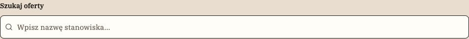

[E20](evidence/E20.jpg) · Wyszukiwarka aplikacji z lupką · z [S23](evidence/S23.jpg)

### 1. Cel i wybór

[P] Zbiera krótki tekst. Odmiana z lupką objaśnia wyszukiwanie; zwykłe pole służy edycji profilu. [R] Dłuższe odpowiedzi kieruj do [C03](#C03), wybór ze skończonej listy do [C04](#C04).

### 2. Anatomia

| Część                       | Obecność             | Znaczenie                                                    |
| --------------------------- | -------------------- | ------------------------------------------------------------ |
| Etykieta                    | Widoczna             | „Szukaj oferty” lub nazwa pola; pozostaje nad kontrolką.     |
| Pole                        | Stałe                | Jasna powierzchnia, obrys i wpisywana wartość.               |
| Lupka / placeholder / pomoc | Zależne od kontekstu | Wyszukiwarka aplikacji ma lupkę i „Wpisz nazwę stanowiska…”. |

### 3. Warianty, rozmiary i stany

| Oś           | Wartości / kombinacja                  | Różnica                                 | Dowód / granica                                                                                                                |
| ------------ | -------------------------------------- | --------------------------------------- | ------------------------------------------------------------------------------------------------------------------------------ |
| Zastosowanie | Zwykłe pole / wyszukiwanie             | Profil / lista aplikacji                | [P] [S18](evidence/S18.jpg), [S23](evidence/S23.jpg).                                                                          |
| Kompozycja   | Osobno / w pasku z lokalizacją i akcją | Lista kandydatur / listing ofert        | [P] [E20](evidence/E20.jpg), [E06](evidence/E06.jpg).                                                                          |
| Stan         | Puste, wypełnione, focus               | Wyraźny tekst pomocniczy i obrys focusu | [P] [E22](evidence/E22.jpg), [S18](evidence/S18.jpg); disabled/readonly są opisane w kodzie [[A03](#A03)], bez pełnej planszy. |

### 4. Właściwości

[R] Model do konfiguracji projektu, nie deklaracja gotowego API lub komponentu Figma.

| Właściwość           | Typ / pochodzenie | Wartości                                       | Domyślność                                    | Zależność                                                      |
| -------------------- | ----------------- | ---------------------------------------------- | --------------------------------------------- | -------------------------------------------------------------- |
| Etykieta             | tekst [R]         | „Szukaj oferty”; „Imię i nazwisko”             | Nie ustalono                                  | Nie zastępuj placeholderem.                                    |
| Wartość / podpowiedź | tekst [R]         | Pusta lub wpisana; placeholder zależny od roli | Pusta wyszukiwarka przy wejściu [[A04](#A04)] | Kandydat: stanowisko; rekruter: imię, nazwisko lub stanowisko. |
| Lupka                | obecność [R]      | Pokazana w wyszukiwaniu                        | Brak w zwykłym polu [P]                       | Dekoracja poza kolejnością focusu [[A03](#A03)].               |

### 5. Tokeny i style

| Token [A01]                 | Deklaracja            | Rozwiązana wartość |
| --------------------------- | --------------------- | ------------------ |
| --gui-control               | var(--gui-surface)    | #fffdf8            |
| --gui-text                  | var(--gui-neutral-10) | #171411            |
| --gui-text-muted-accessible | var(--gui-neutral-8)  | #665a50            |
| --gui-focus                 | #171411               | #171411            |
| --gui-radius-s              | 8px                   | 8px                |

[P] Udokumentowany tryb: jasny. Brak źródła wizualnego dla dark/high contrast jako osobnych wariantów. Konkretne użycie koloru zależy od części opisanych powyżej.

### 6. Wymiary, odstępy i układ

| Element       | Kontekst               | Reguła                                        | Pochodzenie                                                     |
| ------------- | ---------------------- | --------------------------------------------- | --------------------------------------------------------------- |
| Wysokość      | Wspólne Input          | Minimum 48px                                  | [[A03](#A03)].                                                  |
| Lupka → tekst | Wyszukiwanie aplikacji | Ikona 16px, left 10px; padding-left pola 34px | [[A05](#A05)], nie nakłada się na tekst.                        |
| Szerokość     | Lista aplikacji        | Cała dostępna szerokość, także mobile         | [[A05](#A05)], [S23](evidence/S23.jpg)–[S24](evidence/S24.jpg). |

[[A02](#A02)] Próbka z [S23](evidence/S23.jpg), selektor roli „input”: 956×48 CSS px; padding 12px 12px 12px 34px; gap normal; radius 8px. Nie jest to limit wszystkich wariantów tej rodziny.

### 7. Typografia

[[A03](#A03)] Input: IBM Plex Serif 400, 15px/21px, tracking 0.01em. Label ma lokalną rolę 14px/600 [[A05](#A05)]. Pasek wyszukiwania ofert używa własnego 14/12px zależnie od szerokości, a nie tej samej wartości wszędzie.

### 8. Zachowanie i treść

[[A04](#A04)] W aplikacjach wpis zmienia lokalne wyniki od razu; nie jest zachowywany w URL. W publicznym listingu query/lokalizacja wysyłane są przyciskiem Szukaj i trafiają do adresu. Pole listy aplikacji nie wyszukuje po nazwie firmy.

[R/T] Zachowaj polskie znaki i pełne znaczenie etykiet; sprawdź dłuższy tekst oraz zawijanie. Dodatkowe języki i RTL nie są potwierdzonymi wariantami.

### 9. Używaj / unikaj

| Używaj                                          | Unikaj                                         | Powód                                              |
| ----------------------------------------------- | ---------------------------------------------- | -------------------------------------------------- |
| Zachowaj label i dodaj przykład w placeholderze | Puste, nieopisane pole albo tylko ikona        | [R] Wygląd ma tłumaczyć cel.                       |
| Placeholder „Wpisz nazwę stanowiska…”           | Obietnica wyszukiwania po firmie w aplikacjach | [[A04](#A04)/R] Nie obiecuj nieobsługiwanej cechy. |

### 10. Dostępność

| Obszar           | Wymaganie / dowód / test                                                                                                                  |
| ---------------- | ----------------------------------------------------------------------------------------------------------------------------------------- |
| Etykieta i ikona | [[A03](#A03)] Input jest wewnątrz label, lupka aria-hidden i nie przechwytuje pointera. [T] Odsłuchaj nazwę oraz pomoc ([A11-N](#A11-N)). |
| Focus i błędy    | [R/T] Sprawdź [A11-K](#A11-K) i [A11-B](#A11-B); placeholder nie jest etykietą i znika po wpisaniu.                                       |

### 11. Źródła i pytania

Źródła bieżące: [S03](evidence/S03.jpg), [S18](evidence/S18.jpg), [S23](evidence/S23.jpg), [S24](evidence/S24.jpg); wycinek [E20](evidence/E20.jpg) pochodzi z [S23](evidence/S23.jpg). Adnotacje [A01](#A01)–[A06](#A06) są pomocnicze; nie rozszerzają automatycznie wizualnej macierzy stanów.

[?] Brak osobnej wizualnej macierzy readonly/disabled/invalid dla każdego wariantu pola.

## C03 · Pole dłuższej odpowiedzi

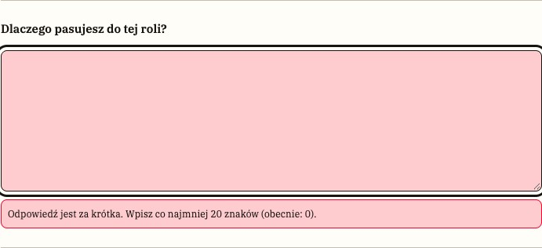

[E30](evidence/E30.jpg) · Pomoc i walidacja odpowiedzi · z [S29](evidence/S29.jpg)

### 1. Cel i wybór

[P] Służy do swobodnej odpowiedzi aplikacyjnej, opisu profilu lub notatki rekrutera. [R] Wybierz je zamiast [C02](#C02), gdy tekst wymaga kilku wierszy i odczytania w kontekście.

### 2. Anatomia

| Część               | Obecność              | Znaczenie                                                               |
| ------------------- | --------------------- | ----------------------------------------------------------------------- |
| Etykieta            | Stała w przykładach   | Pytanie lub „Notatka rekrutacyjna”.                                     |
| Pole wielowierszowe | Stałe                 | Jasne tło i ciemny obrys.                                               |
| Pomoc / błąd        | Zależne od formularza | Liczba znaków i wskazanie zbyt krótkiej odpowiedzi; widoczność notatki. |

### 3. Warianty, rozmiary i stany

| Oś         | Wartości / kombinacja               | Różnica                       | Dowód / granica                                                                |
| ---------- | ----------------------------------- | ----------------------------- | ------------------------------------------------------------------------------ |
| Rola       | Odpowiedź / bio / notatka rekrutera | Aplikowanie / profil / proces | [P] [S28](evidence/S28.jpg), [S18](evidence/S18.jpg), [S38](evidence/S38.jpg). |
| Stan       | Puste / uzupełnione / z błędem      | Zbieranie i poprawa tekstu    | [P] [S28](evidence/S28.jpg)–[S30](evidence/S30.jpg), [S39](evidence/S39.jpg).  |
| Dostępność | Edytowalne / disabled po wysłaniu   | Wstrzymanie ponownej edycji   | [[A04](#A04)]; stan przejściowy nie jest osobno uchwycony.                     |

### 4. Właściwości

[R] Model do konfiguracji projektu, nie deklaracja gotowego API lub komponentu Figma.

| Właściwość       | Typ / pochodzenie        | Wartości                                     | Domyślność                               | Zależność                                             |
| ---------------- | ------------------------ | -------------------------------------------- | ---------------------------------------- | ----------------------------------------------------- |
| Etykieta / pomoc | tekst [R]                | Pytanie, minimum znaków, zakres widoczności  | Nie ustalono                             | Treść zależy od zadania.                              |
| Wartość          | tekst wielowierszowy [R] | Zwykły tekst, bez proponowanej odpowiedzi AI | Pusta nowa aplikacja [[A04](#A04)]       | Szkic można zapisać.                                  |
| Walidacja        | liczba / stan [R]        | Odpowiedź min. 20; limit 12000 znaków        | [[A04](#A04)] Dotyczy obecnego prototypu | Nie traktuj jako uniwersalnego limitu wszystkich pól. |

### 5. Tokeny i style

| Token [A01]             | Deklaracja         | Rozwiązana wartość |
| ----------------------- | ------------------ | ------------------ |
| --gui-control           | var(--gui-surface) | #fffdf8            |
| --gui-error             | #fc032d            | #fc032d            |
| --gui-error-transparent | #fc032d33          | #fc032d33          |
| --gui-radius-s          | 8px                | 8px                |

[P] Udokumentowany tryb: jasny. Brak źródła wizualnego dla dark/high contrast jako osobnych wariantów. Konkretne użycie koloru zależy od części opisanych powyżej.

### 6. Wymiary, odstępy i układ

| Element   | Kontekst              | Reguła                                | Pochodzenie                             |
| --------- | --------------------- | ------------------------------------- | --------------------------------------- |
| Wysokość  | Odpowiedź w aplikacji | Minimum 180px                         | [[A05](#A05)].                          |
| Wysokość  | Notatka rekrutera     | Minimum 116px; rows 4                 | [[A04](#A04),[A05](#A05)].              |
| Opis pola | Pomoc pod odpowiedzią | Margines 10px, długie treści zawijane | [[A05](#A05)], [S29](evidence/S29.jpg). |

[[A02](#A02)] Próbka z [S28](evidence/S28.jpg), selektor roli „textarea”: 690.09×180 CSS px; padding 12px; gap normal; radius 8px. Nie jest to limit wszystkich wariantów tej rodziny.

### 7. Typografia

[[A05](#A05)] Odpowiedź aplikacyjna: IBM Plex Serif 15px, line-height 1.7. Notatka i pola profilu korzystają z reguł wspólnej kontrolki; nie zakładaj jednej wysokości wszystkich textarea.

### 8. Zachowanie i treść

[[A04](#A04)] Zmiana odpowiedzi resetuje zgodę. Nieudana walidacja zachowuje tekst i kieruje focus do odpowiedzi lub zgody. Notatka rekrutera zapisuje się przy zmianie etapu; kandydat jej nie widzi w swoim widoku.

[R/T] Zachowaj polskie znaki i pełne znaczenie etykiet; sprawdź dłuższy tekst oraz zawijanie. Dodatkowe języki i RTL nie są potwierdzonymi wariantami.

### 9. Używaj / unikaj

| Używaj                                            | Unikaj                               | Powód                                      |
| ------------------------------------------------- | ------------------------------------ | ------------------------------------------ |
| Pokaż minimum i konkretny powód błędu             | Sam czerwony obrys bez objaśnienia   | [R] Użytkownik potrzebuje sposobu poprawy. |
| Oddziel odpowiedź kandydata od notatki pracodawcy | Wspólne pole o niejasnej widoczności | [[A04](#A04)/R] Różne role mają różny cel. |

### 10. Dostępność

| Obszar       | Wymaganie / dowód / test                                                                                                       |
| ------------ | ------------------------------------------------------------------------------------------------------------------------------ |
| Pomoc i błąd | [[A04](#A04)] Jest aria-describedby i aria-invalid odpowiedzi. [T] Sprawdź ogłoszenie komunikatu po błędzie ([A11-B](#A11-B)). |
| Powiększenie | [R/T] Sprawdź [A11-R](#A11-R), przewijanie pola i brak zasłonięcia akcji klawiaturą ekranową.                                  |

### 11. Źródła i pytania

Źródła bieżące: [S18](evidence/S18.jpg), [S28](evidence/S28.jpg), [S29](evidence/S29.jpg), [S38](evidence/S38.jpg); wycinek [E30](evidence/E30.jpg) pochodzi z [S29](evidence/S29.jpg). Adnotacje [A01](#A01)–[A06](#A06) są pomocnicze; nie rozszerzają automatycznie wizualnej macierzy stanów.

[?] Nie pokazano wszystkich stanów disabled i skrajnych długości w każdym formularzu.

## C04 · Wybór z listy

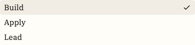

[E36](evidence/E36.jpg) · Lista wyboru z zaznaczeniem · z [S42](evidence/S42.jpg)

### 1. Cel i wybór

[P] Umożliwia wybranie jednej wartości ze znanego zestawu. Wyszukiwarka ofert ma natywną listę lokalizacji; formularze pracodawcy mają otwieraną listę Base UI. [R] Nie pokazuj jej jako wyszukiwania z sugestiami.

### 2. Anatomia

| Część       | Obecność    | Znaczenie                                 |
| ----------- | ----------- | ----------------------------------------- |
| Wyzwalacz   | Stały       | Wybrana etykieta / placeholder i chevron. |
| Lista opcji | Po otwarciu | Elementy z widocznym zaznaczeniem.        |
| Etykieta    | Przy polu   | Nazwa kryterium lub pola formularza.      |

### 3. Warianty, rozmiary i stany

| Oś            | Wartości / kombinacja                  | Różnica                         | Dowód / granica                                       |
| ------------- | -------------------------------------- | ------------------------------- | ----------------------------------------------------- |
| Implementacja | Natywna lokalizacja / lista formularza | Pasek szukania / edytor oferty  | [P] [E06](evidence/E06.jpg), [S42](evidence/S42.jpg). |
| Stan          | Zamknięte / otwarte / wybrane          | Wartość oraz aktualny wybór     | [P] [S41](evidence/S41.jpg)–[S42](evidence/S42.jpg).  |
| Rozmiar       | default / sm                           | 48 / 40px minimum w komponencie | [[A03](#A03)]; mały wariant nie ma osobnej planszy.   |

### 4. Właściwości

[R] Model do konfiguracji projektu, nie deklaracja gotowego API lub komponentu Figma.

| Właściwość            | Typ / pochodzenie              | Wartości                                        | Domyślność                                      | Zależność                                                   |
| --------------------- | ------------------------------ | ----------------------------------------------- | ----------------------------------------------- | ----------------------------------------------------------- |
| Opcje                 | lista par wartość–etykieta [R] | Kategorie, tryby, umowy i inne listy formularza | Zależne od pola [[A03](#A03)]                   | Jeden wybór.                                                |
| Wartość / placeholder | tekst [R]                      | Wybrana wartość lub „Wybierz”                   | [[A03](#A03)] Placeholder FormSelect: „Wybierz” | Nie tworzy dowolnej nowej opcji.                            |
| Required / disabled   | boolean [R]                    | Opisane w implementacji                         | Nieokreślone wizualnie                          | Nie przedstawiaj nieuchwyconych stanów jako zatwierdzonych. |

### 5. Tokeny i style

| Token [A01]    | Deklaracja              | Rozwiązana wartość      |
| -------------- | ----------------------- | ----------------------- |
| --gui-control  | var(--gui-surface)      | #fffdf8                 |
| --popover      | var(--gui-neutral-1)    | #fffdf8                 |
| --gui-radius-s | 8px                     | 8px                     |
| --gui-shadow-m | inset 0 0 0 1px #171411 | inset 0 0 0 1px #171411 |

[P] Udokumentowany tryb: jasny. Brak źródła wizualnego dla dark/high contrast jako osobnych wariantów. Konkretne użycie koloru zależy od części opisanych powyżej.

### 6. Wymiary, odstępy i układ

| Element   | Kontekst         | Reguła                                                      | Pochodzenie                                                                     |
| --------- | ---------------- | ----------------------------------------------------------- | ------------------------------------------------------------------------------- |
| Wyzwalacz | default / sm     | Minimum 48 / 40px                                           | [[A03](#A03)].                                                                  |
| Lista     | Popup formularza | Szerokość kotwicy, limit dostępnej wysokości, przewijanie   | [[A03](#A03)], [S42](evidence/S42.jpg).                                         |
| Położenie | Popup            | sideOffset 4px; domyślnie wyrównanie aktywnej opcji do pola | [[A03](#A03)] alignItemWithTrigger=true; 4px nie jest stałą widoczną szczeliną. |

[[A02](#A02)] Próbka z [S41](evidence/S41.jpg), selektor roli „select”: 388×48 CSS px; padding 12px; gap 8px; radius 8px. Nie jest to limit wszystkich wariantów tej rodziny.

### 7. Typografia

[[A03](#A03)] IBM Plex Serif; default 15px/21px, sm 13px/17px. Natywna lista systemowa może mieć wygląd zależny od przeglądarki.

### 8. Zachowanie i treść

[[A03](#A03)/[A04](#A04)] FormSelect utrzymuje jedną wartość i przekazuje ją formularzowi. Natywna lokalizacja jest wysyłana razem z publicznym query. Nie ma dowodu na wyszukiwanie wewnątrz listy.

[R/T] Zachowaj polskie znaki i pełne znaczenie etykiet; sprawdź dłuższy tekst oraz zawijanie. Dodatkowe języki i RTL nie są potwierdzonymi wariantami.

### 9. Używaj / unikaj

| Używaj                                   | Unikaj                                          | Powód                               |
| ---------------------------------------- | ----------------------------------------------- | ----------------------------------- |
| Użyj znanej listy poziomów doświadczenia | Pozwól wpisać nieistniejącą umowę bez walidacji | [R] Wybór ma pozostać jednoznaczny. |
| Pokaż wybraną etykietę                   | Sam chevron bez aktualnej wartości              | [R] Użytkownik musi odczytać stan.  |

### 10. Dostępność

| Obszar     | Wymaganie / dowód / test                                                                                              |
| ---------- | --------------------------------------------------------------------------------------------------------------------- |
| Wzorzec    | [R/T] Dobierz APG select-only combobox dla listy formularza, bez udawania editable combobox. Sprawdź [A11-N](#A11-N). |
| Klawiatura | [T] Strzałki, Enter, Escape i powrót do wyzwalacza; przetestuj rzeczywisty native select osobno ([A11-K](#A11-K)).    |

### 11. Źródła i pytania

Źródła bieżące: [S03](evidence/S03.jpg), [S41](evidence/S41.jpg), [S42](evidence/S42.jpg); wycinek [E36](evidence/E36.jpg) pochodzi z [S42](evidence/S42.jpg). Adnotacje [A01](#A01)–[A06](#A06) są pomocnicze; nie rozszerzają automatycznie wizualnej macierzy stanów.

[?] Nie udokumentowano klawiaturowego wyszukiwania po literach ani zachowania listy dla setek opcji.

## C05 · Checkbox i zgoda

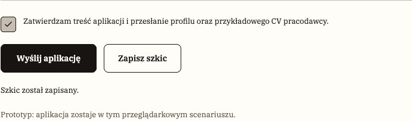

[E31](evidence/E31.jpg) · Zaznaczona zgoda i akcje · z [S30](evidence/S30.jpg) · Po kadrze [S30](evidence/S30.jpg) zaznaczono zgodę; wycinek pokazuje kolejny stan tego scenariusza.

### 1. Cel i wybór

[P] Pokazuje wybór warunku lub świadomą zgodę. [R] Odróżniaj zgodę na wysłanie od pojedynczego wyboru w grupie filtrów; podobny wygląd nie oznacza tej samej logiki.

### 2. Anatomia

| Część              | Obecność           | Znaczenie                           |
| ------------------ | ------------------ | ----------------------------------- |
| Kwadrat i znacznik | Stałe              | Stan pusty lub check.               |
| Etykieta           | Stała w źródłach   | Klikalna treść obok.                |
| Pomoc / błąd       | W formularzu zgody | Wyjaśnienie, co zostanie przesłane. |

### 3. Warianty, rozmiary i stany

| Oś             | Wartości / kombinacja         | Różnica                        | Dowód / granica                                                                                       |
| -------------- | ----------------------------- | ------------------------------ | ----------------------------------------------------------------------------------------------------- |
| Rodzina        | Natywny facet / Base UI zgoda | Filtry / aplikowanie           | [P] [S06](evidence/S06.jpg), [E31](evidence/E31.jpg).                                                 |
| Stan           | Niezaznaczone / zaznaczone    | Warunek nieaktywny / aktywny   | [P] [S05](evidence/S05.jpg)–[S06](evidence/S06.jpg), [S28](evidence/S28.jpg)–[S30](evidence/S30.jpg). |
| Stan dodatkowy | Invalid / disabled            | Walidacja / kończenie wysłania | [[A04](#A04)]; mixed nie jest opisanym wariantem produktu.                                            |

### 4. Właściwości

[R] Model do konfiguracji projektu, nie deklaracja gotowego API lub komponentu Figma.

| Właściwość  | Typ / pochodzenie  | Wartości                            | Domyślność                                | Zależność                                     |
| ----------- | ------------------ | ----------------------------------- | ----------------------------------------- | --------------------------------------------- |
| Zaznaczenie | boolean [R]        | false / true                        | Zgoda nowej aplikacji false [[A04](#A04)] | Zmiana odpowiedzi może cofnąć zgodę.          |
| Etykieta    | tekst [R]          | Warunek albo treść zgody            | Nie ustalono                              | Nie sprowadzaj treści zgody do samego checka. |
| Grupa       | nazwa i zestaw [R] | Tryb, doświadczenie, umowa, funkcja | [[A04](#A04)] Jeden warunek na grupę      | Nie zakładaj dowolnego wielokrotnego wyboru.  |

### 5. Tokeny i style

| Token [A01]       | Deklaracja              | Rozwiązana wartość      |
| ----------------- | ----------------------- | ----------------------- |
| --gui-color-1     | #f5cf49                 | #f5cf49                 |
| --gui-text        | var(--gui-neutral-10)   | #171411                 |
| --gui-edge-shadow | inset 0 0 0 1px #171411 | inset 0 0 0 1px #171411 |
| --gui-radius-xs   | 5px                     | 5px                     |

[P] Udokumentowany tryb: jasny. Brak źródła wizualnego dla dark/high contrast jako osobnych wariantów. Konkretne użycie koloru zależy od części opisanych powyżej.

### 6. Wymiary, odstępy i układ

| Element | Kontekst      | Reguła                          | Pochodzenie                                      |
| ------- | ------------- | ------------------------------- | ------------------------------------------------ |
| Kwadrat | Natywny facet | 17 × 17px                       | [[A05](#A05)]; etykieta zwiększa obszar aktywny. |
| Kwadrat | Base UI zgoda | 26 × 26px                       | [[A03](#A03)], nie jest kopią 17px filtra.       |
| Odstęp  | Zgoda         | 12px do wielowierszowego tekstu | [[A05](#A05)].                                   |

[[A02](#A02)] Próbka z [S28](evidence/S28.jpg), selektor roli „checkbox”: 26×26 CSS px; padding 0px; gap normal; radius 5px. Nie jest to limit wszystkich wariantów tej rodziny.

### 7. Typografia

[[A05](#A05)] Facety mają etykiety 13px desktop i 15px w mobilnym oknie. Zgoda: 13px z interlinią 1.7. Wszystkie używają IBM Plex Serif.

### 8. Zachowanie i treść

[[A04](#A04)] Facet aktualizuje query URL; wybór tego samego warunku usuwa go. Zgoda jest wymagana przy wysłaniu, a zapis szkicu jej nie wymaga. [P] [E31](evidence/E31.jpg) i [S31](evidence/S31.jpg) pokazują zaznaczenie; [S30](evidence/S30.jpg) zapis szkicu bez zgody. Nie są dowodem finalnego przesłania.

[R/T] Zachowaj polskie znaki i pełne znaczenie etykiet; sprawdź dłuższy tekst oraz zawijanie. Dodatkowe języki i RTL nie są potwierdzonymi wariantami.

### 9. Używaj / unikaj

| Używaj                                | Unikaj                                    | Powód                                          |
| ------------------------------------- | ----------------------------------------- | ---------------------------------------------- |
| Pełne zdanie przy zgodzie             | Żółty kwadrat bez opisu skutku            | [R] Kolor nie tłumaczy decyzji.                |
| Opisz zasadę jednego warunku w grupie | Sugeruj wielokrotny wybór samym kształtem | [[A04](#A04)/R] Logika musi być przewidywalna. |

### 10. Dostępność

| Obszar  | Wymaganie / dowód / test                                                                                                                                   |
| ------- | ---------------------------------------------------------------------------------------------------------------------------------------------------------- |
| Stan    | [[A03](#A03)] Dwa stany; APG Checkbox dopuszcza mixed, lecz produkt go nie dokumentuje. [T] Odsłuchaj checked i błędy ([A11-N](#A11-N) i [A11-B](#A11-B)). |
| Obsługa | [R/T] Space zmienia stan; sprawdź klik etykiety i rzeczywisty cel według [A11-CEL](#A11-CEL).                                                              |

### 11. Źródła i pytania

Źródła bieżące: [S05](evidence/S05.jpg), [S06](evidence/S06.jpg), [S28](evidence/S28.jpg), [S30](evidence/S30.jpg); wycinek [E31](evidence/E31.jpg) pochodzi z [S30](evidence/S30.jpg). Adnotacje [A01](#A01)–[A06](#A06) są pomocnicze; nie rozszerzają automatycznie wizualnej macierzy stanów.

[?] Checkboxy filtrów działają jak przełączany pojedynczy wybór; warto ocenić zrozumiałość tego modelu z użytkownikami, bez cichej zmiany na radio.

## C06 · Kategorie Build / Apply / Lead

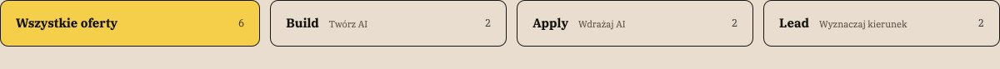

[E07](evidence/E07.jpg) · Kategorie i liczby · z [S03](evidence/S03.jpg)

### 1. Cel i wybór

[P] Rozdzielają oferty według sposobu pracy z AI. [R] Służą do filtrowania wyników, a nie przełączania paneli w znaczeniu zakładek [C22](#C22).

### 2. Anatomia

| Część           | Obecność        | Znaczenie                                    |
| --------------- | --------------- | -------------------------------------------- |
| Nazwa kategorii | Stała           | Wszystkie oferty, Build, Apply, Lead.        |
| Opis            | Wariant desktop | Twórz AI / Wdrażaj AI / Wyznaczaj kierunek.  |
| Liczba          | Widoczna        | Liczba dopasowanych ofert w danej kategorii. |

### 3. Warianty, rozmiary i stany

| Oś        | Wartości / kombinacja  | Różnica                          | Dowód / granica                                       |
| --------- | ---------------------- | -------------------------------- | ----------------------------------------------------- |
| Wybór     | Jeden aktywny przycisk | Żółte tło i stan wybrania        | [P] [S03](evidence/S03.jpg), [S07](evidence/S07.jpg). |
| Szerokość | Desktop / mobile       | Siatka / przewijany poziomy rząd | [P] [S03](evidence/S03.jpg)–[S04](evidence/S04.jpg).  |
| Treść     | Z opisem / bez opisu   | Opis znika w wąskiej kompozycji  | [[A05](#A05)], nie jest usunięty z modelu kategorii.  |

### 4. Właściwości

[R] Model do konfiguracji projektu, nie deklaracja gotowego API lub komponentu Figma.

| Właściwość | Typ / pochodzenie | Wartości                      | Domyślność                                | Zależność                               |
| ---------- | ----------------- | ----------------------------- | ----------------------------------------- | --------------------------------------- |
| Kategoria  | enum [R]          | Wszystkie, Build, Apply, Lead | [[A04](#A04)] Wszystkie przy pustym query | Aktualizuje filtr URL.                  |
| Liczba     | liczba [R]        | Dynamiczne liczby wyników     | Nie jest stałą treścią                    | Nie wpisuj liczby z makiety na sztywno. |
| Wybranie   | boolean [R]       | Żółty / neutralny             | Zależne od adresu                         | Nie twórz kilku aktywnych kategorii.    |

### 5. Tokeny i style

| Token [A01]    | Deklaracja            | Rozwiązana wartość |
| -------------- | --------------------- | ------------------ |
| --gui-color-1  | #f5cf49               | #f5cf49            |
| --gui-text     | var(--gui-neutral-10) | #171411            |
| --gui-line     | #c5bdb1               | #c5bdb1            |
| --gui-radius-m | 10px                  | 10px               |

[P] Udokumentowany tryb: jasny. Brak źródła wizualnego dla dark/high contrast jako osobnych wariantów. Konkretne użycie koloru zależy od części opisanych powyżej.

### 6. Wymiary, odstępy i układ

| Element  | Kontekst         | Reguła                                            | Pochodzenie                             |
| -------- | ---------------- | ------------------------------------------------- | --------------------------------------- |
| Rząd     | Desktop          | 4 kolumny, gap 12px                               | [[A05](#A05)].                          |
| Wysokość | Desktop / mobile | Minimum 56 / 44px                                 | [[A05](#A05)].                          |
| Mobile   | Opis i szerokość | Opis ukryty przy max-width 600px; rząd przewijany | [[A05](#A05)], [S04](evidence/S04.jpg). |

[[A02](#A02)] Próbka z [S03](evidence/S03.jpg), selektor roli „category”: 312.28×56 CSS px; padding 12px 18px; gap 20px; radius 10px. Nie jest to limit wszystkich wariantów tej rodziny.

### 7. Typografia

[[A05](#A05)] Nazwa 15px z deklaracją CSS weight 650, opis 11px/400; mobile nazwa 12px. 650 jest wartością CSS, nie osobnym plikiem fontu (patrz luka [Q03](#questions)).

### 8. Zachowanie i treść

[[A04](#A04)] Klik zmienia kategorię i zeruje stronę paginacji; liczby uwzględniają aktualne pozostałe kryteria. [R] W utrzymaniu treści zachowaj oryginalne etykiety.

[R/T] Zachowaj polskie znaki i pełne znaczenie etykiet; sprawdź dłuższy tekst oraz zawijanie. Dodatkowe języki i RTL nie są potwierdzonymi wariantami.

### 9. Używaj / unikaj

| Używaj                      | Unikaj                                         | Powód                                               |
| --------------------------- | ---------------------------------------------- | --------------------------------------------------- |
| Pokazuj nazwę oraz wybranie | Tylko żółty kolor bez etykiety                 | [R] Użytkownik musi rozpoznać kryterium.            |
| Zachowaj rząd na mobile     | Zmniejsz etykiety do nieczytelnego mikrotekstu | [R] Przewijanie jest widocznym rozwiązaniem źródła. |

### 10. Dostępność

| Obszar         | Wymaganie / dowód / test                                                                                             |
| -------------- | -------------------------------------------------------------------------------------------------------------------- |
| Semantyka      | [[A04](#A04)] Przyciski mają aria-pressed, nie tab/tabpanel. [T] Sprawdź odczyt wybrania i liczby ([A11-N](#A11-N)). |
| Zmiana wyników | [R/T] Sprawdź informację o liczbie po zmianie bez nieoczekiwanego focusu ([A11-S](#A11-B)).                          |

### 11. Źródła i pytania

Źródła bieżące: [S03](evidence/S03.jpg), [S04](evidence/S04.jpg), [S07](evidence/S07.jpg); wycinek [E07](evidence/E07.jpg) pochodzi z [S03](evidence/S03.jpg). Adnotacje [A01](#A01)–[A06](#A06) są pomocnicze; nie rozszerzają automatycznie wizualnej macierzy stanów.

[?] Widoczność możliwości przewijania na małych ekranach wymaga badania; brak paska nie dowodzi odkrywalności.

## C07 · Panel filtrów i mobilne okno

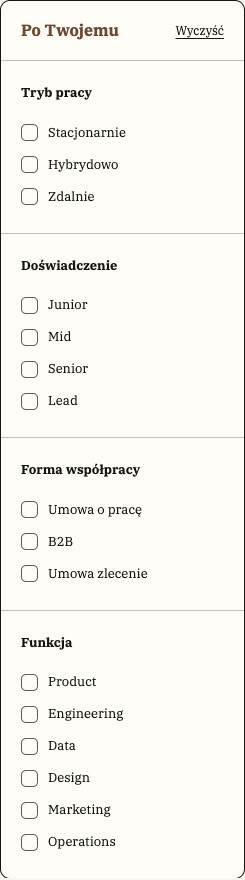

[E08](evidence/E08.jpg) · Panel filtrów · z [S03](evidence/S03.jpg)

### 1. Cel i wybór

[P] Grupuje szczegółowe kryteria. Na desktopie stanowi kolumnę; na mobile ten sam zestaw znajduje się w pełnoekranowym oknie. [R] Wyszukiwanie tekstu pozostaw poza oknem.

### 2. Anatomia

| Część              | Obecność     | Znaczenie                                                   |
| ------------------ | ------------ | ----------------------------------------------------------- |
| Nagłówek i Wyczyść | Desktop      | Tytuł panelu i reset.                                       |
| Grupy z legendą    | Stałe        | Checkboxy [C05](#C05): tryb, doświadczenie, umowa, funkcja. |
| Mobilna rama       | Tylko mobile | Tytuł, zamknięcie, opis i dolna akcja „Pokaż N ofert”.      |

### 3. Warianty, rozmiary i stany

| Oś         | Wartości / kombinacja  | Różnica                        | Dowód / granica                                                              |
| ---------- | ---------------------- | ------------------------------ | ---------------------------------------------------------------------------- |
| Kompozycja | Kolumna / modal        | Duża / mała dostępna szerokość | [P] [S03](evidence/S03.jpg), [S05](evidence/S05.jpg).                        |
| Stan       | Bez wyboru / z wyborem | Puste lub zaznaczone warunki   | [P] [S05](evidence/S05.jpg)–[S06](evidence/S06.jpg).                         |
| Wynik      | N ofert                | Liczba w akcji zamknięcia      | [P] [S06](evidence/S06.jpg); nie jest osobnym krokiem zatwierdzania filtrów. |

### 4. Właściwości

[R] Model do konfiguracji projektu, nie deklaracja gotowego API lub komponentu Figma.

| Właściwość     | Typ / pochodzenie    | Wartości              | Domyślność                             | Zależność                                |
| -------------- | -------------------- | --------------------- | -------------------------------------- | ---------------------------------------- |
| Grupy          | zestaw kryteriów [R] | Cztery pokazane grupy | [[A04](#A04)] Dane źródłowe formularza | Jeden wybór na grupę.                    |
| Otwarcie       | boolean [R]          | Zamknięte / otwarte   | [[A04](#A04)] false                    | Dotyczy mobilnego ResponsivePanel.       |
| Liczba wyników | liczba [R]           | Bieżąca liczba ofert  | Zależna od filtrów                     | Etykieta dolnej akcji odpowiada wynikom. |

### 5. Tokeny i style

| Token [A01]    | Deklaracja            | Rozwiązana wartość |
| -------------- | --------------------- | ------------------ |
| --gui-surface  | var(--gui-neutral-2)  | #fffdf8            |
| --gui-line     | #c5bdb1               | #c5bdb1            |
| --gui-text     | var(--gui-neutral-10) | #171411            |
| --gui-radius-m | 10px                  | 10px               |

[P] Udokumentowany tryb: jasny. Brak źródła wizualnego dla dark/high contrast jako osobnych wariantów. Konkretne użycie koloru zależy od części opisanych powyżej.

### 6. Wymiary, odstępy i układ

| Element | Kontekst         | Reguła                               | Pochodzenie                                                  |
| ------- | ---------------- | ------------------------------------ | ------------------------------------------------------------ |
| Kolumna | Desktop          | 245px bazowo; 218px w węższej siatce | [[A05](#A05)].                                               |
| Grupy   | Desktop / mobile | Padding około 20px / 24px            | [[A05](#A05)], dokładna próbka [A02](#A02).                  |
| Próg    | ResponsivePanel  | max-width 850px uruchamia modal      | [[A04](#A04)], wartość ze specyfikacji, nie z dwóch obrazów. |

[[A02](#A02)] Próbka z [S03](evidence/S03.jpg), selektor roli „filter”: 245×879.19 CSS px; padding 0px; gap normal; radius 10px. Nie jest to limit wszystkich wariantów tej rodziny.

### 7. Typografia

[[A05](#A05)] Tytuł panelu 16px/700, legenda 13px/650, opcje 13px. Mobilne grupy: 15px. Nie przenoś wielkości tytułu modalu na wszystkie legendy.

### 8. Zachowanie i treść

[[A04](#A04)] Filtry działają natychmiast. Dolna akcja zamyka okno; Escape również. Wersje mają wspólne dane, a reset synchronizuje formularz i URL. Statyczny [S06](evidence/S06.jpg) pokazuje wybór z istniejącego adresu, nie test przejścia kliknięciem.

[R/T] Zachowaj polskie znaki i pełne znaczenie etykiet; sprawdź dłuższy tekst oraz zawijanie. Dodatkowe języki i RTL nie są potwierdzonymi wariantami.

### 9. Używaj / unikaj

| Używaj                           | Unikaj                                  | Powód                                       |
| -------------------------------- | --------------------------------------- | ------------------------------------------- |
| Jedne kryteria w obu układach    | Osobna, rozjeżdżająca się lista mobilna | [R] To samo zadanie i dane.                 |
| Wyszukiwarka widoczna na stronie | Chowanie query w oknie filtrów          | [P/R] Źródło rozdziela szukanie od facetów. |

### 10. Dostępność

| Obszar      | Wymaganie / dowód / test                                                                                                                           |
| ----------- | -------------------------------------------------------------------------------------------------------------------------------------------------- |
| Modal       | [[A04](#A04)] Wykorzystuje Dialog; [T] sprawdź pułapkę focusu, Escape, powrót do wyzwalacza według APG Dialog i [A11-K](#A11-K) i [A11-N](#A11-N). |
| Przewijanie | [R/T] Nagłówek i stopka nie mogą całkowicie zasłonić aktywnej opcji ([A11-F](#A11-F)).                                                             |

### 11. Źródła i pytania

Źródła bieżące: [S03](evidence/S03.jpg), [S05](evidence/S05.jpg), [S06](evidence/S06.jpg); wycinek [E08](evidence/E08.jpg) pochodzi z [S03](evidence/S03.jpg). Adnotacje [A01](#A01)–[A06](#A06) są pomocnicze; nie rozszerzają automatycznie wizualnej macierzy stanów.

[?] Nie wykonano odsłuchu czytnikiem ekranu ani kompletnego przeglądu wszystkich kombinacji facetów.

## C08 · Aktywne kryterium i usuwanie filtra

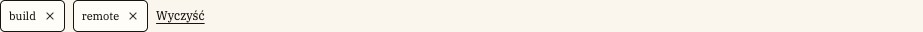

[E10](evidence/E10.jpg) · Aktywne kryteria i czyszczenie · z [S07](evidence/S07.jpg)

### 1. Cel i wybór

[P] Pokazuje zastosowane ograniczenie i pozwala je usunąć. [R] Nie używaj go dla nieinteraktywnej etykiety technologii/funkcji [C09](#C09).

### 2. Anatomia

| Część   | Obecność     | Znaczenie                              |
| ------- | ------------ | -------------------------------------- |
| Wartość | Stała        | Np. build lub remote w obecnym widoku. |
| Krzyżyk | Stały        | Część przycisku usuwania.              |
| Wyczyść | Obok zestawu | Reset całego zestawu.                  |

### 3. Warianty, rozmiary i stany

| Oś        | Wartości / kombinacja                  | Różnica                          | Dowód / granica                                                      |
| --------- | -------------------------------------- | -------------------------------- | -------------------------------------------------------------------- |
| Zakres    | Pojedyncze kryterium / Wyczyść         | Usuń jeden warunek / cały zestaw | [P] [E10](evidence/E10.jpg).                                         |
| Zawartość | Query, kategoria, tryb i inne wartości | Zależna od adresu                | [P/[A04](#A04)] Nie ma zatwierdzonego osobnego wzoru na każdy tekst. |
| Stan      | Spoczynek / focus                      | Obsługa klawiaturą               | Focus opisany [[A04](#A04)], nie wszystkie odmiany pokazano.         |

### 4. Właściwości

[R] Model do konfiguracji projektu, nie deklaracja gotowego API lub komponentu Figma.

| Właściwość      | Typ / pochodzenie | Wartości                         | Domyślność                          | Zależność                         |
| --------------- | ----------------- | -------------------------------- | ----------------------------------- | --------------------------------- |
| Tekst wartości  | tekst [R]         | Surowe wartości filtrów w źródle | Zależny od query                    | Nie utożsamiaj z nazwą biznesową. |
| Nazwa usunięcia | tekst [R]         | „Usuń filtr: …”                  | [[A04](#A04)] Generowana z wartości | Musi wskazywać usuwany warunek.   |

### 5. Tokeny i style

| Token [A01]     | Deklaracja            | Rozwiązana wartość |
| --------------- | --------------------- | ------------------ |
| --gui-surface   | var(--gui-neutral-2)  | #fffdf8            |
| --gui-text      | var(--gui-neutral-10) | #171411            |
| --gui-radius-xs | 5px                   | 5px                |

[P] Udokumentowany tryb: jasny. Brak źródła wizualnego dla dark/high contrast jako osobnych wariantów. Konkretne użycie koloru zależy od części opisanych powyżej.

### 6. Wymiary, odstępy i układ

| Element         | Kontekst         | Reguła                                  | Pochodzenie    |
| --------------- | ---------------- | --------------------------------------- | -------------- |
| Obrys / promień | Chip             | 1px / 5px                               | [[A05](#A05)]. |
| Obszar          | Chip             | Minimum 32px wysokości; padding 5px 8px | [[A05](#A05)]. |
| Rząd            | Zestaw kryteriów | Zawija się, gap 8px                     | [[A05](#A05)]. |

[[A02](#A02)] Próbka z [S07](evidence/S07.jpg), selektor roli „chip”: 64.84×32 CSS px; padding 5px 8px; gap 8px; radius 5px. Nie jest to limit wszystkich wariantów tej rodziny.

### 7. Typografia

[[A05](#A05)] IBM Plex Serif 11px; mobile 10px. Ikona 12px jest częścią większego przycisku, a nie całym celem.

### 8. Zachowanie i treść

[[A04](#A04)] Usunięcie aktualizuje URL i wyniki; obsługa klawiaturą przenosi focus do sąsiedniego chipa albo nagłówka wyników. [R] Nie ukrywaj usuwania pod samym hoverem.

[R/T] Zachowaj polskie znaki i pełne znaczenie etykiet; sprawdź dłuższy tekst oraz zawijanie. Dodatkowe języki i RTL nie są potwierdzonymi wariantami.

### 9. Używaj / unikaj

| Używaj                                    | Unikaj                                           | Powód                                    |
| ----------------------------------------- | ------------------------------------------------ | ---------------------------------------- |
| Pozostaw widoczny sposób cofnięcia        | Nieusuwalna etykieta wyglądająca jak przycisk    | [R] Jasna odwracalność kryterium.        |
| Rozważ czytelne „Build” zamiast raw build | Potajemnie zmień etykiety podczas dokumentowania | [R] Taka zmiana wymaga odrębnej decyzji. |

### 10. Dostępność

| Obszar             | Wymaganie / dowód / test                                                                               |
| ------------------ | ------------------------------------------------------------------------------------------------------ |
| Nazwa              | [[A04](#A04)] Nazwa usunięcia istnieje; [T] sprawdź jej odczyt ([A11-N](#A11-N)).                      |
| Focus po usunięciu | [T] Sprawdź powrót logiczny, nie do body ([A11-K](#A11-K)); cel ocenia się według [A11-CEL](#A11-CEL). |

### 11. Źródła i pytania

Źródła bieżące: [S07](evidence/S07.jpg), [S14](evidence/S14.jpg); wycinek [E10](evidence/E10.jpg) pochodzi z [S07](evidence/S07.jpg). Adnotacje [A01](#A01)–[A06](#A06) są pomocnicze; nie rozszerzają automatycznie wizualnej macierzy stanów.

[?] Surowe wartości angielskie w chipach są stanem zastanym; lokalizacja etykiet pozostaje propozycją, nie zmianą wdrożoną.

## C09 · Fakty oferty, wynagrodzenie i etykiety

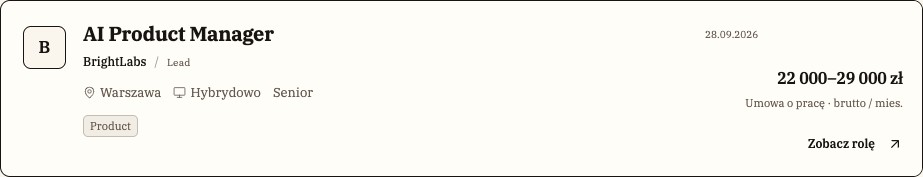

[E05](evidence/E05.jpg) · Karta oferty · z [S03](evidence/S03.jpg)

### 1. Cel i wybór

[P] Pozwalają szybko porównać warunki: kwotę, podstawę, tryb, lokalizację i funkcję. [R] Traktuj je jako informację; nie stylizuj kwoty jak akcji do kliknięcia.

### 2. Anatomia

| Część                 | Obecność           | Znaczenie                                                |
| --------------------- | ------------------ | -------------------------------------------------------- |
| Kwota / brak kwoty    | Alternatywne       | Zakres i waluta albo jawny komunikat braku.              |
| Podstawa i okres      | Przy znanej kwocie | Umowa, netto/brutto, VAT i miesiąc/rok.                  |
| Pozostałe fakty i tag | Zależne od danych  | Ikony lokalizacji/trybu, poziom, jedna etykieta funkcji. |

### 3. Warianty, rozmiary i stany

| Oś    | Wartości / kombinacja                     | Różnica                                         | Dowód / granica                                       |
| ----- | ----------------------------------------- | ----------------------------------------------- | ----------------------------------------------------- |
| Płaca | PLN miesięcznie / EUR rocznie / niepodana | Różne warunki i brak danych                     | [P] [S03](evidence/S03.jpg), [S34](evidence/S34.jpg). |
| Skala | Karta / detal                             | Zwięzłe porównanie / główna informacja w panelu | [P] [E05](evidence/E05.jpg), [E11](evidence/E11.jpg). |
| Tag   | Funkcja                                   | Product, Engineering, Design itd.               | [P/[A04](#A04)] To nie lista technologii.             |

### 4. Właściwości

[R] Model do konfiguracji projektu, nie deklaracja gotowego API lub komponentu Figma.

| Właściwość            | Typ / pochodzenie           | Wartości                  | Domyślność                                  | Zależność                              |
| --------------------- | --------------------------- | ------------------------- | ------------------------------------------- | -------------------------------------- |
| Kwoty i waluta        | liczby / enum [[A04](#A04)] | Min, max; PLN lub EUR     | Nie określono wspólnej wartości             | Brak kwot usuwa opis podstawy.         |
| Okres i rodzaj        | enum [[A04](#A04)]          | Miesiąc/rok, netto/brutto | [[A04](#A04)] Rendering ma domyślne gałęzie | Nie zgaduj warunków oferty.            |
| Funkcja / lokalizacja | etykieta / lista [R]        | Pokazane w źródle         | Zależne od danych                           | Nie zastępuj stanowiska samymi tagami. |

### 5. Tokeny i style

| Token [A01]         | Deklaracja            | Rozwiązana wartość |
| ------------------- | --------------------- | ------------------ |
| --gui-text          | var(--gui-neutral-10) | #171411            |
| --gui-text-muted    | #665a50               | #665a50            |
| --gui-surface-muted | var(--gui-neutral-3)  | #f2ede4            |
| --gui-line          | #c5bdb1               | #c5bdb1            |

[P] Udokumentowany tryb: jasny. Brak źródła wizualnego dla dark/high contrast jako osobnych wariantów. Konkretne użycie koloru zależy od części opisanych powyżej.

### 6. Wymiary, odstępy i układ

| Element     | Kontekst      | Reguła                          | Pochodzenie                                           |
| ----------- | ------------- | ------------------------------- | ----------------------------------------------------- |
| Kwota       | Karta / detal | 16px / 24px                     | [[A05](#A05)].                                        |
| Mobile      | Kwota         | Osobny wiersz pod treścią karty | [P] [S04](evidence/S04.jpg), [S35](evidence/S35.jpg). |
| Tag funkcji | Etykieta      | Promień 5px, delikatny obrys    | [[A05](#A05)].                                        |

[[A02](#A02)] Próbka z [S03](evidence/S03.jpg), selektor roli „salary”: 126.03×23.19 CSS px; padding 0px; gap normal; radius 5px. Nie jest to limit wszystkich wariantów tej rodziny.

### 7. Typografia

[[A05](#A05)] Kwota 600, cyfry tabularne; opis podstawy 11px/400 w karcie, 12px w detalu. Fakty 13px desktop i 12px mobile. Wszystko w IBM Plex Serif.

### 8. Zachowanie i treść

[[A04](#A04)] SalaryFact formatuje liczby po polsku i rozdziela kwotę od podstawy. Dla braku kwot pokazuje „Nie podano wynagrodzenia”, bez sugerowania znanej podstawy. Nie ma tu automatycznego przeliczania walut.

[R/T] Zachowaj polskie znaki i pełne znaczenie etykiet; sprawdź dłuższy tekst oraz zawijanie. Dodatkowe języki i RTL nie są potwierdzonymi wariantami.

### 9. Używaj / unikaj

| Używaj                                | Unikaj                              | Powód                                                       |
| ------------------------------------- | ----------------------------------- | ----------------------------------------------------------- |
| „22 000–29 000 zł” + podstawa i okres | Sama kwota bez wyjaśnienia          | [R] Zapewnia porównywalność.                                |
| Jawny brak wynagrodzenia              | Pusta plama lub sam napis „/ mies.” | [P/R] [S34](evidence/S34.jpg) pokazuje uczciwy brak danych. |

### 10. Dostępność

| Obszar     | Wymaganie / dowód / test                                                                              |
| ---------- | ----------------------------------------------------------------------------------------------------- |
| Informacja | [R/T] Nie polegaj tylko na ikonie lub kolorze; zachowaj tekst faktu ([A11-N](#A11-N)/1.4.1 A).        |
| Reflow     | [R/T] Kwota, długa lokalizacja i tytuł muszą być czytelne bez konkurujących kolumn ([A11-R](#A11-R)). |

### 11. Źródła i pytania

Źródła bieżące: [S03](evidence/S03.jpg), [S08](evidence/S08.jpg), [S34](evidence/S34.jpg), [S35](evidence/S35.jpg); wycinek [E05](evidence/E05.jpg) pochodzi z [S03](evidence/S03.jpg). Adnotacje [A01](#A01)–[A06](#A06) są pomocnicze; nie rozszerzają automatycznie wizualnej macierzy stanów.

[?] Obecny model pokazuje jeden tag funkcji, bez listy 12 technologii i bez mechanizmu +N. Takich stanów nie udokumentowano jako istniejących.

## C10 · Tożsamość firmy

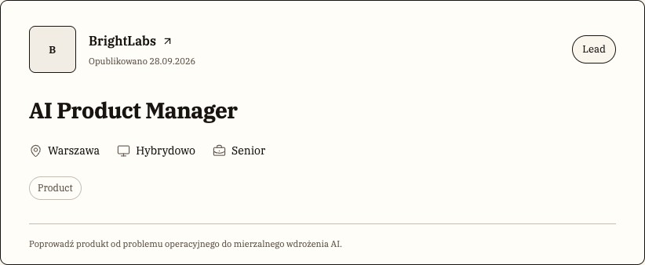

[E12](evidence/E12.jpg) · Tożsamość firmy i warunki roli · z [S08](evidence/S08.jpg)

### 1. Cel i wybór

[P] Łączy znak lub inicjał z pełną nazwą pracodawcy. [R] Nie myl logo firmy z robotem marki DoRoboty.ai ani z drwalem [C16](#C16).

### 2. Anatomia

| Część           | Obecność           | Znaczenie                                            |
| --------------- | ------------------ | ---------------------------------------------------- |
| Znak / inicjały | Widoczne pole      | W zebranych ekranach dominują B, NH, PS.             |
| Nazwa firmy     | Stała w kompozycji | Pełna nazwa obok lub przy tytule roli.               |
| Kontekst        | Zależny od miejsca | Data publikacji, link do firmy lub opis organizacji. |

### 3. Warianty, rozmiary i stany

| Oś       | Wartości / kombinacja              | Różnica                        | Dowód / granica                                                                |
| -------- | ---------------------------------- | ------------------------------ | ------------------------------------------------------------------------------ |
| Kontekst | Karta / hero oferty / profil firmy | Różne skale i ilość informacji | [P] [S03](evidence/S03.jpg), [S08](evidence/S08.jpg), [S10](evidence/S10.jpg). |
| Zasób    | Inicjały / obraz                   | Fallback / dostarczony znak    | [P] Inicjały; obraz obsługiwany [[A03](#A03)], bez bieżącej planszy przykładu. |

### 4. Właściwości

[R] Model do konfiguracji projektu, nie deklaracja gotowego API lub komponentu Figma.

| Właściwość       | Typ / pochodzenie           | Wartości                              | Domyślność                          | Zależność                             |
| ---------------- | --------------------------- | ------------------------------------- | ----------------------------------- | ------------------------------------- |
| Nazwa / inicjały | tekst [R]                   | BrightLabs / B; Northstar Health / NH | Zależne od firmy                    | Zawsze zachowaj pełną nazwę w treści. |
| Zasób logo       | lokalny adres [[A03](#A03)] | Opcjonalny                            | Brak prowadzi do inicjałów          | Nie zastępuj go ilustracją platformy. |
| Skala            | kontekst [R]                | Listing, oferta, profil               | Nie ustalono jednej domyślnej skali | Zależna od kompozycji.                |

### 5. Tokeny i style

| Token [A01]         | Deklaracja            | Rozwiązana wartość |
| ------------------- | --------------------- | ------------------ |
| --gui-surface       | var(--gui-neutral-2)  | #fffdf8            |
| --gui-surface-muted | var(--gui-neutral-3)  | #f2ede4            |
| --gui-text          | var(--gui-neutral-10) | #171411            |
| --gui-radius-s      | 8px                   | 8px                |

[P] Udokumentowany tryb: jasny. Brak źródła wizualnego dla dark/high contrast jako osobnych wariantów. Konkretne użycie koloru zależy od części opisanych powyżej.

### 6. Wymiary, odstępy i układ

| Element | Kontekst                 | Reguła                                   | Pochodzenie                                              |
| ------- | ------------------------ | ---------------------------------------- | -------------------------------------------------------- |
| Znak    | Listing desktop / mobile | 43px / 35px w lokalnych regułach         | [[A05](#A05)].                                           |
| Znak    | Hero oferty              | 60px desktop; 47px w mniejszym wariancie | [[A05](#A05)].                                           |
| Nazwa   | Wąski ekran              | Dopuszczone zawijanie                    | [P] [S35](evidence/S35.jpg); wymaga testu długiej nazwy. |

### 7. Typografia

[P/[A05](#A05)] Nazwa jest IBM Plex Serif, wyróżniona względem metadanych; listing 12px, link firmy w hero 16px/600. Nie stosuj fontu obrazu jako normy typograficznej.

### 8. Zachowanie i treść

[[A03](#A03)] Brak obrazu albo błąd wczytania daje inicjały. Link do firmy otwiera jej widok; nazwa pozostaje tekstem niezależnym od grafiki.

[R/T] Zachowaj polskie znaki i pełne znaczenie etykiet; sprawdź dłuższy tekst oraz zawijanie. Dodatkowe języki i RTL nie są potwierdzonymi wariantami.

### 9. Używaj / unikaj

| Używaj                | Unikaj                                      | Powód                                            |
| --------------------- | ------------------------------------------- | ------------------------------------------------ |
| Logo + pełna nazwa    | Sam znaczek bez nazwy                       | [R] Inicjały nie wystarczą do rozpoznania firmy. |
| Fallback z inicjałami | Uszkodzony obraz lub logo innej organizacji | [[A03](#A03)/R] Zachowuje wiarygodną tożsamość.  |

### 10. Dostępność

| Obszar      | Wymaganie / dowód / test                                                                                                      |
| ----------- | ----------------------------------------------------------------------------------------------------------------------------- |
| Alternatywa | [[A03](#A03)] Znak jest dekoracyjny obok nazwy. [T] Sprawdź, czy czytnik nie powtarza tej samej informacji ([A11-N](#A11-N)). |
| Cel linku   | [R/T] Nazwa i miejsce docelowe muszą być jednoznaczne (2.4.4 A).                                                              |

### 11. Źródła i pytania

Źródła bieżące: [S03](evidence/S03.jpg), [S08](evidence/S08.jpg), [S10](evidence/S10.jpg); wycinek [E12](evidence/E12.jpg) pochodzi z [S08](evidence/S08.jpg). Adnotacje [A01](#A01)–[A06](#A06) są pomocnicze; nie rozszerzają automatycznie wizualnej macierzy stanów.

[?] Brak wizualnej planszy poprawnego logotypu obrazowego i stanu błędu pliku w aktualnym korpusie.

## C11 · Karta oferty

[E05](evidence/E05.jpg) · Karta oferty · z [S03](evidence/S03.jpg)

### 1. Cel i wybór

[P] Umożliwia szybkie porównanie ofert i przejście do szczegółów. [R] Zachowaj tę samą kolejność informacji; nie zamieniaj każdej roli w odrębny wizualny szablon.

### 2. Anatomia

| Część     | Obecność                 | Znaczenie                                                              |
| --------- | ------------------------ | ---------------------------------------------------------------------- |
| Tożsamość | Stała                    | Inicjał firmy [C10](#C10), tytuł, firma i kategoria.                   |
| Fakty     | Stałe, zależne od danych | Lokalizacja, tryb, seniority, etykieta funkcji [C09](#C09).            |
| Decyzja   | Stała                    | Pensja albo tekst braku, link „Zobacz rolę”, zapis; data na desktopie. |

### 3. Warianty, rozmiary i stany

| Oś    | Wartości / kombinacja                | Różnica                                     | Dowód / granica                                                        |
| ----- | ------------------------------------ | ------------------------------------------- | ---------------------------------------------------------------------- |
| Układ | Desktop / mobile                     | Pensja po prawej / w osobnym dolnym wierszu | [P] [S03](evidence/S03.jpg)–[S04](evidence/S04.jpg).                   |
| Dane  | Standard / długi tytuł / brak pensji | Bez ucinania opisu znaczenia                | [P] [S34](evidence/S34.jpg)–[S35](evidence/S35.jpg); dane syntetyczne. |
| Zapis | Niezapisana / zapisana               | Kontur / wypełniona zakładka                | [P] [S03](evidence/S03.jpg), [S21](evidence/S21.jpg).                  |

### 4. Właściwości

[R] Model do konfiguracji projektu, nie deklaracja gotowego API lub komponentu Figma.

| Właściwość    | Typ / pochodzenie | Wartości                           | Domyślność                     | Zależność                                   |
| ------------- | ----------------- | ---------------------------------- | ------------------------------ | ------------------------------------------- |
| Tytuł i firma | tekst [R]         | Dane konkretnej oferty             | Brak wspólnej wartości         | Nie przepisuj copy przy zmianie stylu.      |
| Pensja        | dane lub brak [R] | Zakres + waluta + okres + podstawa | Brak → jawny tekst [P]         | Nie podawaj 0 zamiast braku.                |
| Zapis         | boolean [R]       | Dwa stany                          | Zależny od osoby [[A04](#A04)] | To oddzielna operacja od otwierania oferty. |

### 5. Tokeny i style

| Token [A01]    | Deklaracja           | Rozwiązana wartość |
| -------------- | -------------------- | ------------------ |
| --gui-surface  | var(--gui-neutral-2) | #fffdf8            |
| --gui-edge     | #171411              | #171411            |
| --gui-line     | #c5bdb1              | #c5bdb1            |
| --gui-radius-m | 10px                 | 10px               |

[P] Udokumentowany tryb: jasny. Brak źródła wizualnego dla dark/high contrast jako osobnych wariantów. Konkretne użycie koloru zależy od części opisanych powyżej.

### 6. Wymiary, odstępy i układ

| Element   | Kontekst    | Reguła                                             | Pochodzenie                                                                     |
| --------- | ----------- | -------------------------------------------------- | ------------------------------------------------------------------------------- |
| Kolumny   | Desktop     | 66px + elastyczna treść + 236px                    | [[A05](#A05)].                                                                  |
| Przejście | Mobile      | Jedna główna treść, wynagrodzenie oddzielone linią | [P] [S04](evidence/S04.jpg).                                                    |
| Wysokość  | Długi tytuł | Wynika z treści, bez stałej wysokości              | [P] [S34](evidence/S34.jpg)–[S35](evidence/S35.jpg); ryzyko przy ikonie zapisu. |

[[A02](#A02)] Próbka z [S03](evidence/S03.jpg), selektor roli „card”: 923×176.78 CSS px; padding 0px; gap normal; radius 10px. Nie jest to limit wszystkich wariantów tej rodziny.

### 7. Typografia

[[A05](#A05)] IBM Plex Serif: tytuł 20px/700 desktop, 18px mobile; pensja 16px/600; firma i fakty mniejsze. [P] Tytuł ma wyższy priorytet niż metadane.

### 8. Zachowanie i treść

[[A04](#A04)] Link otwiera detal, zakładka zapisuje ofertę dla wybranej osoby. Karta nie jest jednym zagnieżdżonym przyciskiem. [P] Bardzo długi tytuł na [S35](evidence/S35.jpg) zbliża się do ikony zapisu — to ryzyko wymagające korekty, nie wzorzec do kopiowania.

[R/T] Zachowaj polskie znaki i pełne znaczenie etykiet; sprawdź dłuższy tekst oraz zawijanie. Dodatkowe języki i RTL nie są potwierdzonymi wariantami.

### 9. Używaj / unikaj

| Używaj                                          | Unikaj                              | Powód                                         |
| ----------------------------------------------- | ----------------------------------- | --------------------------------------------- |
| Zawijaj pełny tytuł i zachowaj miejsce na zapis | Tekst pod ikoną lub nachodzące cele | [R] Długa treść nie może utrudniać działania. |
| Jawny brak pensji                               | Puste miejsce o niejasnym znaczeniu | [P/R] Ułatwia porównanie.                     |

### 10. Dostępność

| Obszar         | Wymaganie / dowód / test                                                                                                   |
| -------------- | -------------------------------------------------------------------------------------------------------------------------- |
| Linki i akcje  | [R/T] Osobne nazwy otwarcia i zapisu; aktualny stan zapisu dostępny programowo ([A11-N](#A11-N), [A11-K](#A11-K)).         |
| Treści skrajne | [T] Test 320px i powiększenie, zwłaszcza [S35](evidence/S35.jpg); sam zrzut 390px nie potwierdza reflow ([A11-R](#A11-R)). |

### 11. Źródła i pytania

Źródła bieżące: [S03](evidence/S03.jpg), [S04](evidence/S04.jpg), [S21](evidence/S21.jpg), [S34](evidence/S34.jpg), [S35](evidence/S35.jpg); wycinek [E05](evidence/E05.jpg) pochodzi z [S03](evidence/S03.jpg). Adnotacje [A01](#A01)–[A06](#A06) są pomocnicze; nie rozszerzają automatycznie wizualnej macierzy stanów.

[?] Bez planszy bardzo długiej nazwy firmy i wszystkich kombinacji danych. [R] Zarezerwować bezpieczny obszar dla zapisu w stresowym wariancie mobile.

## C12 · Paginacja i licznik wyników

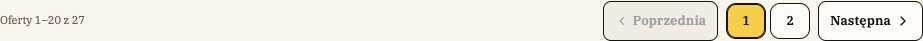

[E33](evidence/E33.jpg) · Paginacja · z [S36](evidence/S36.jpg)

### 1. Cel i wybór

[P] Pokazuje zakres dostępnych ofert i przechodzi między stronami. [R] Używaj jej dla dłuższej listy; pusty wynik należy do [C26](#C26).

### 2. Anatomia

| Część             | Obecność  | Znaczenie                             |
| ----------------- | --------- | ------------------------------------- |
| Podsumowanie      | Widoczne  | Zakres i liczba wyników.              |
| Numery i kierunki | Warunkowe | Poprzednia, bieżąca strona, następna. |

### 3. Warianty, rozmiary i stany

| Oś     | Wartości / kombinacja        | Różnica                                   | Dowód / granica                                                                |
| ------ | ---------------------------- | ----------------------------------------- | ------------------------------------------------------------------------------ |
| Liczba | 6 / 27 / 0                   | Jedna strona / dwie / brak wyników        | [P] [S03](evidence/S03.jpg), [S36](evidence/S36.jpg), [S14](evidence/S14.jpg). |
| Stan   | Bieżąca / dostępna / granica | Żółty numer / obrys / disabled poprzednia | [P] [S36](evidence/S36.jpg).                                                   |

### 4. Właściwości

[R] Model do konfiguracji projektu, nie deklaracja gotowego API lub komponentu Figma.

| Właściwość      | Typ / pochodzenie    | Wartości      | Domyślność                           | Zależność                                           |
| --------------- | -------------------- | ------------- | ------------------------------------ | --------------------------------------------------- |
| Strona          | liczba [R]           | 1, 2 w próbce | Pierwsza bez parametru [[A04](#A04)] | Wynika z URL.                                       |
| Liczba ofert    | liczba [R]           | 0, 6, 27      | Zależna od filtrów                   | Nie wpisuj ręcznie.                                 |
| Wielkość strony | liczba [[A04](#A04)] | 20            | 20                                   | Obecne zachowanie prototypu, nie uniwersalny token. |

### 5. Tokeny i style

| Token [A01]       | Deklaracja         | Rozwiązana wartość |
| ----------------- | ------------------ | ------------------ |
| --gui-accent      | var(--gui-color-1) | #f5cf49            |
| --gui-accent-text | #171411            | #171411            |
| --gui-edge        | #171411            | #171411            |
| --gui-radius-s    | 8px                | 8px                |

[P] Udokumentowany tryb: jasny. Brak źródła wizualnego dla dark/high contrast jako osobnych wariantów. Konkretne użycie koloru zależy od części opisanych powyżej.

### 6. Wymiary, odstępy i układ

| Element       | Kontekst     | Reguła                                   | Pochodzenie                  |
| ------------- | ------------ | ---------------------------------------- | ---------------------------- |
| Kompozycja    | Stopka listy | Podsumowanie i grupa sterowania          | [P] [S36](evidence/S36.jpg). |
| Mniej wyników | Jedna strona | Brak zbędnej grupy numerów               | [P] [S03](evidence/S03.jpg). |
| Cele          | Numery       | Wymiary kontrolki potwierdź w kontekście | [T] Szczególnie na mobile.   |

### 7. Typografia

[P] IBM Plex Serif, małe etykiety; aktywny numer wyróżniony także położeniem i stanem, nie wyłącznie kolorem.

### 8. Zachowanie i treść

[[A04](#A04)] Zmiana strony aktualizuje URL; filtracja koryguje zakres strony. Numery pojawiają się dopiero przy więcej niż jednej stronie. [S36](evidence/S36.jpg) używa odizolowanych 27 syntetycznych ofert.

[R/T] Zachowaj polskie znaki i pełne znaczenie etykiet; sprawdź dłuższy tekst oraz zawijanie. Dodatkowe języki i RTL nie są potwierdzonymi wariantami.

### 9. Używaj / unikaj

| Używaj                        | Unikaj                                           | Powód                                 |
| ----------------------------- | ------------------------------------------------ | ------------------------------------- |
| Pokaż aktualny numer i zakres | Nieskończony scroll udający istniejącą paginację | [R] Dokumentuj rzeczywisty mechanizm. |
| Wyłącz poprzednią na początku | Pozornie aktywna akcja bez skutku                | [P/R] Stan ma odpowiadać działaniu.   |

### 10. Dostępność

| Obszar          | Wymaganie / dowód / test                                                             |
| --------------- | ------------------------------------------------------------------------------------ |
| Bieżąca pozycja | [R/T] Sprawdź nazwę nawigacji, aria-current i etykiety numerów ([A11-N](#A11-N)).    |
| Klawiatura      | [T] Focus po zmianie strony i obsługa granic ([A11-K](#A11-K), [A11-CEL](#A11-CEL)). |

### 11. Źródła i pytania

Źródła bieżące: [S03](evidence/S03.jpg), [S14](evidence/S14.jpg), [S36](evidence/S36.jpg); wycinek [E33](evidence/E33.jpg) pochodzi z [S36](evidence/S36.jpg). Adnotacje [A01](#A01)–[A06](#A06) są pomocnicze; nie rozszerzają automatycznie wizualnej macierzy stanów.

[?] Nie uchwycono ostatniej strony, wielu numerów z wielokropkiem ani mobilnego wariantu 27 ofert.

## C13 · Nagłówek publiczny i stopka

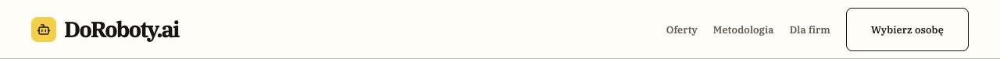

[E03](evidence/E03.jpg) · Marka i nawigacja publiczna · z [S01](evidence/S01.jpg)

### 1. Cel i wybór

[P] Zapewnia stały dostęp do marki, głównych sekcji i konta; stopka domyka publiczną część serwisu. [R] Przestrzeń robocza korzysta z [C14](#C14).

### 2. Anatomia

| Część             | Obecność                      | Znaczenie                                           |
| ----------------- | ----------------------------- | --------------------------------------------------- |
| Marka             | Stała                         | Żółty znak robota i nazwa DoRoboty.ai.              |
| Nawigacja / konto | Zależne od szerokości i osoby | Środkowe linki oraz obrys „Moje konto”.             |
| Stopka            | Publiczna                     | Nazwa, krótki tekst, linki i linia praw autorskich. |

### 3. Warianty, rozmiary i stany

| Oś        | Wartości / kombinacja | Różnica                          | Dowód / granica                                          |
| --------- | --------------------- | -------------------------------- | -------------------------------------------------------- |
| Szerokość | Desktop / mobile      | Pełne linki / marka i konto      | [P] [S01](evidence/S01.jpg)–[S04](evidence/S04.jpg).     |
| Osoba     | Wybrana / brak        | Dostęp do konta i operacji sesji | [[A04](#A04)]; nie oznacza prawdziwego uwierzytelnienia. |

### 4. Właściwości

[R] Model do konfiguracji projektu, nie deklaracja gotowego API lub komponentu Figma.

| Właściwość     | Typ / pochodzenie        | Wartości                                         | Domyślność           | Zależność                                    |
| -------------- | ------------------------ | ------------------------------------------------ | -------------------- | -------------------------------------------- |
| Pozycje        | lista linków [R]         | Oferty, Metodologia, Dla firm, Aplikacje, Profil | Zależne od kontekstu | Nie zmieniaj etykiet ze względów wizualnych. |
| Logo           | zasób + tekst [R]        | Robot i wordmark                                 | Stała marka          | Nie zastępuj drwalem.                        |
| Linki środkowe | widoczność [[A05](#A05)] | Od 768px                                         | Ukryte poniżej progu | Nie ma publicznego hamburgera.               |

### 5. Tokeny i style

| Token [A01]   | Deklaracja            | Rozwiązana wartość |
| ------------- | --------------------- | ------------------ |
| --gui-surface | var(--gui-neutral-2)  | #fffdf8            |
| --gui-text    | var(--gui-neutral-10) | #171411            |
| --gui-accent  | var(--gui-color-1)    | #f5cf49            |
| --gui-line    | #c5bdb1               | #c5bdb1            |

[P] Udokumentowany tryb: jasny. Brak źródła wizualnego dla dark/high contrast jako osobnych wariantów. Konkretne użycie koloru zależy od części opisanych powyżej.

### 6. Wymiary, odstępy i układ

| Element           | Kontekst                        | Reguła                  | Pochodzenie                  |
| ----------------- | ------------------------------- | ----------------------- | ---------------------------- |
| Wysokość nagłówka | Desktop / mobile                | 76px / 72px             | [[A05](#A05)].               |
| Margines poziomy  | Desktop / ≤1100 / mobile / ≤360 | 40 / 24 / 18 / 12px     | [[A05](#A05)].               |
| Stopka            | Wąski ekran                     | Bloki zawijane w pionie | [P] [S04](evidence/S04.jpg). |

### 7. Typografia

[[A05](#A05)] Wordmark 28px desktop, 25px mobile, 20px ≤360; pozostała treść IBM Plex Serif. 768–1023px ciaśniejsze odstępy 12px i brak zawijania etykiet nagłówka.

### 8. Zachowanie i treść

[[A04](#A04)] Linki prowadzą do istniejących tras. [P] Mobile ukrywa środkowe pozycje; nie należy dopowiadać menu, którego nie ma. [R] Ocenić dostępność kluczowych ścieżek po tym uproszczeniu.

[R/T] Zachowaj polskie znaki i pełne znaczenie etykiet; sprawdź dłuższy tekst oraz zawijanie. Dodatkowe języki i RTL nie są potwierdzonymi wariantami.

### 9. Używaj / unikaj

| Używaj                        | Unikaj                         | Powód                                          |
| ----------------------------- | ------------------------------ | ---------------------------------------------- |
| Jedna spójna marka w nagłówku | Drwal jako znak logowania      | [R] Ilustracja i identyfikacja mają inne role. |
| Zachowaj konto na mobile      | Ściśnięte, nachodzące etykiety | [P/R] Priorytet czytelności.                   |

### 10. Dostępność

| Obszar    | Wymaganie / dowód / test                                                               |
| --------- | -------------------------------------------------------------------------------------- |
| Struktura | [R/T] Landmark header/nav/footer, sensowna kolejność linków i nazwy ([A11-N](#A11-N)). |
| Reflow    | [T] Szczególnie 768–1023px, powiększenie i długie etykiety ([A11-R](#A11-R)).          |

### 11. Źródła i pytania

Źródła bieżące: [S01](evidence/S01.jpg), [S02](evidence/S02.jpg), [S03](evidence/S03.jpg), [S04](evidence/S04.jpg); wycinek [E03](evidence/E03.jpg) pochodzi z [S01](evidence/S01.jpg). Adnotacje [A01](#A01)–[A06](#A06) są pomocnicze; nie rozszerzają automatycznie wizualnej macierzy stanów.

[?] Brak pełnej analizy odkrywalności schowanych sekcji na mobile.

## C14 · Nawigacja obszaru roboczego

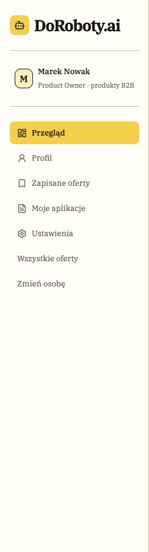

[E18](evidence/E18.jpg) · Nawigacja boczna · z [S16](evidence/S16.jpg)

### 1. Cel i wybór

[P] Orientuje osobę w strefie kandydata albo pracodawcy. [R] Zachowaj wspólną strukturę z rolami i wyraźnie zaznacz bieżącą sekcję.

### 2. Anatomia

| Część           | Obecność        | Znaczenie                                          |
| --------------- | --------------- | -------------------------------------------------- |
| Marka i osoba   | Stałe           | Znak, imię i opis roli.                            |
| Pozycje         | Zależne od roli | Ikona konturowa + etykieta, żółta aktywna pozycja. |
| Belka kontekstu | Desktop         | Nazwa strefy i osoba; mobile ma przycisk menu.     |

### 3. Warianty, rozmiary i stany

| Oś        | Wartości / kombinacja           | Różnica            | Dowód / granica                                                                |
| --------- | ------------------------------- | ------------------ | ------------------------------------------------------------------------------ |
| Rola      | Kandydat / pracodawca           | Inny zestaw sekcji | [P] [S16](evidence/S16.jpg), [S38](evidence/S38.jpg).                          |
| Szerokość | Sidebar / zwinięty / rozwinięty | Desktop / mobile   | [P] [S17](evidence/S17.jpg), [S24](evidence/S24.jpg), [S40](evidence/S40.jpg). |

### 4. Właściwości

[R] Model do konfiguracji projektu, nie deklaracja gotowego API lub komponentu Figma.

| Właściwość     | Typ / pochodzenie     | Wartości                           | Domyślność        | Zależność                    |
| -------------- | --------------------- | ---------------------------------- | ----------------- | ---------------------------- |
| Sekcja aktywna | pozycja [R]           | Profil, aplikacje, ustawienia itd. | Zależna od trasy  | Jedna aktywna pozycja.       |
| Rola i osoba   | tekst [R]             | Dane syntetyczne                   | Zależne od wyboru | Nie jest systemem uprawnień. |
| Menu           | boolean [[A04](#A04)] | Otwarte / zamknięte                | Zamknięte mobile  | Rozwinięty aside, nie modal. |

### 5. Tokeny i style

| Token [A01]                 | Deklaracja             | Rozwiązana wartość |
| --------------------------- | ---------------------- | ------------------ |
| --sidebar                   | var(--gui-surface)     | #fffdf8            |
| --sidebar-accent            | var(--gui-color-1)     | #f5cf49            |
| --sidebar-accent-foreground | var(--gui-accent-text) | #171411            |
| --gui-surface-shaded        | #e8ddce                | #e8ddce            |

[P] Udokumentowany tryb: jasny. Brak źródła wizualnego dla dark/high contrast jako osobnych wariantów. Konkretne użycie koloru zależy od części opisanych powyżej.

### 6. Wymiary, odstępy i układ

| Element | Kontekst                 | Reguła                                  | Pochodzenie                       |
| ------- | ------------------------ | --------------------------------------- | --------------------------------- |
| Sidebar | Desktop                  | 244px; treść odsunięta o tę szerokość   | [[A05](#A05)].                    |
| Belka   | Desktop / mobile         | 72px / 68px                             | [[A05](#A05)].                    |
| Treść   | Padding desktop / mobile | 40px / 24px i 18px w regułach mobilnych | [[A05](#A05)]; zależnie od bloku. |

[[A02](#A02)] Próbka z [S16](evidence/S16.jpg), selektor roli „sidebar”: 244×900 CSS px; padding 24px 16px 16px; gap normal; radius 0px. Nie jest to limit wszystkich wariantów tej rodziny.

### 7. Typografia

[P] Serif również w nawigacji i danych osoby. Aktywna pozycja ma większą wagę i żółte wypełnienie; ikona nie zastępuje etykiety.

### 8. Zachowanie i treść

[[A04](#A04)] Przycisk mobile rozwija pozycjonowany aside. Nie jest to Dialog i nie ma deklarowanej pułapki focusu. „Zmień osobę” wraca do symulowanego wyboru roli.

[R/T] Zachowaj polskie znaki i pełne znaczenie etykiet; sprawdź dłuższy tekst oraz zawijanie. Dodatkowe języki i RTL nie są potwierdzonymi wariantami.

### 9. Używaj / unikaj

| Używaj                       | Unikaj                              | Powód                           |
| ---------------------------- | ----------------------------------- | ------------------------------- |
| Tekst wraz z ikoną           | Same niepodpisane piktogramy        | [R] Mniejszy koszt rozpoznania. |
| Bieżąca sekcja w żółtym polu | Kilka równorzędnych żółtych pozycji | [R] Wyraźna lokalizacja.        |

### 10. Dostępność

| Obszar        | Wymaganie / dowód / test                                                                                             |
| ------------- | -------------------------------------------------------------------------------------------------------------------- |
| Menu mobile   | [[A04](#A04)/T] Sprawdź expanded, kontrolowany obszar, kolejność focusu i zamknięcie po nawigacji ([A11-K](#A11-K)). |
| Aktywna trasa | [R/T] Programowe oznaczenie bieżącej pozycji i kontrast ([A11-N](#A11-N), [A11-C](#A11-C)).                          |

### 11. Źródła i pytania

Źródła bieżące: [S16](evidence/S16.jpg), [S17](evidence/S17.jpg), [S23](evidence/S23.jpg), [S24](evidence/S24.jpg), [S38](evidence/S38.jpg), [S40](evidence/S40.jpg); wycinek [E18](evidence/E18.jpg) pochodzi z [S16](evidence/S16.jpg). Adnotacje [A01](#A01)–[A06](#A06) są pomocnicze; nie rozszerzają automatycznie wizualnej macierzy stanów.

[?] Nie wykonano pełnego odsłuchu i klawiaturowego audytu mobile. Nie nazywaj rozwiniętego aside modalem.

## C15 · Powrót i link kontekstowy

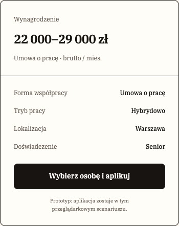

[E11](evidence/E11.jpg) · Warunki i akcje oferty · z [S08](evidence/S08.jpg)

### 1. Cel i wybór

[P] Prowadzi do listy, powiązanej oferty lub wcześniejszego kontekstu. [R] Używaj zamiast mocnego przycisku, gdy celem jest orientacja, nie zatwierdzenie operacji.

### 2. Anatomia

| Część      | Obecność             | Znaczenie                               |
| ---------- | -------------------- | --------------------------------------- |
| Tekst celu | Stały                | Nazwa miejsca, do którego można wrócić. |
| Strzałka   | Zależna od przykładu | Poprzedza etykietę powrotu.             |

### 3. Warianty, rozmiary i stany

| Oś        | Wartości / kombinacja    | Różnica                        | Dowód / granica                                       |
| --------- | ------------------------ | ------------------------------ | ----------------------------------------------------- |
| Kierunek  | Powrót / powiązany widok | Lista aplikacji / pełna oferta | [P] [S25](evidence/S25.jpg), [S28](evidence/S28.jpg). |
| Szerokość | Desktop / mobile         | Ta sama rola, mniejszy tekst   | [P] [S08](evidence/S08.jpg)–[S09](evidence/S09.jpg).  |

### 4. Właściwości

[R] Model do konfiguracji projektu, nie deklaracja gotowego API lub komponentu Figma.

| Właściwość | Typ / pochodzenie | Wartości                  | Domyślność              | Zależność                                 |
| ---------- | ----------------- | ------------------------- | ----------------------- | ----------------------------------------- |
| Cel        | adres [R]         | Trasa listy lub szczegółu | Zależny od wejścia      | Nie zakładaj operacji cofnięcia historii. |
| Etykieta   | tekst [R]         | Opisuje cel               | Brak globalnej etykiety | Zachowaj znaczenie przy skracaniu.        |

### 5. Tokeny i style

| Token [A01] | Deklaracja            | Rozwiązana wartość |
| ----------- | --------------------- | ------------------ |
| --gui-text  | var(--gui-neutral-10) | #171411            |
| --gui-brand | #71472e               | #71472e            |
| --gui-focus | #171411               | #171411            |

[P] Udokumentowany tryb: jasny. Brak źródła wizualnego dla dark/high contrast jako osobnych wariantów. Konkretne użycie koloru zależy od części opisanych powyżej.

### 6. Wymiary, odstępy i układ

| Element        | Kontekst          | Reguła         | Pochodzenie                  |
| -------------- | ----------------- | -------------- | ---------------------------- |
| BackLink       | Minimum wysokości | 36px           | [[A05](#A05)].               |
| Ikona / odstęp | BackLink          | 17px / 9px     | [[A05](#A05)].               |
| Miejsce        | Nad nagłówkiem    | Odrębny wiersz | [P] [S25](evidence/S25.jpg). |

[[A02](#A02)] Próbka z [S08](evidence/S08.jpg), selektor roli „back”: 108.47×36 CSS px; padding 0px; gap 9px; radius 0px. Nie jest to limit wszystkich wariantów tej rodziny.

### 7. Typografia

[[A05](#A05)] BackLink IBM Plex Serif 13px desktop, 12px ≤700px. Linki wewnątrz treści mają własny kontekst, nie muszą kopiować tego rozmiaru.

### 8. Zachowanie i treść

[[A04](#A04)] To zwykła nawigacja do określonej trasy. [R] Nie obiecuj zachowania filtrów lub historii, jeżeli dany link ich nie przenosi.

[R/T] Zachowaj polskie znaki i pełne znaczenie etykiet; sprawdź dłuższy tekst oraz zawijanie. Dodatkowe języki i RTL nie są potwierdzonymi wariantami.

### 9. Używaj / unikaj

| Używaj                                | Unikaj                                     | Powód                             |
| ------------------------------------- | ------------------------------------------ | --------------------------------- |
| „Wróć do aplikacji”                   | Niejasne „Kliknij tutaj”                   | [R] Cel zrozumiały poza akapitem. |
| Link do oferty w kontekście aplikacji | Druga główna akcja konkurująca z wysłaniem | [R] Wspiera orientację.           |

### 10. Dostępność

| Obszar         | Wymaganie / dowód / test                                                      |
| -------------- | ----------------------------------------------------------------------------- |
| Cel i focus    | [R/T] 2.4.4 A oraz [A11-K](#A11-K); dekoracyjna strzałka bez podwójnej nazwy. |
| Obszar aktywny | [R/T] Mierz cały link, nie glif strzałki ([A11-CEL](#A11-CEL)).               |

### 11. Źródła i pytania

Źródła bieżące: [S08](evidence/S08.jpg), [S25](evidence/S25.jpg), [S28](evidence/S28.jpg), [S38](evidence/S38.jpg); wycinek [E11](evidence/E11.jpg) pochodzi z [S08](evidence/S08.jpg). Adnotacje [A01](#A01)–[A06](#A06) są pomocnicze; nie rozszerzają automatycznie wizualnej macierzy stanów.

[?] Brak kompletnej matrycy powrotów z każdej trasy.

## C16 · Wstęp marki i szkicowa ilustracja

[E09](evidence/E09.jpg) · Nagłówek marki z drwalem · z [S03](evidence/S03.jpg)

### 1. Cel i wybór

[P] Wprowadza ton serwisu przed wyszukiwaniem. Drwal jest powtarzalnym bohaterem, szkice podkreślają kierunek uwagi. [R] Nie stosuj ilustracji przy każdej karcie danych.

### 2. Anatomia

| Część           | Obecność          | Znaczenie                                                                              |
| --------------- | ----------------- | -------------------------------------------------------------------------------------- |
| Nagłówek i opis | Zależne od strony | Listing: „Dobra robota. Z AI w środku.”; home: „Praca dla ludzi, którzy dowożą z AI.”. |
| Drwal           | Desktop/tablet    | Jeden spójny zasób z projektu.                                                         |
| Ślad atramentu  | Dekoracyjny       | Podkreślenie i strzałka.                                                               |

### 3. Warianty, rozmiary i stany

| Oś        | Wartości / kombinacja     | Różnica                             | Dowód / granica                                       |
| --------- | ------------------------- | ----------------------------------- | ----------------------------------------------------- |
| Miejsce   | Home / listing            | Inna kompozycja wstępu              | [P] [S01](evidence/S01.jpg), [S03](evidence/S03.jpg). |
| Szerokość | Desktop / tablet / mobile | Ilustracja duża / mniejsza / ukryta | [P] Desktop i mobile; tablet [[A05](#A05)].           |

### 4. Właściwości

[R] Model do konfiguracji projektu, nie deklaracja gotowego API lub komponentu Figma.

| Właściwość      | Typ / pochodzenie | Wartości                | Domyślność             | Zależność                                    |
| --------------- | ----------------- | ----------------------- | ---------------------- | -------------------------------------------- |
| Nagłówek / opis | tekst [R]         | Istniejące copy         | Zależne od strony      | Nie zmieniaj pod pretekstem stylu.           |
| Ilustracja      | zasób [R]         | Projektowy drwal        | Jeden bohater          | Nie generuj innej postaci do każdego widoku. |
| Dekoracja       | zasób [R]         | Strzałka / podkreślenie | Zależnie od kompozycji | Bez znaczenia niezbędnego do działania.      |

### 5. Tokeny i style

| Token [A01]        | Deklaracja                                          | Rozwiązana wartość                                  |
| ------------------ | --------------------------------------------------- | --------------------------------------------------- |
| --gui-brand        | #71472e                                             | #71472e                                             |
| --gui-surface-hero | var(--gui-surface-shaded)                           | #e8ddce                                             |
| --gui-font-brand   | "IBM Plex Serif", Georgia, "Times New Roman", serif | "IBM Plex Serif", Georgia, "Times New Roman", serif |

[P] Udokumentowany tryb: jasny. Brak źródła wizualnego dla dark/high contrast jako osobnych wariantów. Konkretne użycie koloru zależy od części opisanych powyżej.

### 6. Wymiary, odstępy i układ

| Element      | Kontekst                  | Reguła                                    | Pochodzenie    |
| ------------ | ------------------------- | ----------------------------------------- | -------------- |
| Listing hero | Desktop                   | Minimum 330px, kolumny elastyczna + 300px | [[A05](#A05)]. |
| Drwal        | Desktop / tablet / ≤600px | 300px wysokości / 230px / ukryty          | [[A05](#A05)]. |
| Szkice       | Listing                   | Strzałka 72px; podkreślenie 108×12px      | [[A05](#A05)]. |

[[A02](#A02)] Próbka z [S03](evidence/S03.jpg), selektor roli „hero”: 1200×340 CSS px; padding 20px 0px; gap 40px; radius 0px. Nie jest to limit wszystkich wariantów tej rodziny.

### 7. Typografia

[[A05](#A05)] Listing H1 48px/1.08, tracking −1.5px; 44px ≤850 i 36px ≤600. Waga 400. Rola marki jest serif, tak samo jak pozostała treść.

### 8. Zachowanie i treść

[P] Elementy statyczne w zebranych kadrach. [[A06](#A06)] Zasoby pochodzą z lokalnego projektu. Zrzuty wykonano przy reduced motion i wyłączonych przejściach, więc nie dokumentują animacji.

[R/T] Zachowaj polskie znaki i pełne znaczenie etykiet; sprawdź dłuższy tekst oraz zawijanie. Dodatkowe języki i RTL nie są potwierdzonymi wariantami.

### 9. Używaj / unikaj

| Używaj                                     | Unikaj                                   | Powód                            |
| ------------------------------------------ | ---------------------------------------- | -------------------------------- |
| Stały bohater i lekki szkic                | Nowa stylistyka postaci w każdym miejscu | [R] Zachowuje rozpoznawalny ton. |
| Mniejszy nagłówek i brak postaci na mobile | Ściskanie tekstu obok drwala             | [P/R] Treść ma pierwszeństwo.    |

### 10. Dostępność

| Obszar     | Wymaganie / dowód / test                                                                             |
| ---------- | ---------------------------------------------------------------------------------------------------- |
| Dekoracje  | [R/T] Alt pusty/aria-hidden, jeśli nie niosą dodatkowej informacji ([A11-N](#A11-N)).                |
| Czytelność | [T] Długie copy, tekst-spacing i 320px; kolor brown/beige 5.93:1 ([A11-C](#A11-C), [A11-R](#A11-R)). |

### 11. Źródła i pytania

Źródła bieżące: [S01](evidence/S01.jpg), [S02](evidence/S02.jpg), [S03](evidence/S03.jpg), [S04](evidence/S04.jpg); wycinek [E09](evidence/E09.jpg) pochodzi z [S03](evidence/S03.jpg). Adnotacje [A01](#A01)–[A06](#A06) są pomocnicze; nie rozszerzają automatycznie wizualnej macierzy stanów.

[?] Nie ustalono katalogu nowych póz ani zasad animowania bohatera. Historyczny [U01](evidence/U01.png) ma wycofane copy.

## C17 · Powierzchnie, panele i układ formularza

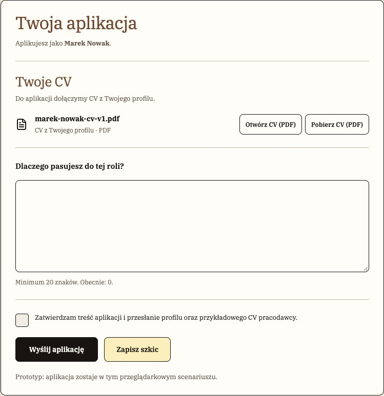

[E29](evidence/E29.jpg) · CV, odpowiedź i zgoda · z [S28](evidence/S28.jpg)

### 1. Cel i wybór

[P] Oddziela tło strony od grupy treści lub zadania. [R] Karta oznacza spójny blok, a nie każdy akapit; dokumenty do czytania mogą pozostać na płaskim papierze.

### 2. Anatomia

| Część   | Obecność                 | Znaczenie                            |
| ------- | ------------------------ | ------------------------------------ |
| Tło     | Stałe w danym kontekście | Papier albo wspólny ciemniejszy beż. |
| Panel   | Zależny od strony        | Jasna powierzchnia i cienki kontur.  |
| Wnętrze | Treść                    | Nagłówki, pola, pomoc, akcje.        |

### 3. Warianty, rozmiary i stany

| Oś           | Wartości / kombinacja            | Różnica                                       | Dowód / granica                                                                |
| ------------ | -------------------------------- | --------------------------------------------- | ------------------------------------------------------------------------------ |
| Powierzchnia | Canvas / shaded / card / muted   | Strona / strefa / panel / pomocniczy fragment | [P] [S03](evidence/S03.jpg), [S11](evidence/S11.jpg), [S28](evidence/S28.jpg). |
| Kompozycja   | Jedna kolumna / treść + kontekst | Profil / aplikowanie                          | [P] [S18](evidence/S18.jpg), [S28](evidence/S28.jpg)–[S31](evidence/S31.jpg).  |

### 4. Właściwości

[R] Model do konfiguracji projektu, nie deklaracja gotowego API lub komponentu Figma.

| Właściwość        | Typ / pochodzenie | Wartości                                          | Domyślność         | Zależność                       |
| ----------------- | ----------------- | ------------------------------------------------- | ------------------ | ------------------------------- |
| Ton powierzchni   | enum [R]          | Cztery role powyżej                               | Zależny od trasy   | Nie ustanowiono ciemnego trybu. |
| Obrys             | obecność [R]      | Atrament dla kontenera, subtelna linia separatora | Zależny od rodziny | Nie podwajaj border i inset.    |
| Sekcje formularza | lista [R]         | Pola + pomoc + akcje                              | Zależne od zadania | Zachowaj kolejność domenową.    |

### 5. Tokeny i style

| Token [A01]          | Deklaracja              | Rozwiązana wartość      |
| -------------------- | ----------------------- | ----------------------- |
| --gui-canvas         | #faf6ee                 | #faf6ee                 |
| --gui-surface        | var(--gui-neutral-2)    | #fffdf8                 |
| --gui-surface-shaded | #e8ddce                 | #e8ddce                 |
| --gui-surface-muted  | var(--gui-neutral-3)    | #f2ede4                 |
| --gui-edge-shadow    | inset 0 0 0 1px #171411 | inset 0 0 0 1px #171411 |
| --gui-line           | #c5bdb1                 | #c5bdb1                 |

[P] Udokumentowany tryb: jasny. Brak źródła wizualnego dla dark/high contrast jako osobnych wariantów. Konkretne użycie koloru zależy od części opisanych powyżej.

### 6. Wymiary, odstępy i układ

| Element          | Kontekst          | Reguła                            | Pochodzenie                                          |
| ---------------- | ----------------- | --------------------------------- | ---------------------------------------------------- |
| Rytm bazowy      | Tokeny            | 4, 8, 12, 16, 24, 32, 48px        | [[A01](#A01)].                                       |
| Lokalne przepisy | Istniejące widoki | Występują także 20, 22, 28 i 30px | [[A05](#A05)]; nie są automatycznie nowymi tokenami. |
| Promienie        | Wspólne role      | 5, 8, 10, 16px                    | [[A01](#A01)]; wybór według rodziny.                 |

[[A02](#A02)] Próbka z [S18](evidence/S18.jpg), selektor roli „panel”: 850×551.56 CSS px; padding 28px; gap 16px; radius 10px. Nie jest to limit wszystkich wariantów tej rodziny.

### 7. Typografia

[P] IBM Plex Serif w nagłówkach, pomocach, danych i kontrolkach. [R] Oddziel rolę tekstu rozmiarem, wagą i przestrzenią; nie wprowadzaj ponownie sans do danych.

### 8. Zachowanie i treść

[[A05](#A05)] Wspólne zacienione tło stosowane w metodologii, auth, /app i aplikowaniu; hero listingu używa tego samego koloru. Nie jest to globalna podmiana body każdej strony.

[R/T] Zachowaj polskie znaki i pełne znaczenie etykiet; sprawdź dłuższy tekst oraz zawijanie. Dodatkowe języki i RTL nie są potwierdzonymi wariantami.

### 9. Używaj / unikaj

| Używaj                              | Unikaj                                   | Powód                                          |
| ----------------------------------- | ---------------------------------------- | ---------------------------------------------- |
| Jasny panel na zacienionym tle      | Kilka podobnych beżów bez znaczenia      | [R] Utrzymuje czytelne warstwy.                |
| Cienki obrys bez odsuniętego cienia | Gruby plakatowy cień historycznego stylu | [P/R] Aktualna iteracja ma spokojną strukturę. |

### 10. Dostępność

| Obszar         | Wymaganie / dowód / test                                                                                                                  |
| -------------- | ----------------------------------------------------------------------------------------------------------------------------------------- |
| Kolejność      | [R/T] Semantyczne grupy pól i nagłówki; kolejność DOM zgodna z czytaniem ([A11-N](#A11-N)).                                               |
| Reflow i linie | [T] Obrysy pól muszą być rozpoznawalne; subtelny separator nie zastępuje niezbędnej granicy kontrolki ([A11-C](#A11-C), [A11-R](#A11-R)). |

### 11. Źródła i pytania

Źródła bieżące: [S03](evidence/S03.jpg), [S11](evidence/S11.jpg), [S18](evidence/S18.jpg), [S28](evidence/S28.jpg), [S41](evidence/S41.jpg), [S43](evidence/S43.jpg); wycinek [E29](evidence/E29.jpg) pochodzi z [S28](evidence/S28.jpg). Adnotacje [A01](#A01)–[A06](#A06) są pomocnicze; nie rozszerzają automatycznie wizualnej macierzy stanów.

[?] Brak zatwierdzonej reguły normalizacji wszystkich lokalnych odstępów i promieni.

## C18 · Podsumowanie liczbowe

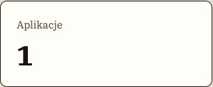

[E17](evidence/E17.jpg) · Metryka w panelu · z [S16](evidence/S16.jpg)

### 1. Cel i wybór

[P] Podaje liczbę w kontekście konta, np. stan aktywności. [R] Używaj dla jednej miary z jednoznaczną etykietą; lista szczegółów należy do [C20](#C20).

### 2. Anatomia

| Część       | Obecność   | Znaczenie                       |
| ----------- | ---------- | ------------------------------- |
| Nazwa       | Stała      | Co jest liczone.                |
| Wartość     | Stała      | Dominująca liczba.              |
| Opis / link | Opcjonalny | Uzupełnia kontekst i przejście. |

### 3. Warianty, rozmiary i stany

| Oś          | Wartości / kombinacja | Różnica            | Dowód / granica                          |
| ----------- | --------------------- | ------------------ | ---------------------------------------- |
| Zestawienie | Kilka paneli          | Ekran przeglądu    | [P] [S16](evidence/S16.jpg).             |
| Stan danych | Aktualna liczba       | Syntetyczny profil | [P] Bez osobnej planszy ładowania/błędu. |

### 4. Właściwości

[R] Model do konfiguracji projektu, nie deklaracja gotowego API lub komponentu Figma.

| Właściwość | Typ / pochodzenie    | Wartości             | Domyślność        | Zależność                                     |
| ---------- | -------------------- | -------------------- | ----------------- | --------------------------------------------- |
| Etykieta   | tekst [R]            | Znaczenie liczby     | Zależne od miary  | Bez ogólnej domyślnej nazwy.                  |
| Wartość    | liczba [R]           | Dane lokalnego stanu | Wynika z danych   | Nie jest wskaźnikiem rzeczywistej rekrutacji. |
| Opis       | tekst opcjonalny [R] | Wyjaśnienie lub link | Zależny od panelu | Nie dopisuj prognoz AI.                       |

### 5. Tokeny i style

| Token [A01]    | Deklaracja            | Rozwiązana wartość |
| -------------- | --------------------- | ------------------ |
| --gui-surface  | var(--gui-neutral-2)  | #fffdf8            |
| --gui-text     | var(--gui-neutral-10) | #171411            |
| --gui-brand    | #71472e               | #71472e            |
| --gui-radius-m | 10px                  | 10px               |

[P] Udokumentowany tryb: jasny. Brak źródła wizualnego dla dark/high contrast jako osobnych wariantów. Konkretne użycie koloru zależy od części opisanych powyżej.

### 6. Wymiary, odstępy i układ

| Element       | Kontekst           | Reguła                            | Pochodzenie                                                     |
| ------------- | ------------------ | --------------------------------- | --------------------------------------------------------------- |
| Kontener      | Przegląd           | Wspólny panel w siatce            | [P] [S16](evidence/S16.jpg).                                    |
| Responsywność | Wąski ekran        | Siatka przechodzi w mniej kolumn  | [[A05](#A05)/T] Pełny mobilny przegląd nie jest osobnym kadrem. |
| Nazwa rodziny | Model dokumentacji | Receptura, nie klasa .metric-card | [[A03](#A03)] Renderowane .prototype-panel.                     |

[[A02](#A02)] Próbka z [S16](evidence/S16.jpg), selektor roli „metric”: 305.33×124 CSS px; padding 24px; gap normal; radius 10px. Nie jest to limit wszystkich wariantów tej rodziny.

### 7. Typografia

[P] Serif; większa liczba i mniejsza etykieta tworzą hierarchię. Dokładne wartości próbki w [A02](#A02), nie globalna skala dla wszystkich statystyk.

### 8. Zachowanie i treść

[[A04](#A04)] Wartości wynikają z lokalnych danych prototypu. [R] Przejście musi mieć widoczny cel, jeśli panel jest interaktywny.

[R/T] Zachowaj polskie znaki i pełne znaczenie etykiet; sprawdź dłuższy tekst oraz zawijanie. Dodatkowe języki i RTL nie są potwierdzonymi wariantami.

### 9. Używaj / unikaj

| Używaj                     | Unikaj                                   | Powód                          |
| -------------------------- | ---------------------------------------- | ------------------------------ |
| „Aplikacje” + liczba       | Sama liczba bez jednostki                | [R] Odbiorca rozumie zakres.   |
| Zwykła informacja liczbowa | Nieuzasadniony trend lub ocena kandydata | [R] Dane nie dowodzą prognozy. |

### 10. Dostępność

| Obszar       | Wymaganie / dowód / test                                                                                                     |
| ------------ | ---------------------------------------------------------------------------------------------------------------------------- |
| Odczyt       | [R/T] Zachowaj powiązanie etykiety i wartości w DOM ([A11-N](#A11-N)).                                                       |
| Aktualizacja | [T] Jeśli liczba zmienia się po akcji, sprawdź adekwatny komunikat bez niepotrzebnego przenoszenia focusu ([A11-B](#A11-B)). |

### 11. Źródła i pytania

Źródła bieżące: [S16](evidence/S16.jpg); wycinek [E17](evidence/E17.jpg) pochodzi z [S16](evidence/S16.jpg). Adnotacje [A01](#A01)–[A06](#A06) są pomocnicze; nie rozszerzają automatycznie wizualnej macierzy stanów.

[?] Brak osobnych stanów bardzo dużej liczby, braku danych i błędu.

## C19 · Karta wyboru osoby i roli

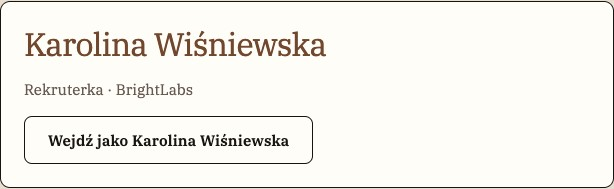

[E14](evidence/E14.jpg) · Karta wyboru persony · z [S12](evidence/S12.jpg)

### 1. Cel i wybór

[P] Pozwala wejść w syntetyczną rolę w prototypie. [R] Wyraźnie odróżniaj ją od rzeczywistego logowania i profilu publicznego.

### 2. Anatomia

| Część              | Obecność | Znaczenie                 |
| ------------------ | -------- | ------------------------- |
| Osoba              | Stała    | Imię i opis.              |
| Rola / organizacja | Kontekst | Kandydat albo pracodawca. |
| Akcja wejścia      | Stała    | Wybór tej osoby.          |

### 3. Warianty, rozmiary i stany

| Oś    | Wartości / kombinacja | Różnica                    | Dowód / granica                                                            |
| ----- | --------------------- | -------------------------- | -------------------------------------------------------------------------- |
| Rola  | Kandydat / pracodawca | Dostęp do różnych obszarów | [P] [S12](evidence/S12.jpg) pokazuje pracodawców; inne role [[A04](#A04)]. |
| Karta | Osoba syntetyczna     | Stałe przykłady            | [[A04](#A04)] Nie są prawdziwymi kontami.                                  |

### 4. Właściwości

[R] Model do konfiguracji projektu, nie deklaracja gotowego API lub komponentu Figma.

| Właściwość    | Typ / pochodzenie           | Wartości              | Domyślność                  | Zależność                                   |
| ------------- | --------------------------- | --------------------- | --------------------------- | ------------------------------------------- |
| Osoba         | tekst [R]                   | Imię, opis            | Wybór z przygotowanej listy | Nie wpisuj danych prywatnych.               |
| Rola          | enum [[A04](#A04)]          | Kandydat / pracodawca | Wynika z osoby              | Zmienia widok, nie zapewnia bezpieczeństwa. |
| Wybrana osoba | identyfikator [[A04](#A04)] | Lokalny stan          | Zależny od sesji            | Można zmienić w menu.                       |

### 5. Tokeny i style

| Token [A01]          | Deklaracja            | Rozwiązana wartość |
| -------------------- | --------------------- | ------------------ |
| --gui-surface        | var(--gui-neutral-2)  | #fffdf8            |
| --gui-surface-shaded | #e8ddce               | #e8ddce            |
| --gui-text           | var(--gui-neutral-10) | #171411            |
| --primary            | var(--gui-text)       | #171411            |

[P] Udokumentowany tryb: jasny. Brak źródła wizualnego dla dark/high contrast jako osobnych wariantów. Konkretne użycie koloru zależy od części opisanych powyżej.

### 6. Wymiary, odstępy i układ

| Element    | Kontekst     | Reguła                        | Pochodzenie                     |
| ---------- | ------------ | ----------------------------- | ------------------------------- |
| Kompozycja | Wybór        | Powtarzalne artykuły/karty    | [P] [S12](evidence/S12.jpg).    |
| Treść      | Dłuższy opis | Zawijanie w obrębie karty     | [R/T] Brak skrajnego przykładu. |
| Akcja      | Przycisk     | Wspólna receptura [C01](#C01) | [[A03](#A03)].                  |

[[A02](#A02)] Próbka z [S12](evidence/S12.jpg), selektor roli „persona”: 614×187.39 CSS px; padding 24px; gap normal; radius 10px. Nie jest to limit wszystkich wariantów tej rodziny.

### 7. Typografia

[P] Serif; imię dominuje nad opisem, przycisk zachowuje wagę wspólnych akcji.

### 8. Zachowanie i treść

[[A04](#A04)] Wybranie osoby wchodzi w przypisaną strefę. Stan i dane są lokalne; reset przywraca próbkę. Nie jest to uwierzytelnienie ani kontrola dostępu.

[R/T] Zachowaj polskie znaki i pełne znaczenie etykiet; sprawdź dłuższy tekst oraz zawijanie. Dodatkowe języki i RTL nie są potwierdzonymi wariantami.

### 9. Używaj / unikaj

| Używaj                       | Unikaj                                       | Powód                                |
| ---------------------------- | -------------------------------------------- | ------------------------------------ |
| Opisz symulację w kontekście | Sugerowanie bezpiecznego konta produkcyjnego | [R] Zachowuje uczciwy model zadania. |
| Jasno nazwij rolę            | Sam awatar bez opisu                         | [R] Ułatwia wybór.                   |

### 10. Dostępność

| Obszar | Wymaganie / dowód / test                                                                                      |
| ------ | ------------------------------------------------------------------------------------------------------------- |
| Wybór  | [R/T] Każdy przycisk ma nazwę osoby/roli w kontekście, logiczna kolejność ([A11-N](#A11-N), [A11-K](#A11-K)). |
| Karty  | [T] Sprawdź nagłówki i brak zbędnych powtórzeń ([A11-R](#A11-R)).                                             |

### 11. Źródła i pytania

Źródła bieżące: [S12](evidence/S12.jpg); wycinek [E14](evidence/E14.jpg) pochodzi z [S12](evidence/S12.jpg). Adnotacje [A01](#A01)–[A06](#A06) są pomocnicze; nie rozszerzają automatycznie wizualnej macierzy stanów.

[?] Nie projektowano produkcyjnego procesu rejestracji, haseł ani odzyskiwania konta.

## C20 · Wiersz aplikacji lub kandydatury

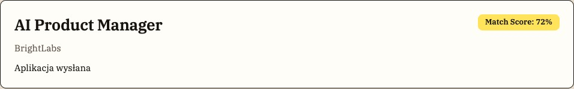

[E21](evidence/E21.jpg) · Rekord kandydata na liście · z [S23](evidence/S23.jpg)

### 1. Cel i wybór

[P] Umożliwia przegląd i otwarcie konkretnej aplikacji. [R] Nie myl wiersza procesu z kartą publicznej oferty [C11](#C11).

### 2. Anatomia

| Część             | Obecność          | Znaczenie                                        |
| ----------------- | ----------------- | ------------------------------------------------ |
| Tożsamość rekordu | Stała             | Kandydat: rola i firma; rekruter: osoba i rola.  |
| Etap              | Widoczny          | Stan aplikacji w tekście.                        |
| Match Score       | Widoczny w próbce | Nieinteraktywna etykieta procentowa [C21](#C21). |

### 3. Warianty, rozmiary i stany

| Oś        | Wartości / kombinacja | Różnica                                       | Dowód / granica                                       |
| --------- | --------------------- | --------------------------------------------- | ----------------------------------------------------- |
| Odbiorca  | Kandydat / rekruter   | Inna tożsamość główna i etykieta wyszukiwania | [P] [S23](evidence/S23.jpg), [S37](evidence/S37.jpg). |
| Szerokość | Desktop / mobile      | Zawijanie i układ pionowy                     | [P] [S23](evidence/S23.jpg)–[S24](evidence/S24.jpg).  |

### 4. Właściwości

[R] Model do konfiguracji projektu, nie deklaracja gotowego API lub komponentu Figma.

| Właściwość | Typ / pochodzenie    | Wartości                  | Domyślność         | Zależność                           |
| ---------- | -------------------- | ------------------------- | ------------------ | ----------------------------------- |
| Rekord     | dane [R]             | Osoba, rola, firma, etap  | Wynika z aplikacji | Nie odtwarza karty oferty.          |
| Ocena      | liczba [[A04](#A04)] | 72% w głównym przykładzie | Syntetyczna        | Nie jest rekomendacją zatrudnienia. |
| Przejście  | adres [R]            | Szczegóły aplikacji       | Zależne od rekordu | Cały cel ma rozpoznawalną nazwę.    |

### 5. Tokeny i style

| Token [A01]        | Deklaracja           | Rozwiązana wartość |
| ------------------ | -------------------- | ------------------ |
| --gui-surface      | var(--gui-neutral-2) | #fffdf8            |
| --gui-edge         | #171411              | #171411            |
| --gui-radius-m     | 10px                 | 10px               |
| --gui-match-yellow | #ffe45b              | #ffe45b            |

[P] Udokumentowany tryb: jasny. Brak źródła wizualnego dla dark/high contrast jako osobnych wariantów. Konkretne użycie koloru zależy od części opisanych powyżej.

### 6. Wymiary, odstępy i układ

| Element | Kontekst  | Reguła                          | Pochodzenie                                       |
| ------- | --------- | ------------------------------- | ------------------------------------------------- |
| Desktop | Układ     | Treść po lewej, score po prawej | [P] [S23](evidence/S23.jpg).                      |
| Mobile  | Zawartość | Zawijana w dostępnej szerokości | [P] [S24](evidence/S24.jpg).                      |
| Lista   | Odstęp    | Powtarzalny rytm kart           | [P] Bez sztywnej wysokości dla wszystkich danych. |

### 7. Typografia

[P] Tytuł/imię bold, firma spokojniejsza, etap zwykłym tekstem. Wszystko IBM Plex Serif; score ma mocną etykietę.

### 8. Zachowanie i treść

[[A04](#A04)] Otwarcie pokazuje rekord w kontekście danej roli. Wyszukiwanie [C02](#C02) filtruje lokalnie osobę i stanowisko. [P] Lista kandydata nie pokazuje obecnie daty ani następnego kroku; data i historia są w detalu; osobny następny krok nie jest tam wyszczególniony.

[R/T] Zachowaj polskie znaki i pełne znaczenie etykiet; sprawdź dłuższy tekst oraz zawijanie. Dodatkowe języki i RTL nie są potwierdzonymi wariantami.

### 9. Używaj / unikaj

| Używaj                             | Unikaj                           | Powód                                            |
| ---------------------------------- | -------------------------------- | ------------------------------------------------ |
| Jawny etap słowami                 | Sam kolor bez nazwy              | [R] Znaczenie pozostaje czytelne.                |
| Oddziel score od decyzji rekrutera | Score jako przycisk „zaakceptuj” | [R] Nieinteraktywna informacja nie jest decyzją. |

### 10. Dostępność

| Obszar          | Wymaganie / dowód / test                                                              |
| --------------- | ------------------------------------------------------------------------------------- |
| Cel             | [R/T] Nazwa otwieranej aplikacji i programowe znaczenie etapu ([A11-N](#A11-N)).      |
| Kontekst danych | [T] Sprawdź odczyt osoby, roli i wyniku bez polegania na położeniu ([A11-K](#A11-K)). |

### 11. Źródła i pytania

Źródła bieżące: [S23](evidence/S23.jpg), [S24](evidence/S24.jpg), [S37](evidence/S37.jpg); wycinek [E21](evidence/E21.jpg) pochodzi z [S23](evidence/S23.jpg). Adnotacje [A01](#A01)–[A06](#A06) są pomocnicze; nie rozszerzają automatycznie wizualnej macierzy stanów.

[R] Do rozważenia data na liście i jawny następny krok procesu. [?] Brak wizualnej listy wielu długich rekordów na mobile.

## C21 · Etap, Match Score i badge

[E24](evidence/E24.jpg) · Etap i Match Score · z [S25](evidence/S25.jpg)

### 1. Cel i wybór

[P] Nazywa etap i podaje syntetyczne dopasowanie. [R] Rozdziel stan procesu od obliczenia: etap opisuje zdarzenie, score jest faktem demonstracyjnym.

### 2. Anatomia

| Część        | Obecność           | Znaczenie                                        |
| ------------ | ------------------ | ------------------------------------------------ |
| Etykieta     | Stała              | Tekst etapu albo „Match Score: 72%”.             |
| Powierzchnia | Zależna od rodzaju | Żółty przykład score; inna spokojna forma etapu. |
| Wartość      | Dla score          | Liczba i znak procentu.                          |

### 3. Warianty, rozmiary i stany

| Oś     | Wartości / kombinacja       | Różnica                                                    | Dowód / granica                                                |
| ------ | --------------------------- | ---------------------------------------------------------- | -------------------------------------------------------------- |
| Rodzaj | Etap / score / ogólny badge | Różna treść i rola                                         | [P] [S25](evidence/S25.jpg), [S38](evidence/S38.jpg).          |
| Etap   | Wysłana / W przeglądzie     | Przed i po zmianie                                         | [P] [S25](evidence/S25.jpg), [S39](evidence/S39.jpg).          |
| Score  | Cztery pasma                | <40 czerwone, 40–59 pomarańczowe, 60–79 żółte, ≥80 zielone | [[A01](#A01),[A04](#A04)]; wizualnie potwierdzone głównie 72%. |

### 4. Właściwości

[R] Model do konfiguracji projektu, nie deklaracja gotowego API lub komponentu Figma.

| Właściwość | Typ / pochodzenie        | Wartości                     | Domyślność          | Zależność                                         |
| ---------- | ------------------------ | ---------------------------- | ------------------- | ------------------------------------------------- |
| Etap       | tekst/enum [[A04](#A04)] | Zależny od procesu           | Wynika z aplikacji  | Nie traktuj jako lokalnego stylu dowolnej treści. |
| Score      | liczba [[A04](#A04)]     | 72 w próbce                  | Wartość syntetyczna | Nie interaktywny i nie rozstrzyga zatrudnienia.   |
| Pasmo      | pochodne [[A04](#A04)]   | Czerwony/orange/yellow/green | Zależne od liczby   | Nie ustawiaj niezależnie od wartości.             |

### 5. Tokeny i style

| Token [A01]        | Deklaracja            | Rozwiązana wartość |
| ------------------ | --------------------- | ------------------ |
| --gui-match-red    | #ff6b79               | #ff6b79            |
| --gui-match-orange | #ffb15c               | #ffb15c            |
| --gui-match-yellow | #ffe45b               | #ffe45b            |
| --gui-match-green  | #00c853               | #00c853            |
| --gui-text         | var(--gui-neutral-10) | #171411            |

[P] Udokumentowany tryb: jasny. Brak źródła wizualnego dla dark/high contrast jako osobnych wariantów. Konkretne użycie koloru zależy od części opisanych powyżej.

### 6. Wymiary, odstępy i układ

| Element       | Kontekst   | Reguła                                  | Pochodzenie                                           |
| ------------- | ---------- | --------------------------------------- | ----------------------------------------------------- |
| Forma         | Score      | Dopasowana do etykiety, nie pełna karta | [P] [E24](evidence/E24.jpg).                          |
| Położenie     | Rekord     | Obok etapu albo w podsumowaniu          | [P] [S25](evidence/S25.jpg), [S38](evidence/S38.jpg). |
| Skrajna treść | Długi etap | Powinna się zawijać                     | [R/T] Nie pokazano pełnego katalogu.                  |

[[A02](#A02)] Próbka z [S23](evidence/S23.jpg), selektor roli „score”: 136.02×26.8 CSS px; padding 3px 12px; gap normal; radius 8px. Nie jest to limit wszystkich wariantów tej rodziny.

### 7. Typografia

[P] Serif, czytelna etykieta tekstowa i wyższa waga score. Wspólne badge nie dziedziczą automatycznie wszystkich wymiarów Match Score.

### 8. Zachowanie i treść

[[A04](#A04)] Kolor score wynika z pasma, etap z operacji domenowej. Zmiana etapu może dopisać zdarzenie do historii [C24](#C24). [R] Nie przypisuj moralnej lub prawnej oceny osobie na podstawie koloru.

[R/T] Zachowaj polskie znaki i pełne znaczenie etykiet; sprawdź dłuższy tekst oraz zawijanie. Dodatkowe języki i RTL nie są potwierdzonymi wariantami.

### 9. Używaj / unikaj

| Używaj                        | Unikaj                                 | Powód                                    |
| ----------------------------- | -------------------------------------- | ---------------------------------------- |
| Nazwa + procent               | Sam zielony/czerwony znaczek           | [R] Wynik musi być zrozumiały bez barwy. |
| Wyjaśnij syntetyczność wyniku | Traktuj go jako wiarygodną selekcję AI | [R] Prototyp nie dowodzi jakości modelu. |

### 10. Dostępność

| Obszar    | Wymaganie / dowód / test                                                                                       |
| --------- | -------------------------------------------------------------------------------------------------------------- |
| Kolor     | [R/T] 1.4.1 A; każda wartość ma tekst. Kontrast wszystkich pasm wymaga osobnego sprawdzenia ([A11-C](#A11-C)). |
| Semantyka | [R/T] Bez roli button i bez focusu dla nieinteraktywnego score ([A11-N](#A11-N)).                              |

### 11. Źródła i pytania

Źródła bieżące: [S23](evidence/S23.jpg), [S25](evidence/S25.jpg), [S38](evidence/S38.jpg), [S39](evidence/S39.jpg); wycinek [E24](evidence/E24.jpg) pochodzi z [S25](evidence/S25.jpg). Adnotacje [A01](#A01)–[A06](#A06) są pomocnicze; nie rozszerzają automatycznie wizualnej macierzy stanów.

[?] Brak osobnej planszy czterech pasm i pełnego słownika etapów. [?] Nie ustalono objaśnienia metody wyliczania wyniku w docelowym produkcie.

## C22 · Arkusz rekordu i zakładki

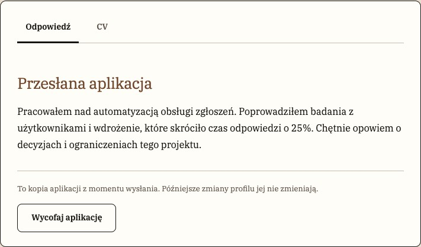

[E23](evidence/E23.jpg) · Arkusz odpowiedzi i zakładki · z [S25](evidence/S25.jpg)

### 1. Cel i wybór

[P] Porządkuje odpowiedź, dokument CV i kontekst jednej aplikacji. [R] Użyj zakładek dla alternatywnych widoków tego samego rekordu, nie dla kroków wysyłania formularza.

### 2. Anatomia

| Część                   | Obecność      | Znaczenie                                    |
| ----------------------- | ------------- | -------------------------------------------- |
| Kontener                | Stały         | Jasny arkusz z obrysem.                      |
| Tablist                 | Stały         | „Odpowiedź” / „CV” z aktywnym podkreśleniem. |
| Panel                   | Jeden aktywny | Treść, objaśnienie kopii, lokalne akcje.     |
| Potwierdzenie wycofania | Warunkowe     | Fragment inline pod treścią.                 |

### 3. Warianty, rozmiary i stany

| Oś        | Wartości / kombinacja      | Różnica                                 | Dowód / granica                                       |
| --------- | -------------------------- | --------------------------------------- | ----------------------------------------------------- |
| Panel     | Odpowiedź / CV             | Tekst kandydata / załącznik [C23](#C23) | [P] [S25](evidence/S25.jpg)–[S26](evidence/S26.jpg).  |
| Rola      | Kandydat / pracodawca      | Wycofanie / notatka i etap              | [P] [S25](evidence/S25.jpg), [S38](evidence/S38.jpg). |
| Wycofanie | Spoczynek / pytanie inline | Zwykły przycisk / potwierdź i anuluj    | [P] [S27](evidence/S27.jpg); nie modal.               |

### 4. Właściwości

[R] Model do konfiguracji projektu, nie deklaracja gotowego API lub komponentu Figma.

| Właściwość     | Typ / pochodzenie   | Wartości                 | Domyślność            | Zależność                                 |
| -------------- | ------------------- | ------------------------ | --------------------- | ----------------------------------------- |
| Aktywna sekcja | enum [[A03](#A03)]  | Pierwsza / CV            | Pierwsza przy wejściu | Base UI Tabs, activateOnFocus.            |
| Odpowiedź      | tekst [[A04](#A04)] | Kopia z momentu wysłania | Z rekordu             | Późniejszy profil jej nie zmienia.        |
| Akcje          | zależne od roli [R] | Wycofaj / zmień etap     | Zależne od stanu      | Nie mieszaj uprawnień w modelu wizualnym. |

### 5. Tokeny i style

| Token [A01]    | Deklaracja           | Rozwiązana wartość |
| -------------- | -------------------- | ------------------ |
| --gui-surface  | var(--gui-neutral-2) | #fffdf8            |
| --gui-edge     | #171411              | #171411            |
| --gui-line     | #c5bdb1              | #c5bdb1            |
| --gui-brand    | #71472e              | #71472e            |
| --gui-radius-m | 10px                 | 10px               |

[P] Udokumentowany tryb: jasny. Brak źródła wizualnego dla dark/high contrast jako osobnych wariantów. Konkretne użycie koloru zależy od części opisanych powyżej.

### 6. Wymiary, odstępy i układ

| Element  | Kontekst  | Reguła                                                   | Pochodzenie    |
| -------- | --------- | -------------------------------------------------------- | -------------- |
| Arkusz   | Desktop   | Padding 24px 28px; border 1px; radius 10px               | [[A05](#A05)]. |
| Zakładka | Kontrolka | Min-height 46px; padding 8px 14px 14px; podkreślenie 3px | [[A05](#A05)]. |
| Czytanie | Panel     | 30px pionowo, tekst 16px / 1.75                          | [[A05](#A05)]. |

[[A02](#A02)] Próbka z [S25](evidence/S25.jpg), selektor roli „sheet”: 710.78×415.98 CSS px; padding 24px 28px; gap normal; radius 10px. Nie jest to limit wszystkich wariantów tej rodziny.

### 7. Typografia

[[A05](#A05)] Treść 16px, śródtytuły 26px w brązie. Widoczne zakładki serif i większa waga aktywnej; struktura ma także ukryty H2 [[A03](#A03)].

### 8. Zachowanie i treść

[[A03](#A03),[A04](#A04)] Zakładki aktywują panel przy focusie. Wycofanie rozwija potwierdzenie wewnątrz arkusza i dopiero druga akcja zmienia proces. Kontrolki CV są tylko w panelu CV.

[R/T] Zachowaj polskie znaki i pełne znaczenie etykiet; sprawdź dłuższy tekst oraz zawijanie. Dodatkowe języki i RTL nie są potwierdzonymi wariantami.

### 9. Używaj / unikaj

| Używaj                                      | Unikaj                            | Powód                                       |
| ------------------------------------------- | --------------------------------- | ------------------------------------------- |
| Jeden panel do czytania naraz               | Treść CV pod zakładką Odpowiedź   | [R] Etykieta musi odpowiadać zawartości.    |
| Potwierdzenie inline w tym samym kontekście | Opisywanie go jako okna modalnego | [P/R] Mechanizm i wymagania focusu są inne. |

### 10. Dostępność

| Obszar       | Wymaganie / dowód / test                                                                                                       |
| ------------ | ------------------------------------------------------------------------------------------------------------------------------ |
| Zakładki     | [[A03](#A03)/T] Base UI; sprawdź role, selected, powiązanie tab/panel, strzałki i kolejność według APG Tabs ([A11-Z](#A11-Z)). |
| Zmiana stanu | [T] Focus i komunikat po wycofaniu, czytanie nagłówków ([A11-K](#A11-K), [A11-B](#A11-B)).                                     |

### 11. Źródła i pytania

Źródła bieżące: [S25](evidence/S25.jpg), [S26](evidence/S26.jpg), [S27](evidence/S27.jpg), [S38](evidence/S38.jpg), [S40](evidence/S40.jpg); wycinek [E23](evidence/E23.jpg) pochodzi z [S25](evidence/S25.jpg). Adnotacje [A01](#A01)–[A06](#A06) są pomocnicze; nie rozszerzają automatycznie wizualnej macierzy stanów.

[?] Nie ma pełnej planszy wszystkich etapów × rola × zakładka × dostępne akcje.

## C23 · Załącznik CV i podgląd

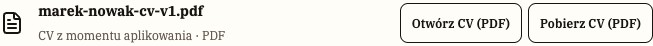

[E26](evidence/E26.jpg) · Załącznik CV i akcje · z [S26](evidence/S26.jpg)

### 1. Cel i wybór

[P] Przedstawia przygotowany lokalny dokument CV i umożliwia jego podgląd. [R] Nazwa pliku, typ i akcja powinny pozostać czytelne bez zaglądania do dokumentu.

### 2. Anatomia

| Część   | Obecność              | Znaczenie                                                                                                                |
| ------- | --------------------- | ------------------------------------------------------------------------------------------------------------------------ |
| Plik    | Stały, jeśli istnieje | Ikona, nazwa i informacja o załączniku.                                                                                  |
| Akcje   | Zależne od kontekstu  | Otwarcie w nowej karcie i pobranie.                                                                                      |
| Podgląd | Warunkowy             | Obszar iframe PDF; [S26](evidence/S26.jpg) pokazuje kontener przed wczytaniem, [S27](evidence/S27.jpg) także stronę PDF. |

### 3. Warianty, rozmiary i stany

| Oś       | Wartości / kombinacja          | Różnica                                 | Dowód / granica                                                   |
| -------- | ------------------------------ | --------------------------------------- | ----------------------------------------------------------------- |
| Kontekst | Aplikowanie / przesłany rekord | CV z profilu / CV z momentu aplikowania | [P] [S28](evidence/S28.jpg), [S26](evidence/S26.jpg).             |
| Dane     | Plik obecny                    | Syntetyczny lokalny PDF                 | [P] [S26](evidence/S26.jpg); brak i błąd nie mają pełnej planszy. |

### 4. Właściwości

[R] Model do konfiguracji projektu, nie deklaracja gotowego API lub komponentu Figma.

| Właściwość | Typ / pochodzenie    | Wartości                                 | Domyślność              | Zależność                                             |
| ---------- | -------------------- | ---------------------------------------- | ----------------------- | ----------------------------------------------------- |
| Plik       | obiekt [[A04](#A04)] | Wersjonowany PDF albo zachowana treść CV | Zależny od danych osoby | Tylko syntetyczne materiały.                          |
| Podgląd    | stan [R]             | Otwarty / zamknięty                      | Zależny od akcji        | Nie jest zakładką Odpowiedź.                          |
| Dostępność | stan [R]             | Plik obecny lub brak                     | Z danych                | Nie pokazuj aktywnego pobrania nieistniejącego pliku. |

### 5. Tokeny i style

| Token [A01]    | Deklaracja            | Rozwiązana wartość |
| -------------- | --------------------- | ------------------ |
| --gui-surface  | var(--gui-neutral-2)  | #fffdf8            |
| --gui-line     | #c5bdb1               | #c5bdb1            |
| --gui-text     | var(--gui-neutral-10) | #171411            |
| --gui-radius-s | 8px                   | 8px                |

[P] Udokumentowany tryb: jasny. Brak źródła wizualnego dla dark/high contrast jako osobnych wariantów. Konkretne użycie koloru zależy od części opisanych powyżej.

### 6. Wymiary, odstępy i układ

| Element     | Kontekst          | Reguła                                         | Pochodzenie                  |
| ----------- | ----------------- | ---------------------------------------------- | ---------------------------- |
| Wiersz      | CV                | Ikona i nazwa z akcjami                        | [P] [E26](evidence/E26.jpg). |
| Szerokość   | Arkusz            | W granicach panelu [C22](#C22)                 | [P] [S26](evidence/S26.jpg). |
| Długa nazwa | Przypadek skrajny | Zawijanie lub czytelne skrócenie z pełną nazwą | [R/T] Brak próbki.           |

[[A02](#A02)] Próbka z [S26](evidence/S26.jpg), selektor roli „cv”: 652.78×45 CSS px; padding 0px; gap 14px; radius 0px. Nie jest to limit wszystkich wariantów tej rodziny.

### 7. Typografia

[P] Serif w chrome podglądu. Wnętrze dostarczonego PDF nie ustala typografii systemu.

### 8. Zachowanie i treść

[[A04](#A04)] Przygotowane PDF są niemutowalnymi zasobami scenariusza. Importowane CV o innej treści jest pokazywane jako zachowany tekst, bez podszywania się pod PDF. Podgląd zależy od przeglądarki. [P] [S26](evidence/S26.jpg) pokazuje kontener i akcje, a [S27](evidence/S27.jpg) wczytany PDF; typografia PDF nie jest typografią interfejsu.

[R/T] Zachowaj polskie znaki i pełne znaczenie etykiet; sprawdź dłuższy tekst oraz zawijanie. Dodatkowe języki i RTL nie są potwierdzonymi wariantami.

### 9. Używaj / unikaj

| Używaj                      | Unikaj                                  | Powód                                                       |
| --------------------------- | --------------------------------------- | ----------------------------------------------------------- |
| Nazwa pliku + jawna akcja   | Sama ikona dokumentu                    | [R] Wiadomo, co zostanie otwarte.                           |
| Zachowaj dostęp do pobrania | Poleganie tylko na osadzonym podglądzie | [R] Alternatywa dla przeglądarki i technologii asystującej. |

### 10. Dostępność

| Obszar    | Wymaganie / dowód / test                                                                    |
| --------- | ------------------------------------------------------------------------------------------- |
| Dokument  | [R/T] Nazwy akcji, informacja o nowej karcie i tytuł podglądu ([A11-N](#A11-N)).            |
| Treść PDF | [T] Dostępność samego pliku jest oddzielnym zadaniem; screenshot nie dowodzi tagowania PDF. |

### 11. Źródła i pytania

Źródła bieżące: [S26](evidence/S26.jpg), [S27](evidence/S27.jpg), [S28](evidence/S28.jpg); wycinek [E26](evidence/E26.jpg) pochodzi z [S26](evidence/S26.jpg). Adnotacje [A01](#A01)–[A06](#A06) są pomocnicze; nie rozszerzają automatycznie wizualnej macierzy stanów.

[?] Brak plansz długiej nazwy, wariantu tekstowego i uszkodzonego PDF. Nie udokumentowano kontrolki uploadu, bo nie należy do tej kompozycji.

## C24 · Historia i podsumowanie procesu

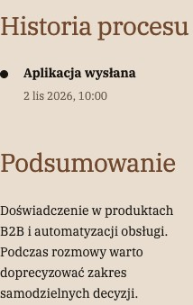

[E25](evidence/E25.jpg) · Historia procesu · z [S25](evidence/S25.jpg)

### 1. Cel i wybór

[P] Pokazuje zdarzenia oraz podsumowanie aplikacji. [R] To historia faktów, a nie dekoracyjny progress bar ani gwarancja terminu odpowiedzi.

### 2. Anatomia

| Część         | Obecność        | Znaczenie                                |
| ------------- | --------------- | ---------------------------------------- |
| Podsumowanie  | Kontekst        | Etap w metadanych i podsumowanie.        |
| Lista zdarzeń | Stała           | Znacznik, nazwa, czas i ewentualny opis. |
| Notatka       | Zależna od roli | Wewnętrzna informacja rekrutera.         |

### 3. Warianty, rozmiary i stany

| Oś       | Wartości / kombinacja      | Różnica                            | Dowód / granica                                       |
| -------- | -------------------------- | ---------------------------------- | ----------------------------------------------------- |
| Historia | Wysłana / po zmianie etapu | Nowe zdarzenie po operacji         | [P] [S25](evidence/S25.jpg), [S39](evidence/S39.jpg). |
| Rola     | Kandydat / rekruter        | Różny zakres widocznych informacji | [[A04](#A04)], [S38](evidence/S38.jpg).               |

### 4. Właściwości

[R] Model do konfiguracji projektu, nie deklaracja gotowego API lub komponentu Figma.

| Właściwość   | Typ / pochodzenie   | Wartości                           | Domyślność | Zależność                              |
| ------------ | ------------------- | ---------------------------------- | ---------- | -------------------------------------- |
| Zdarzenia    | lista [[A04](#A04)] | Nazwa, czas, autor/kontekst        | Z procesu  | Nie zapisuj fikcyjnego sukcesu UI.     |
| Podsumowanie | tekst [[A04](#A04)] | Syntetyczna informacja o aplikacji | Z rekordu  | Nie jest obietnicą kolejnej czynności. |
| Notatka      | tekst [[A04](#A04)] | Rekruter dodaje przy zmianie etapu | Opcjonalna | Niewidoczna w widoku kandydata.        |

### 5. Tokeny i style

| Token [A01]                 | Deklaracja            | Rozwiązana wartość |
| --------------------------- | --------------------- | ------------------ |
| --gui-line                  | #c5bdb1               | #c5bdb1            |
| --gui-text                  | var(--gui-neutral-10) | #171411            |
| --gui-text-muted-accessible | var(--gui-neutral-8)  | #665a50            |
| --gui-brand                 | #71472e               | #71472e            |

[P] Udokumentowany tryb: jasny. Brak źródła wizualnego dla dark/high contrast jako osobnych wariantów. Konkretne użycie koloru zależy od części opisanych powyżej.

### 6. Wymiary, odstępy i układ

| Element       | Kontekst       | Reguła                       | Pochodzenie                  |
| ------------- | -------------- | ---------------------------- | ---------------------------- |
| Oś            | Pionowa        | Zdarzenia w kolejności       | [P] [E25](evidence/E25.jpg). |
| Długie treści | Opis / notatka | Zawijanie we własnym wierszu | [P] [S39](evidence/S39.jpg). |
| Daty          | Metadane       | Mniejsze od nazwy zdarzenia  | [P].                         |

[[A02](#A02)] Próbka z [S25](evidence/S25.jpg), selektor roli „timeline”: 213.22×72 CSS px; padding 0px; gap normal; radius 0px. Nie jest to limit wszystkich wariantów tej rodziny.

### 7. Typografia

[P] Serif, wyraźna nazwa zdarzenia i spokojniejsze metadane. Nie używaj małych jasnych dat jako jedynego wyróżnika kolejności.

### 8. Zachowanie i treść

[[A04](#A04)] Zmiana etapu dodaje wpis historii i może zawierać notatkę. Użytkownik nie edytuje tu przeszłych zdarzeń. Lista nie przedstawia pełnego procesu firmy produkcyjnej.

[R/T] Zachowaj polskie znaki i pełne znaczenie etykiet; sprawdź dłuższy tekst oraz zawijanie. Dodatkowe języki i RTL nie są potwierdzonymi wariantami.

### 9. Używaj / unikaj

| Używaj                                              | Unikaj                               | Powód                                  |
| --------------------------------------------------- | ------------------------------------ | -------------------------------------- |
| Zapisuj konkretną zmianę                            | Jedynie zmieniony kolor bez historii | [R] Zapewnia orientację.               |
| Oddziel notatkę prywatną od komunikatu do kandydata | Jednakowa widoczność całej osi       | [[A04](#A04)/R] Zakres zależy od roli. |

### 10. Dostępność

| Obszar       | Wymaganie / dowód / test                                                                      |
| ------------ | --------------------------------------------------------------------------------------------- |
| Chronologia  | [R/T] Semantyczna lista i czytelna kolejność, daty dostępne jako tekst ([A11-N](#A11-N)).     |
| Aktualizacja | [T] Po zmianie etapu ogłoszenie wyniku i focus przy akcji ([A11-B](#A11-B), [A11-K](#A11-K)). |

### 11. Źródła i pytania

Źródła bieżące: [S25](evidence/S25.jpg), [S38](evidence/S38.jpg), [S39](evidence/S39.jpg); wycinek [E25](evidence/E25.jpg) pochodzi z [S25](evidence/S25.jpg). Adnotacje [A01](#A01)–[A06](#A06) są pomocnicze; nie rozszerzają automatycznie wizualnej macierzy stanów.

[?] Brak planszy bardzo długiej historii i grupowania dat. Nie ustalono wzorca stref czasowych jako zasady systemu.

## C25 · Kontekst oferty przy aplikowaniu

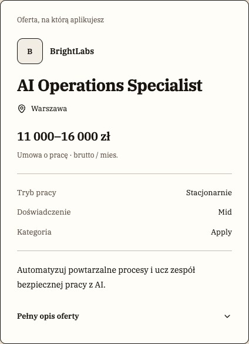

[E28](evidence/E28.jpg) · Kontekst oferty i rozwijany opis · z [S28](evidence/S28.jpg)

### 1. Cel i wybór

[P] Utrzymuje najważniejsze warunki roli obok formularza. [R] Ogranicza potrzebę opuszczania odpowiedzi, ale nie zastępuje pełnego opisu oferty.

### 2. Anatomia

| Część              | Obecność              | Znaczenie                                    |
| ------------------ | --------------------- | -------------------------------------------- |
| Nagłówek           | Stały                 | Stanowisko i firma.                          |
| Fakty              | Z danych              | Warunki, lokalizacja, wynagrodzenie.         |
| Rozwinięcie / link | Zależne od kompozycji | Pełniejszy kontekst lub przejście do oferty. |

### 3. Warianty, rozmiary i stany

| Oś          | Wartości / kombinacja | Różnica                                       | Dowód / granica                                                      |
| ----------- | --------------------- | --------------------------------------------- | -------------------------------------------------------------------- |
| Szerokość   | Desktop / mobile      | Panel obok / skompresowany blok w toku strony | [P] [S28](evidence/S28.jpg), [S31](evidence/S31.jpg).                |
| Rozwinięcie | Zamknięte / otwarte   | Dodatkowy opis                                | [[A03](#A03),[A04](#A04)]; pełna para stanów nie ma osobnych kadrów. |

### 4. Właściwości

[R] Model do konfiguracji projektu, nie deklaracja gotowego API lub komponentu Figma.

| Właściwość   | Typ / pochodzenie     | Wartości              | Domyślność                 | Zależność                               |
| ------------ | --------------------- | --------------------- | -------------------------- | --------------------------------------- |
| Oferta       | dane [R]              | Tytuł, firma, warunki | Z wybranej oferty          | Nie zastępuj inną treścią marketingową. |
| Rozwinięcie  | boolean [[A03](#A03)] | Dwa stany             | Według lokalnej kompozycji | Nie traktuj jako zakładki.              |
| Pełna oferta | adres [R]             | Powiązany szczegół    | Z identyfikatora           | Zachowaj kontekst formularza.           |

### 5. Tokeny i style

| Token [A01]         | Deklaracja           | Rozwiązana wartość |
| ------------------- | -------------------- | ------------------ |
| --gui-surface       | var(--gui-neutral-2) | #fffdf8            |
| --gui-surface-muted | var(--gui-neutral-3) | #f2ede4            |
| --gui-line          | #c5bdb1              | #c5bdb1            |
| --gui-brand         | #71472e              | #71472e            |

[P] Udokumentowany tryb: jasny. Brak źródła wizualnego dla dark/high contrast jako osobnych wariantów. Konkretne użycie koloru zależy od części opisanych powyżej.

### 6. Wymiary, odstępy i układ

| Element | Kontekst   | Reguła                           | Pochodzenie                                                      |
| ------- | ---------- | -------------------------------- | ---------------------------------------------------------------- |
| Desktop | Kompozycja | Kontekst obok formularza         | [P] [S28](evidence/S28.jpg).                                     |
| Mobile  | Przepływ   | Jedna kolumna                    | [P] [S31](evidence/S31.jpg).                                     |
| Gęstość | Warunki    | Krótkie grupy faktów z odstępami | [P] [E28](evidence/E28.jpg); nie kopiuj całego detalu do panelu. |

### 7. Typografia

[P] Serif; tytuł i nazwy warunków tworzą hierarchię, szczegóły spokojniejsze niż pytanie formularza.

### 8. Zachowanie i treść

[[A03](#A03),[A04](#A04)] Disclosure ujawnia dodatkowe treści, nie wysyła formularza. [R/T] Przejście do pełnej oferty powinno zachowywać bezpieczny kontekst szkicu; sprawdzić konkretną ścieżkę.

[R/T] Zachowaj polskie znaki i pełne znaczenie etykiet; sprawdź dłuższy tekst oraz zawijanie. Dodatkowe języki i RTL nie są potwierdzonymi wariantami.

### 9. Używaj / unikaj

| Używaj                                | Unikaj                                | Powód                                      |
| ------------------------------------- | ------------------------------------- | ------------------------------------------ |
| Najważniejsze fakty blisko odpowiedzi | Długi opis wypychający cały formularz | [R] Priorytetem jest ukończenie aplikacji. |
| Nazwane rozwinięcie                   | Niepodpisany chevron                  | [R] Odbiorca zna skutek.                   |

### 10. Dostępność

| Obszar     | Wymaganie / dowód / test                                                                             |
| ---------- | ---------------------------------------------------------------------------------------------------- |
| Disclosure | [R/T] Nazwa, expanded i powiązanie obszaru; aktywacja klawiaturą ([A11-N](#A11-N), [A11-K](#A11-K)). |
| Czytanie   | [T] Kolejność w jednej kolumnie i brak zasłaniania focusu ([A11-R](#A11-R)).                         |

### 11. Źródła i pytania

Źródła bieżące: [S28](evidence/S28.jpg), [S31](evidence/S31.jpg); wycinek [E28](evidence/E28.jpg) pochodzi z [S28](evidence/S28.jpg). Adnotacje [A01](#A01)–[A06](#A06) są pomocnicze; nie rozszerzają automatycznie wizualnej macierzy stanów.

[?] Brak pełnej planszy otwarte/zamknięte dla obu szerokości i stresowego tytułu w tym kontekście.

## C26 · Pusty wynik, brak rekordu i błąd trasy

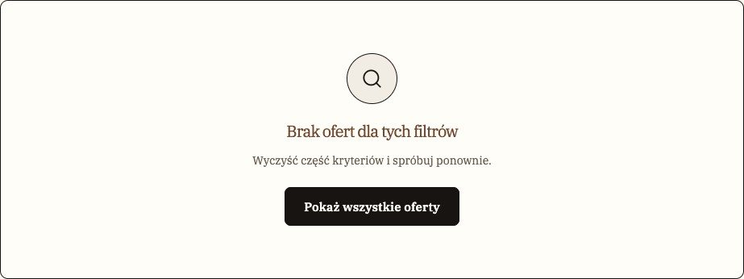

[E16](evidence/E16.jpg) · Pusty wynik i akcja odzyskania · z [S14](evidence/S14.jpg)

### 1. Cel i wybór

[P] Wyjaśnia brak treści i umożliwia odzyskanie drogi. [R] Rozróżniaj pustą kolekcję, brak wyniku filtra oraz nieistniejący rekord.

### 2. Anatomia

| Część        | Obecność            | Znaczenie                                |
| ------------ | ------------------- | ---------------------------------------- |
| Nagłówek     | Stały               | Nazwa sytuacji.                          |
| Wyjaśnienie  | Stałe w przykładach | Powód lub kontekst braku.                |
| Dalsza droga | Zależna od sytuacji | Wyczyść filtr / wróć / przejrzyj oferty. |

### 3. Warianty, rozmiary i stany

| Oś        | Wartości / kombinacja                       | Różnica                 | Dowód / granica                                                                |
| --------- | ------------------------------------------- | ----------------------- | ------------------------------------------------------------------------------ |
| Przyczyna | Brak wyników / zapisanych / nieznana oferta | Inny komunikat i powrót | [P] [S14](evidence/S14.jpg), [S20](evidence/S20.jpg), [S15](evidence/S15.jpg). |
| Stan      | Stabilny                                    | Nie loading skeleton    | [P] Brak wizualnej planszy ładowania.                                          |

### 4. Właściwości

[R] Model do konfiguracji projektu, nie deklaracja gotowego API lub komponentu Figma.

| Właściwość | Typ / pochodzenie | Wartości                         | Domyślność        | Zależność                                 |
| ---------- | ----------------- | -------------------------------- | ----------------- | ----------------------------------------- |
| Powód      | enum [R]          | Pusta lista, filtr, brak rekordu | Z danych i trasy  | Nie łącz wszystkich w „błąd”.             |
| Komunikat  | tekst [R]         | Istniejące copy                  | Zależny od powodu | Bez obwiniania osoby.                     |
| Akcja      | link/przycisk [R] | Następny sensowny krok           | Zależny od stanu  | Nie prowadzi do tego samego pustego celu. |

### 5. Tokeny i style

| Token [A01]   | Deklaracja            | Rozwiązana wartość |
| ------------- | --------------------- | ------------------ |
| --gui-text    | var(--gui-neutral-10) | #171411            |
| --gui-brand   | #71472e               | #71472e            |
| --gui-surface | var(--gui-neutral-2)  | #fffdf8            |
| --gui-line    | #c5bdb1               | #c5bdb1            |

[P] Udokumentowany tryb: jasny. Brak źródła wizualnego dla dark/high contrast jako osobnych wariantów. Konkretne użycie koloru zależy od części opisanych powyżej.

### 6. Wymiary, odstępy i układ

| Element        | Kontekst  | Reguła                       | Pochodzenie                  |
| -------------- | --------- | ---------------------------- | ---------------------------- |
| Pusta lista    | Listing   | Blok w obszarze wyników      | [P] [S14](evidence/S14.jpg). |
| Puste zapisane | Workspace | Treść w miejscu kolekcji     | [P] [S20](evidence/S20.jpg). |
| Brak oferty    | Trasa     | Osobny komunikat kontekstowy | [P] [S15](evidence/S15.jpg). |

[[A02](#A02)] Próbka z [S20](evidence/S20.jpg), selektor roli „panel”: 956×133 CSS px; padding 24px; gap normal; radius 10px. Nie jest to limit wszystkich wariantów tej rodziny.

### 7. Typografia

[P] Serif; nagłówek i opis zachowują hierarchię strony. Nie jest to czerwony alert walidacyjny.

### 8. Zachowanie i treść

[[A04](#A04)] Filtry mogą zwrócić zero ofert. Nieznany identyfikator pokazuje brak rekordu; kolekcja zapisanych bez elementów pokazuje swój pusty stan. Te przyczyny nie są wymienne.

[R/T] Zachowaj polskie znaki i pełne znaczenie etykiet; sprawdź dłuższy tekst oraz zawijanie. Dodatkowe języki i RTL nie są potwierdzonymi wariantami.

### 9. Używaj / unikaj

| Używaj                         | Unikaj                           | Powód                         |
| ------------------------------ | -------------------------------- | ----------------------------- |
| Powiedz, co można zrobić       | Martwy koniec „Brak”             | [R] Ułatwia odzyskanie drogi. |
| Oddziel brak wyników od awarii | Czerwony alarm przy zwykłym zero | [R] Ton odpowiada sytuacji.   |

### 10. Dostępność

| Obszar    | Wymaganie / dowód / test                                                                                  |
| --------- | --------------------------------------------------------------------------------------------------------- |
| Komunikat | [R/T] Nagłówek, czytelna akcja i programowo zauważalna zmiana wyników ([A11-N](#A11-N), [A11-B](#A11-B)). |
| Focus     | [T] Po filtrze focus nie powinien znikać lub trafiać do nieistniejącego elementu ([A11-K](#A11-K)).       |

### 11. Źródła i pytania

Źródła bieżące: [S14](evidence/S14.jpg), [S15](evidence/S15.jpg), [S20](evidence/S20.jpg); wycinek [E16](evidence/E16.jpg) pochodzi z [S14](evidence/S14.jpg). Adnotacje [A01](#A01)–[A06](#A06) są pomocnicze; nie rozszerzają automatycznie wizualnej macierzy stanów.

[?] Nie projektowano wspólnej planszy offline, błędu serwera i ponowienia sieciowego.

## C27 · Okno modalne i potwierdzenie

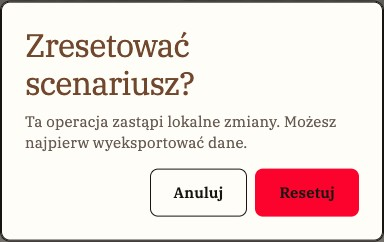

[E32](evidence/E32.jpg) · Alert dialog i akcja destrukcyjna · z [S33](evidence/S33.jpg)

### 1. Cel i wybór

[P] Oddziela zadanie wymagające chwilowego skupienia: mobilne filtry albo reset danych. [R] Używaj alertu potwierdzenia, gdy operacja ma istotny skutek; zwykłe wycofanie w rekordzie jest inline [C22](#C22).

### 2. Anatomia

| Część                  | Obecność        | Znaczenie                                        |
| ---------------------- | --------------- | ------------------------------------------------ |
| Warstwa / powierzchnia | Stała           | Backdrop i jasny panel.                          |
| Tytuł i opis           | Stałe           | Cel okna i skutek.                               |
| Akcje                  | Zależne od typu | Anuluj / Resetuj albo zamknięcie / pokaż wyniki. |

### 3. Warianty, rozmiary i stany

| Oś          | Wartości / kombinacja                    | Różnica                              | Dowód / granica                                                   |
| ----------- | ---------------------------------------- | ------------------------------------ | ----------------------------------------------------------------- |
| Typ         | Dialog filtrów / AlertDialog resetu      | Eksploracja / destrukcja             | [P] [S05](evidence/S05.jpg), [S33](evidence/S33.jpg).             |
| Szerokość   | Mobile / desktop                         | Duży panel filtrów / centralny alert | [P].                                                              |
| Wykluczenie | Potwierdzenie wycofania / menu workspace | Nie są modalami                      | [P/[A04](#A04)] [S27](evidence/S27.jpg), [S17](evidence/S17.jpg). |

### 4. Właściwości

[R] Model do konfiguracji projektu, nie deklaracja gotowego API lub komponentu Figma.

| Właściwość         | Typ / pochodzenie     | Wartości       | Domyślność               | Zależność                            |
| ------------------ | --------------------- | -------------- | ------------------------ | ------------------------------------ |
| Otwarcie           | boolean [[A03](#A03)] | Dwa stany      | Zamknięte do akcji       | Kontrolowane przez lokalny kontekst. |
| Tytuł / opis       | tekst [R]             | Filtry / reset | Zależne od zadania       | Nie pomijaj skutku resetu.           |
| Akcja destrukcyjna | obecność [R]          | Resetuj        | Tylko AlertDialog resetu | Czerwony wariant [C01](#C01).        |

### 5. Tokeny i style

| Token [A01]    | Deklaracja           | Rozwiązana wartość |
| -------------- | -------------------- | ------------------ |
| --gui-backdrop | #17141199            | #17141199          |
| --gui-surface  | var(--gui-neutral-2) | #fffdf8            |
| --gui-radius-m | 10px                 | 10px               |
| --gui-danger   | var(--gui-error)     | #fc032d            |

[P] Udokumentowany tryb: jasny. Brak źródła wizualnego dla dark/high contrast jako osobnych wariantów. Konkretne użycie koloru zależy od części opisanych powyżej.

### 6. Wymiary, odstępy i układ

| Element | Kontekst    | Reguła                                                     | Pochodzenie                               |
| ------- | ----------- | ---------------------------------------------------------- | ----------------------------------------- |
| Filtry  | Mobile      | Wypełniony dostępny ekran, przewijana treść i akcja u dołu | [P] [S05](evidence/S05.jpg).              |
| Reset   | Desktop     | Centralne okno                                             | [P] [S33](evidence/S33.jpg).              |
| Zasięg  | Wąski ekran | Odstęp od krawędzi i dostępne akcje                        | [R/T] Alert mobile nie ma osobnego kadru. |

[[A02](#A02)] Próbka z [S33](evidence/S33.jpg), selektor roli „dialog”: 384×240.78 CSS px; padding 24px; gap 12px; radius 10px. Nie jest to limit wszystkich wariantów tej rodziny.

### 7. Typografia

[P] Serif, brązowy tytuł, wyraźne przyciski. Tytuł modalny nie zmienia hierarchii tytułu strony pod spodem.

### 8. Zachowanie i treść

[[A03](#A03)] Base UI Dialog/AlertDialog zarządza interakcją modalną. [[A04](#A04)] Reset po potwierdzeniu przywraca lokalną próbkę. Filtry zmieniają wynik od razu, dolny przycisk zamyka panel, nie dopiero zatwierdza warunki.

[R/T] Zachowaj polskie znaki i pełne znaczenie etykiet; sprawdź dłuższy tekst oraz zawijanie. Dodatkowe języki i RTL nie są potwierdzonymi wariantami.

### 9. Używaj / unikaj

| Używaj                               | Unikaj                              | Powód                                |
| ------------------------------------ | ----------------------------------- | ------------------------------------ |
| Opisz skutek i daj anulowanie        | Samo „Czy na pewno?” bez przedmiotu | [R] Decyzja wymaga konkretu.         |
| Zachowaj odrębny przycisk zamknięcia | Zamknięcie tylko kliknięciem w tło  | [R] Dostępne dla klawiatury i touch. |

### 10. Dostępność

| Obszar     | Wymaganie / dowód / test                                                                                                                           |
| ---------- | -------------------------------------------------------------------------------------------------------------------------------------------------- |
| Modal      | [[A03](#A03)/T] Sprawdź focus początkowy, ograniczenie do okna, Escape stosownie do typu, inert tła i powrót do wyzwalacza (APG, [A11-M](#A11-M)). |
| Destrukcja | [R/T] Kontrast etykiety czerwonego przycisku i bezpieczny wybór początkowy; samo użycie biblioteki nie dowodzi zgodności ([A11-C](#A11-C)).        |

### 11. Źródła i pytania

Źródła bieżące: [S05](evidence/S05.jpg), [S06](evidence/S06.jpg), [S33](evidence/S33.jpg); wycinek [E32](evidence/E32.jpg) pochodzi z [S33](evidence/S33.jpg). Adnotacje [A01](#A01)–[A06](#A06) są pomocnicze; nie rozszerzają automatycznie wizualnej macierzy stanów.

[?] Brak kompletnej macierzy viewport × typ × focus; nie potwierdzono VoiceOver/NVDA.

## C28 · Pomoc, walidacja i odzyskiwanie danych

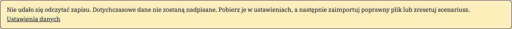

[E37](evidence/E37.jpg) · Komunikat statusu i odzyskiwanie · z [S44](evidence/S44.jpg)

### 1. Cel i wybór

[P] Informuje o wyniku operacji lub koniecznej poprawce. [R] Rozróżniaj lokalny błąd pola, potwierdzenie zapisu i globalne odzyskanie danych.

### 2. Anatomia

| Część         | Obecność        | Znaczenie                                          |
| ------------- | --------------- | -------------------------------------------------- |
| Komunikat     | Stały           | Znaczący tekst, nie tylko kolor.                   |
| Powiązanie    | Zależne od typu | Obok pola albo w zauważalnym miejscu strony.       |
| Akcja / pomoc | Opcjonalna      | Co poprawić lub jak odzyskać kontrolę nad zapisem. |

### 3. Warianty, rozmiary i stany

| Oś        | Wartości / kombinacja                                        | Różnica                  | Dowód / granica                                                                                         |
| --------- | ------------------------------------------------------------ | ------------------------ | ------------------------------------------------------------------------------------------------------- |
| Przyczyna | Błąd odpowiedzi / szkic zapisany / etap zmieniony / recovery | Lokalne i globalne       | [P] [S29](evidence/S29.jpg), [S30](evidence/S30.jpg), [S39](evidence/S39.jpg), [S44](evidence/S44.jpg). |
| Forma     | Tekst przy polu / notice                                     | Inna hierarchia i zasięg | [P].                                                                                                    |

### 4. Właściwości

[R] Model do konfiguracji projektu, nie deklaracja gotowego API lub komponentu Figma.

| Właściwość      | Typ / pochodzenie           | Wartości                                 | Domyślność          | Zależność                              |
| --------------- | --------------------------- | ---------------------------------------- | ------------------- | -------------------------------------- |
| Typ             | enum [R]                    | Błąd, informacja, powodzenie, odzyskanie | Z operacji          | Nie wyznaczaj znaczenia samym kolorem. |
| Treść           | tekst [R]                   | Istniejące objaśnienie                   | Zależne od sytuacji | Nie ujawnia prywatnego free text.      |
| Związek z polem | identyfikator [[A04](#A04)] | Pomoc i error odpowiedzi                 | Tylko lokalny błąd  | aria-describedby / invalid.            |

### 5. Tokeny i style

| Token [A01]             | Deklaracja            | Rozwiązana wartość |
| ----------------------- | --------------------- | ------------------ |
| --gui-error             | #fc032d               | #fc032d            |
| --gui-error-transparent | #fc032d33             | #fc032d33          |
| --gui-success           | #00906c               | #00906c            |
| --gui-line              | #c5bdb1               | #c5bdb1            |
| --gui-text              | var(--gui-neutral-10) | #171411            |

[P] Udokumentowany tryb: jasny. Brak źródła wizualnego dla dark/high contrast jako osobnych wariantów. Konkretne użycie koloru zależy od części opisanych powyżej.

### 6. Wymiary, odstępy i układ

| Element           | Kontekst        | Reguła                                | Pochodzenie                  |
| ----------------- | --------------- | ------------------------------------- | ---------------------------- |
| Błąd              | Pod odpowiedzią | Blisko miejsca poprawy                | [P] [S29](evidence/S29.jpg). |
| Recovery          | Początek strony | Widoczna informacja o lokalnym stanie | [P] [S44](evidence/S44.jpg). |
| Długie komunikaty | Zawijanie       | Bez stałej wysokości                  | [R/T] Sprawdź reflow.        |

[[A02](#A02)] Próbka z [S44](evidence/S44.jpg), selektor roli „panel”: 850×294.39 CSS px; padding 28px; gap 16px; radius 10px. Nie jest to limit wszystkich wariantów tej rodziny.

### 7. Typografia

[P] Serif; komunikaty mniejsze od tytułów, nadal czytelne. Kolor czerwony jest dodatkowym sygnałem, nie zamiennikiem opisu.

### 8. Zachowanie i treść

[[A04](#A04)] Szkic można zapisać bez zgody; błędna odpowiedź nie znika. Niepoprawny lokalny zapis nie jest nadpisywany; notice kieruje do eksportu, poprawnego importu albo resetu. [S44](evidence/S44.jpg) powstał przez odizolowany, celowo niepoprawny stan testowy.

[R/T] Zachowaj polskie znaki i pełne znaczenie etykiet; sprawdź dłuższy tekst oraz zawijanie. Dodatkowe języki i RTL nie są potwierdzonymi wariantami.

### 9. Używaj / unikaj

| Używaj                                      | Unikaj                             | Powód                                 |
| ------------------------------------------- | ---------------------------------- | ------------------------------------- |
| „Odpowiedź jest za krótka” + wymóg          | Sam czerwony obrys                 | [R] Wiadomo, jak poprawić.            |
| Potwierdzenie zgodne z rzeczywistą operacją | „Zapisano”, gdy zapis nie nastąpił | [R] Komunikat jest częścią kontraktu. |

### 10. Dostępność

| Obszar | Wymaganie / dowód / test                                                                                                |
| ------ | ----------------------------------------------------------------------------------------------------------------------- |
| Błędy  | [[A04](#A04)/T] Powiązanie i focus po walidacji; kryteria 3.3.1–3.3.3 ([A11-B](#A11-B)).                                |
| Status | [R/T] Ważny wynik bez przejęcia focusu ogłaszaj adekwatną live region/status; brak audytu czytnikiem ([A11-B](#A11-B)). |

### 11. Źródła i pytania

Źródła bieżące: [S29](evidence/S29.jpg), [S30](evidence/S30.jpg), [S39](evidence/S39.jpg), [S44](evidence/S44.jpg); wycinek [E37](evidence/E37.jpg) pochodzi z [S44](evidence/S44.jpg). Adnotacje [A01](#A01)–[A06](#A06) są pomocnicze; nie rozszerzają automatycznie wizualnej macierzy stanów.

[?] Bez pełnego katalogu błędów technicznych i czasu trwania każdego komunikatu. [T] Kontrast czerwonego drobnego tekstu wymaga szczególnej kontroli.

## C29 · Mapa lokalna

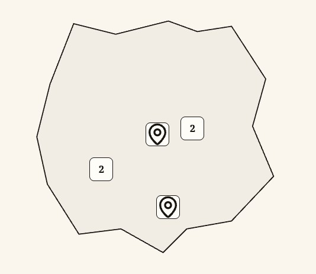

[E15](evidence/E15.jpg) · Mapa i znacznik · z [S13](evidence/S13.jpg)

### 1. Cel i wybór

[P] Daje alternatywny widok lokalizacji ofert. [R] Traktuj mapę jako uzupełnienie dostępnej listy, szczególnie dla osób korzystających z klawiatury.

### 2. Anatomia

| Część                  | Obecność  | Znaczenie                               |
| ---------------------- | --------- | --------------------------------------- |
| Widok mapy             | Stały     | Lokalny schemat bez zewnętrznych kafli. |
| Znacznik               | Dane      | Lokalizacja i liczba/kontekst.          |
| Przełącznik lista/mapa | Nawigacja | Widoczny nad wynikami.                  |

### 3. Warianty, rozmiary i stany

| Oś     | Wartości / kombinacja | Różnica             | Dowód / granica                                        |
| ------ | --------------------- | ------------------- | ------------------------------------------------------ |
| Widok  | Lista / mapa          | Ten sam zbiór ofert | [P] [S03](evidence/S03.jpg), [S13](evidence/S13.jpg).  |
| Zakres | Lokalny schemat       | Dane próbki         | [[A04](#A04)] Nie pełna mapa geograficzna usługodawcy. |

### 4. Właściwości

[R] Model do konfiguracji projektu, nie deklaracja gotowego API lub komponentu Figma.

| Właściwość    | Typ / pochodzenie  | Wartości              | Domyślność                     | Zależność                                 |
| ------------- | ------------------ | --------------------- | ------------------------------ | ----------------------------------------- |
| Tryb          | enum [[A04](#A04)] | Lista / mapa          | Lista bez parametru            | Stan adresu/kontekstu listingu.           |
| Punkty        | lista [R]          | Lokalizacje ofert     | Z danych                       | Nie dopisuj dokładnego adresu bez źródła. |
| Wybrany punkt | stan [R]           | Zależny od interakcji | Nie ustalono wzorca globalnego | Bez spekulacji o klastrach.               |

### 5. Tokeny i style

| Token [A01]         | Deklaracja           | Rozwiązana wartość |
| ------------------- | -------------------- | ------------------ |
| --gui-surface       | var(--gui-neutral-2) | #fffdf8            |
| --gui-surface-muted | var(--gui-neutral-3) | #f2ede4            |
| --gui-accent        | var(--gui-color-1)   | #f5cf49            |
| --gui-edge          | #171411              | #171411            |

[P] Udokumentowany tryb: jasny. Brak źródła wizualnego dla dark/high contrast jako osobnych wariantów. Konkretne użycie koloru zależy od części opisanych powyżej.

### 6. Wymiary, odstępy i układ

| Element   | Kontekst           | Reguła                            | Pochodzenie                  |
| --------- | ------------------ | --------------------------------- | ---------------------------- |
| Mapa      | W obszarze wyników | Zastępuje listę, nie cały serwis  | [P] [S13](evidence/S13.jpg). |
| Znaczniki | Schemat            | Odróżnione od tła                 | [P] [E15](evidence/E15.jpg). |
| Mobile    | Adaptacja          | Nie udokumentowano osobnym kadrem | [?].                         |

[[A02](#A02)] Próbka z [S13](evidence/S13.jpg), selektor roli „panel”: 373.48×462.38 CSS px; padding 24px; gap normal; radius 10px. Nie jest to limit wszystkich wariantów tej rodziny.

### 7. Typografia

[P] Etykiety mapy serif; mała informacja nie staje się nową skalą typografii dla zwykłej treści.

### 8. Zachowanie i treść

[[A04](#A04)] To lokalny demonstrator, nie mapowy provider; nie należy dokumentować nieistniejącego zoomu, geolokalizacji i wyszukiwania ulic.

[R/T] Zachowaj polskie znaki i pełne znaczenie etykiet; sprawdź dłuższy tekst oraz zawijanie. Dodatkowe języki i RTL nie są potwierdzonymi wariantami.

### 9. Używaj / unikaj

| Używaj                      | Unikaj                           | Powód                                          |
| --------------------------- | -------------------------------- | ---------------------------------------------- |
| Zapewnij alternatywę listy  | Mapa jako jedyna droga do oferty | [R] Lista ułatwia porównanie i dostęp.         |
| Nazwij zakres demonstratora | Obietnica precyzyjnej nawigacji  | [R] Schemat nie dowodzi dokładności adresowej. |

### 10. Dostępność

| Obszar      | Wymaganie / dowód / test                                                                           |
| ----------- | -------------------------------------------------------------------------------------------------- |
| Alternatywa | [R/T] Dostępna lista tych samych danych i nazwane cele punktów ([A11-N](#A11-N), [A11-K](#A11-K)). |
| Przestrzeń  | [R/T] Wyjątek reflow dla treści 2D nie zwalnia otaczających kontrolek i tekstu z [A11-R](#A11-R).  |

### 11. Źródła i pytania

Źródła bieżące: [S13](evidence/S13.jpg); wycinek [E15](evidence/E15.jpg) pochodzi z [S13](evidence/S13.jpg). Adnotacje [A01](#A01)–[A06](#A06) są pomocnicze; nie rozszerzają automatycznie wizualnej macierzy stanów.

[?] Brak wizualnego audytu mapy mobile, wielu nakładających się punktów i ich obsługi klawiaturą.

## C30 · Dłuższa treść: oferta i metodologia

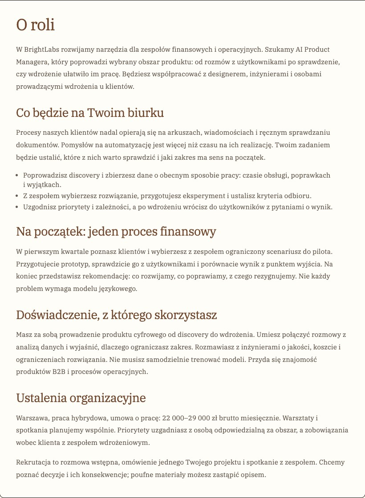

[E13](evidence/E13.jpg) · Sekcja długiego opisu · z [S08](evidence/S08.jpg)

### 1. Cel i wybór

[P] Ułatwia przeczytanie opisu roli, organizacji i sposobu działania serwisu. [R] Stosuj hierarchię akapitów, list i sekcji zamiast zamykania każdego fragmentu w osobnej karcie.

### 2. Anatomia

| Część            | Obecność          | Znaczenie                                                  |
| ---------------- | ----------------- | ---------------------------------------------------------- |
| Tytuł strony     | Stały             | Rola lub nazwa sekcji.                                     |
| Sekcje           | Z treści          | Brązowe nagłówki, akapity i listy.                         |
| Kontekst / akcje | Zależne od strony | Warunki oferty [C09](#C09) i [C25](#C25), linki nawigacji. |

### 3. Warianty, rozmiary i stany

| Oś            | Wartości / kombinacja        | Różnica                            | Dowód / granica                                                                                |
| ------------- | ---------------------------- | ---------------------------------- | ---------------------------------------------------------------------------------------------- |
| Typ dokumentu | Oferta / metodologia / firma | Różny układ treści                 | [P] [S08](evidence/S08.jpg), [S11](evidence/S11.jpg), [S10](evidence/S10.jpg).                 |
| Szerokość     | Desktop / mobile             | Mniejszy nagłówek i jeden przepływ | [P] [S08](evidence/S08.jpg)–[S09](evidence/S09.jpg); metodologia mobile nie ma osobnego kadru. |

### 4. Właściwości

[R] Model do konfiguracji projektu, nie deklaracja gotowego API lub komponentu Figma.

| Właściwość | Typ / pochodzenie   | Wartości                 | Domyślność      | Zależność                                         |
| ---------- | ------------------- | ------------------------ | --------------- | ------------------------------------------------- |
| Treść      | struktura [R]       | Nagłówki, akapity, listy | Istniejące copy | Bez autorskiego przepisywania podczas stylizacji. |
| Poziomy    | hierarchia [R]      | H1 i kolejne sekcje      | Z dokumentu     | Nie wybieraj tagu wyłącznie według rozmiaru.      |
| Kontekst   | blok opcjonalny [R] | Warunki, firma, powrót   | Zależny od typu | Pozostaje związany z dokumentem.                  |

### 5. Tokeny i style

| Token [A01]          | Deklaracja            | Rozwiązana wartość                                  |
| -------------------- | --------------------- | --------------------------------------------------- |
| --gui-font-editorial | var(--gui-font-brand) | "IBM Plex Serif", Georgia, "Times New Roman", serif |
| --gui-brand          | #71472e               | #71472e                                             |
| --gui-text           | var(--gui-neutral-10) | #171411                                             |
| --gui-line           | #c5bdb1               | #c5bdb1                                             |
| --gui-surface-shaded | #e8ddce               | #e8ddce                                             |

[P] Udokumentowany tryb: jasny. Brak źródła wizualnego dla dark/high contrast jako osobnych wariantów. Konkretne użycie koloru zależy od części opisanych powyżej.

### 6. Wymiary, odstępy i układ

| Element   | Kontekst                 | Reguła                            | Pochodzenie                                                              |
| --------- | ------------------------ | --------------------------------- | ------------------------------------------------------------------------ |
| Oferta H1 | Desktop / mobile         | 28px / 26px                       | [[A05](#A05)].                                                           |
| Sekcje    | Nagłówki dłuższej treści | Lokalne 32 / 27 / 26px            | [[A05](#A05)], zależne od kontekstu.                                     |
| Czytanie  | Kolumna                  | Oddech między akapitami i listami | [P] [E13](evidence/E13.jpg); brak zatwierdzonego limitu znaków na linię. |

[[A02](#A02)] Próbka z [S08](evidence/S08.jpg), selektor roli „reading”: 820×1114.88 CSS px; padding 34px 36px 38px; gap normal; radius 0px. Nie jest to limit wszystkich wariantów tej rodziny.

### 7. Typografia

[P] IBM Plex Serif również w czytanej treści. [[A05](#A05)] Dłuższe partie korzystają z większego line-height; nie wymuszaj wspólnego 15/21 na wszystkich tekstach.

### 8. Zachowanie i treść

[P] Treść statyczna z linkami, bez pokazanych interaktywnych edytorów formatowania. [R] Zmiana skali nie upoważnia do modyfikacji sensu opisu.

[R/T] Zachowaj polskie znaki i pełne znaczenie etykiet; sprawdź dłuższy tekst oraz zawijanie. Dodatkowe języki i RTL nie są potwierdzonymi wariantami.

### 9. Używaj / unikaj

| Używaj                           | Unikaj                                   | Powód                                        |
| -------------------------------- | ---------------------------------------- | -------------------------------------------- |
| Prawdziwe listy i spójne poziomy | Symulowane nagłówki pogrubionym akapitem | [R] Struktura wspiera skanowanie i czytniki. |
| Zachowaj copy                    | Nowy slogan w ramach zmiany fontu        | [R] Treść i styl mają oddzielne decyzje.     |

### 10. Dostępność

| Obszar       | Wymaganie / dowód / test                                                                |
| ------------ | --------------------------------------------------------------------------------------- |
| Czytanie     | [R/T] Hierarchia 1.3.1 A, kontrast i sensowne linki ([A11-N](#A11-N), [A11-C](#A11-C)). |
| Powiększenie | [T] 320px, zoom, nadpisane odstępy i długie słowa ([A11-R](#A11-R)).                    |

### 11. Źródła i pytania

Źródła bieżące: [S08](evidence/S08.jpg), [S09](evidence/S09.jpg), [S10](evidence/S10.jpg), [S11](evidence/S11.jpg); wycinek [E13](evidence/E13.jpg) pochodzi z [S08](evidence/S08.jpg). Adnotacje [A01](#A01)–[A06](#A06) są pomocnicze; nie rozszerzają automatycznie wizualnej macierzy stanów.

[?] Bez pełnego audytu długości wiersza, języków innych niż polski i skrajnych opisów.

## Otwarte decyzje i zalecana kolejność przeglądu

| ID                | Kwestia                      | Stan / następny krok                                                                                                                                                                |
| ----------------- | ---------------------------- | ----------------------------------------------------------------------------------------------------------------------------------------------------------------------------------- |
| [Q01](#questions) | Akceptacja kierunku          | [?] Zatwierdzić v1 lub wskazać poprawki. Aktualna wersja pozostaje robocza.                                                                                                         |
| [Q02](#questions) | Bardzo długi tytuł na mobile | [P/R] [S35](evidence/S35.jpg): zbliżenie do ikony zakładki. Sprawdzić rezerwę szerokości i cele przy 320px; zachować tekst.                                                         |
| [Q03](#questions) | Waga650 i lokalna skala      | [[A05](#A05)/?] Uzgodnić, czy przejść na dostępne600/700 i normalizować lokalne przepisy. Dokumentacja niczego nie zmienia.                                                         |
| [Q04](#questions) | Zestaw stanów                | [?] Uzupełnić hover/pressed/disabled/readonly oraz błędy każdej kontrolki; nie przedstawiać nieuchwyconych kombinacji jako zaakceptowanych.                                         |
| [Q05](#questions) | Audyt dostępności            | [T] Klawiatura/czytnik, focus po zmianach, reflow320, kontrast czerwonych komunikatów, popupy i cele dotykowe.                                                                      |
| [Q06](#questions) | Treść procesu                | [R] Ocenić daty na liście i osobny następny krok; obecny detal zawiera historię i podsumowanie, nie jawny komponent następnego kroku.                                               |
| [Q07](#questions) | Słownik i dane               | [?] Raw wartości chipów build/remote, wszystkie pasma score, długie firmy/nazwy plików oraz brakujące stany danych. Rekomendacje nie zmieniają automatycznie copy.                  |
| [Q08](#questions) | Finalizacja i publikacja     | Użytkowniczka zleciła commit i publikację bieżącej iteracji na GitHubie. Wersja pozostaje v1 do oceny; finalizacja oraz rozszerzony pakiet komponentów dla agenta to odrębne kroki. |

## Rejestr adnotacji i materiałów wizualnych

### A01 · Tokeny

tokens.css — aktualna paleta, aliasy, fonty, skala i promienie. Wartości dokładne pochodzą z deklaracji, nie z oszacowania obrazu.

### A02 · Pomiary

evidence/manifest.json → measurements — computed styles i bounding rect elementów w przechwyconych stanach. Nie stanowią uniwersalnej specyfikacji wszystkich elementów rodziny.

### A03 · Kontrolki i struktura

Istniejące Button/Input/Checkbox/Select, RecordSheet i ResponsivePanel — warianty, domyślności, nazwy i semantyka. To adnotacja implementacji, nie nowy pakiet komponentów.

### A04 · Zachowanie

Kontrolery i model prototypu oraz komponenty ofert — stan, wybór osoby, aplikacje, szkice, przejścia i lokalne dane. Kod deklaruje zachowanie; test wykonania jest osobnym dowodem.

### A05 · Układ i lokalne przepisy

notes-ink.css, marketplace*.css, workspace.css, records.css, application.css — breakpointy, odstępy i lokalne role tekstu. Wartości lokalne nie są automatycznie tokenami globalnymi.

### A06 · Fonty i ilustracje

Lokalne IBM Plex Serif400/500/600/700 i projektowe src/assets/notes-ink. Raport kopiuje tylko fonty z licencją; ilustracje widoczne na zachowanych screenshotach, bez edycji.

[Źródła adnotacji i SHA-256](evidence/source-annotations.json)

[Pomiary, adresy i scenariusze](evidence/manifest.json)

[Licencja fontów](assets/fonts/LICENSE.txt)

### Ekrany bieżące S01–S44

| ID                      | Opis                                            | Viewport CSS / kadr | Scenariusz                                                              |
| ----------------------- | ----------------------------------------------- | ------------------- | ----------------------------------------------------------------------- |
| [S01](evidence/S01.jpg) | Strona główna · desktop                         | 1280×900 · fullPage | Prepared application data                                               |
| [S02](evidence/S02.jpg) | Strona główna · mobile                          | 390×900 · fullPage  | Prepared application data                                               |
| [S03](evidence/S03.jpg) | Listing ofert · desktop                         | 1280×900 · fullPage | Prepared application data                                               |
| [S04](evidence/S04.jpg) | Listing ofert · mobile                          | 390×900 · fullPage  | Prepared application data                                               |
| [S05](evidence/S05.jpg) | Mobilne okno filtrów                            | 390×900 · viewport  | Prepared application data                                               |
| [S06](evidence/S06.jpg) | Filtry · zaznaczony tryb pracy                  | 390×900 · viewport  | Prepared application data                                               |
| [S07](evidence/S07.jpg) | Listing · wybrana kategoria i aktywne kryterium | 1280×900 · fullPage | Prepared application data                                               |
| [S08](evidence/S08.jpg) | Detal oferty · desktop                          | 1280×900 · fullPage | Prepared application data                                               |
| [S09](evidence/S09.jpg) | Detal oferty · mobile                           | 390×900 · fullPage  | Prepared application data                                               |
| [S10](evidence/S10.jpg) | Profil firmy                                    | 1280×900 · fullPage | Prepared application data                                               |
| [S11](evidence/S11.jpg) | Metodologia i jasne karty na beżu               | 1280×900 · fullPage | Prepared application data                                               |
| [S12](evidence/S12.jpg) | Wybór persony pracodawcy                        | 1280×900 · fullPage | Prepared application data                                               |
| [S13](evidence/S13.jpg) | Lokalna mapa ofert                              | 1280×900 · fullPage | Prepared application data                                               |
| [S14](evidence/S14.jpg) | Brak wyników wyszukiwania                       | 1280×900 · fullPage | Prepared application data                                               |
| [S15](evidence/S15.jpg) | Nieznany adres oferty                           | 1280×900 · fullPage | Prepared application data                                               |
| [S16](evidence/S16.jpg) | Panel konta kandydata                           | 1280×900 · fullPage | Prepared application data                                               |
| [S17](evidence/S17.jpg) | Mobilne menu strefy konta                       | 390×900 · viewport  | Prepared application data                                               |
| [S18](evidence/S18.jpg) | Edycja profilu i pól                            | 1280×900 · fullPage | Prepared application data                                               |
| [S19](evidence/S19.jpg) | Profil · mobile                                 | 390×900 · fullPage  | Prepared application data                                               |
| [S20](evidence/S20.jpg) | Pusta lista zapisanych ofert                    | 1280×900 · fullPage | Prepared application data                                               |
| [S21](evidence/S21.jpg) | Zapisana oferta · przycisk wybrany              | 1280×900 · fullPage | Prepared application data                                               |
| [S22](evidence/S22.jpg) | Zapisane oferty                                 | 1280×900 · fullPage | Prepared application data                                               |
| [S23](evidence/S23.jpg) | Moje aplikacje · wyszukiwarka i rekord          | 1280×900 · fullPage | Prepared application data                                               |
| [S24](evidence/S24.jpg) | Moje aplikacje · mobile                         | 390×900 · fullPage  | Prepared application data                                               |
| [S25](evidence/S25.jpg) | Wysłana aplikacja kandydata                     | 1280×900 · fullPage | Prepared application data                                               |
| [S26](evidence/S26.jpg) | Zakładka CV i lokalny podgląd                   | 1280×900 · fullPage | Prepared application data                                               |
| [S27](evidence/S27.jpg) | Potwierdzenie wycofania w arkuszu               | 1280×900 · fullPage | Prepared application data                                               |
| [S28](evidence/S28.jpg) | Formularz aplikowania                           | 1280×900 · fullPage | Prepared application data                                               |
| [S29](evidence/S29.jpg) | Błąd zbyt krótkiej odpowiedzi                   | 1280×900 · fullPage | Prepared application data                                               |
| [S30](evidence/S30.jpg) | Potwierdzenie zapisu szkicu                     | 1280×900 · fullPage | Prepared application data                                               |
| [S31](evidence/S31.jpg) | Formularz aplikowania · mobile                  | 390×900 · fullPage  | Prepared application data                                               |
| [S32](evidence/S32.jpg) | Ustawienia scenariusza                          | 1280×900 · fullPage | Prepared application data                                               |
| [S33](evidence/S33.jpg) | Modal potwierdzenia resetu                      | 1280×900 · viewport | Prepared application data                                               |
| [S34](evidence/S34.jpg) | Przypadek brzegowy: długi tytuł i brak płacy    | 1280×900 · fullPage | Isolated synthetic content variant, not canonical fixture text          |
| [S35](evidence/S35.jpg) | Przypadek brzegowy · mobile                     | 390×900 · fullPage  | Isolated synthetic content variant                                      |
| [S36](evidence/S36.jpg) | Paginacja przy większej liczbie ofert           | 1280×900 · fullPage | Isolated synthetic dataset: 27 published jobs                           |
| [S37](evidence/S37.jpg) | Lista kandydatów rekrutera                      | 1280×900 · fullPage | Prepared application data                                               |
| [S38](evidence/S38.jpg) | Arkusz rekrutera · odpowiedź, notatka, etapy    | 1280×900 · fullPage | Prepared application data                                               |
| [S39](evidence/S39.jpg) | Historia po zmianie etapu                       | 1280×900 · fullPage | Prepared application data                                               |
| [S40](evidence/S40.jpg) | Arkusz rekrutera · mobile                       | 390×900 · fullPage  | Prepared application data                                               |
| [S41](evidence/S41.jpg) | Edytor oferty · formularz pracodawcy            | 1280×900 · fullPage | Prepared application data                                               |
| [S42](evidence/S42.jpg) | Lista kategorii otwarta · kontekst formularza   | 1280×900 · viewport | Prepared employer form; trigger scrolled into view before popup capture |
| [S43](evidence/S43.jpg) | Formularz organizacji                           | 1280×900 · fullPage | Prepared application data                                               |
| [S44](evidence/S44.jpg) | Odzyskiwanie nieczytelnego zapisu               | 1280×900 · fullPage | Prepared application data                                               |

Pełne ekrany: [S01](evidence/S01.jpg), [S02](evidence/S02.jpg), [S03](evidence/S03.jpg), [S04](evidence/S04.jpg), [S05](evidence/S05.jpg), [S06](evidence/S06.jpg), [S07](evidence/S07.jpg), [S08](evidence/S08.jpg), [S09](evidence/S09.jpg), [S10](evidence/S10.jpg), [S11](evidence/S11.jpg), [S12](evidence/S12.jpg), [S13](evidence/S13.jpg), [S14](evidence/S14.jpg), [S15](evidence/S15.jpg), [S16](evidence/S16.jpg), [S17](evidence/S17.jpg), [S18](evidence/S18.jpg), [S19](evidence/S19.jpg), [S20](evidence/S20.jpg), [S21](evidence/S21.jpg), [S22](evidence/S22.jpg), [S23](evidence/S23.jpg), [S24](evidence/S24.jpg), [S25](evidence/S25.jpg), [S26](evidence/S26.jpg), [S27](evidence/S27.jpg), [S28](evidence/S28.jpg), [S29](evidence/S29.jpg), [S30](evidence/S30.jpg), [S31](evidence/S31.jpg), [S32](evidence/S32.jpg), [S33](evidence/S33.jpg), [S34](evidence/S34.jpg), [S35](evidence/S35.jpg), [S36](evidence/S36.jpg), [S37](evidence/S37.jpg), [S38](evidence/S38.jpg), [S39](evidence/S39.jpg), [S40](evidence/S40.jpg), [S41](evidence/S41.jpg), [S42](evidence/S42.jpg), [S43](evidence/S43.jpg), [S44](evidence/S44.jpg).

### Wycinki E01–E37

| ID                      | Opis                               | Źródło                                                                                                                                                          |
| ----------------------- | ---------------------------------- | --------------------------------------------------------------------------------------------------------------------------------------------------------------- |
| [E01](evidence/E01.jpg) | Akcja główna                       | [S01](evidence/S01.jpg)                                                                                                                                         |
| [E02](evidence/E02.jpg) | Panel kategorii na stronie głównej | [S01](evidence/S01.jpg)                                                                                                                                         |
| [E03](evidence/E03.jpg) | Marka i nawigacja publiczna        | [S01](evidence/S01.jpg)                                                                                                                                         |
| [E04](evidence/E04.jpg) | Stopka                             | [S01](evidence/S01.jpg)                                                                                                                                         |
| [E05](evidence/E05.jpg) | Karta oferty                       | [S03](evidence/S03.jpg)                                                                                                                                         |
| [E06](evidence/E06.jpg) | Wyszukiwarka i lokalizacja         | [S03](evidence/S03.jpg)                                                                                                                                         |
| [E07](evidence/E07.jpg) | Kategorie i liczby                 | [S03](evidence/S03.jpg)                                                                                                                                         |
| [E08](evidence/E08.jpg) | Panel filtrów                      | [S03](evidence/S03.jpg)                                                                                                                                         |
| [E09](evidence/E09.jpg) | Nagłówek marki z drwalem           | [S03](evidence/S03.jpg)                                                                                                                                         |
| [E10](evidence/E10.jpg) | Aktywne kryteria i czyszczenie     | [S07](evidence/S07.jpg)                                                                                                                                         |
| [E11](evidence/E11.jpg) | Warunki i akcje oferty             | [S08](evidence/S08.jpg)                                                                                                                                         |
| [E12](evidence/E12.jpg) | Tożsamość firmy i warunki roli     | [S08](evidence/S08.jpg)                                                                                                                                         |
| [E13](evidence/E13.jpg) | Sekcja długiego opisu              | [S08](evidence/S08.jpg)                                                                                                                                         |
| [E14](evidence/E14.jpg) | Karta wyboru persony               | [S12](evidence/S12.jpg)                                                                                                                                         |
| [E15](evidence/E15.jpg) | Mapa i znacznik                    | [S13](evidence/S13.jpg)                                                                                                                                         |
| [E16](evidence/E16.jpg) | Pusty wynik i akcja odzyskania     | [S14](evidence/S14.jpg)                                                                                                                                         |
| [E17](evidence/E17.jpg) | Metryka w panelu                   | [S16](evidence/S16.jpg)                                                                                                                                         |
| [E18](evidence/E18.jpg) | Nawigacja boczna                   | [S16](evidence/S16.jpg)                                                                                                                                         |
| [E19](evidence/E19.jpg) | Etykieta i pole formularza         | [S18](evidence/S18.jpg)                                                                                                                                         |
| [E20](evidence/E20.jpg) | Wyszukiwarka aplikacji z lupką     | [S23](evidence/S23.jpg)                                                                                                                                         |
| [E21](evidence/E21.jpg) | Rekord kandydata na liście         | [S23](evidence/S23.jpg)                                                                                                                                         |
| [E22](evidence/E22.jpg) | Wyszukiwarka · focus               | [S23](evidence/S23.jpg) · Focus pola w kolejnym stanie scenariusza [S23](evidence/S23.jpg); nie jest wycinkiem piksel w piksel z pliku [S23](evidence/S23.jpg). |
| [E23](evidence/E23.jpg) | Arkusz odpowiedzi i zakładki       | [S25](evidence/S25.jpg)                                                                                                                                         |
| [E24](evidence/E24.jpg) | Etap i Match Score                 | [S25](evidence/S25.jpg)                                                                                                                                         |
| [E25](evidence/E25.jpg) | Historia procesu                   | [S25](evidence/S25.jpg)                                                                                                                                         |
| [E26](evidence/E26.jpg) | Załącznik CV i akcje               | [S26](evidence/S26.jpg)                                                                                                                                         |
| [E27](evidence/E27.jpg) | Potwierdzenie inline               | [S27](evidence/S27.jpg)                                                                                                                                         |
| [E28](evidence/E28.jpg) | Kontekst oferty i rozwijany opis   | [S28](evidence/S28.jpg)                                                                                                                                         |
| [E29](evidence/E29.jpg) | CV, odpowiedź i zgoda              | [S28](evidence/S28.jpg)                                                                                                                                         |
| [E30](evidence/E30.jpg) | Pomoc i walidacja odpowiedzi       | [S29](evidence/S29.jpg)                                                                                                                                         |
| [E31](evidence/E31.jpg) | Zaznaczona zgoda i akcje           | [S30](evidence/S30.jpg) · Po kadrze [S30](evidence/S30.jpg) zaznaczono zgodę; wycinek pokazuje kolejny stan tego scenariusza.                                   |
| [E32](evidence/E32.jpg) | Alert dialog i akcja destrukcyjna  | [S33](evidence/S33.jpg)                                                                                                                                         |
| [E33](evidence/E33.jpg) | Paginacja                          | [S36](evidence/S36.jpg)                                                                                                                                         |
| [E34](evidence/E34.jpg) | Rekord rekrutera                   | [S37](evidence/S37.jpg)                                                                                                                                         |
| [E35](evidence/E35.jpg) | Notatka rekrutacyjna               | [S38](evidence/S38.jpg)                                                                                                                                         |
| [E36](evidence/E36.jpg) | Lista wyboru z zaznaczeniem        | [S42](evidence/S42.jpg)                                                                                                                                         |
| [E37](evidence/E37.jpg) | Komunikat statusu i odzyskiwanie   | [S44](evidence/S44.jpg)                                                                                                                                         |

Wycinki pozostają oryginalnymi kadrami komponentu; nie są rekonstruowanymi makietami. Kliknij identyfikator w tabeli lub obraz w karcie, aby otworzyć pełny plik.

### Historyczne załączniki — nie aktualny standard

| ID                      | Znaczenie                                               | Decyzja                                                                                                                             |
| ----------------------- | ------------------------------------------------------- | ----------------------------------------------------------------------------------------------------------------------------------- |
| [U01](evidence/U01.png) | Zrzut wcześniejszego hero „Znajdź swój kawałek roboty.” | Wycofane copy. Aktualny home [S01](evidence/S01.jpg) i listing [S03](evidence/S03.jpg) mają własne, zachowane teksty.               |
| [U02](evidence/U02.png) | Wyszukiwarka aplikacji bez lupy i placeholdera          | Historyczny problem. Obecnie [E20](evidence/E20.jpg) i [S23](evidence/S23.jpg)–[S24](evidence/S24.jpg) pokazują poprawiony wariant. |

Historyczny katalog docs/design-system/agent-kit zawiera Poster People i pozostaje bez zmian. Nie jest źródłem aktualnych kolorów ani typografii. Nie kopiowano instrukcji ani kontrolerów tego pakietu do nowego dokumentu.

## Status i przegląd dokumentacji

v1 do oceny. Raport opisuje aktualny wygląd oraz granice dowodów; nie zmienia kodu aplikacji. Wszystkie 30 kart zawiera 11 obszarów. Linki do źródeł, tokeny i pliki podlegają kontroli spójności; wygląd dokumentu jest sprawdzany w Chrome na desktopie i mobile. Szczegóły wykonanej weryfikacji zapisane w README i docs/tasks/notes-designer-documentation.md.

Przy ocenie warto zacząć od palety/typografii, [C11](#C11) karty oferty, [C02](#C02) wyszukiwania oraz [C20](#C20)–[C24](#C24) procesu. Następnie zamknąć [Q01](#questions)–[Q08](#questions) i wrócić do finalizacji. Dokument nie zawiera dodatkowego design.md, przenośnych komponentów ani przykładów integracji dla agenta.
