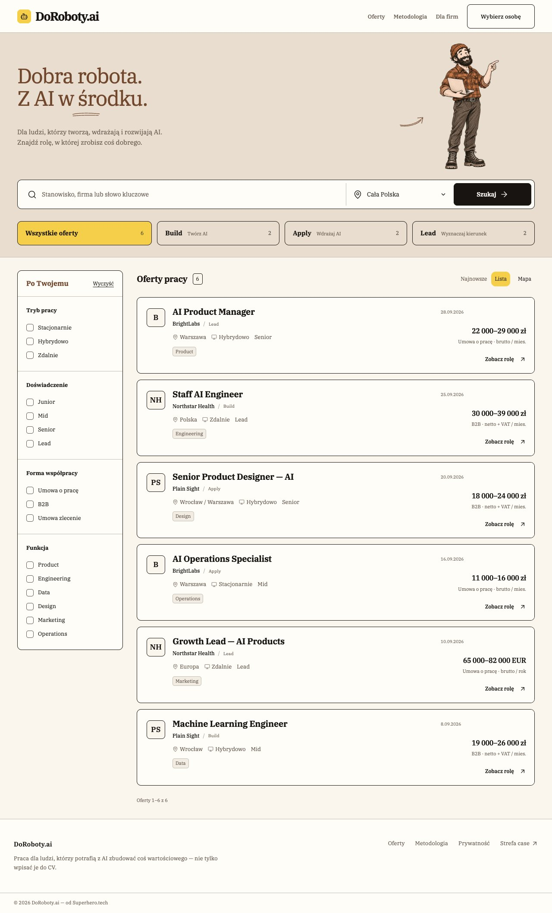
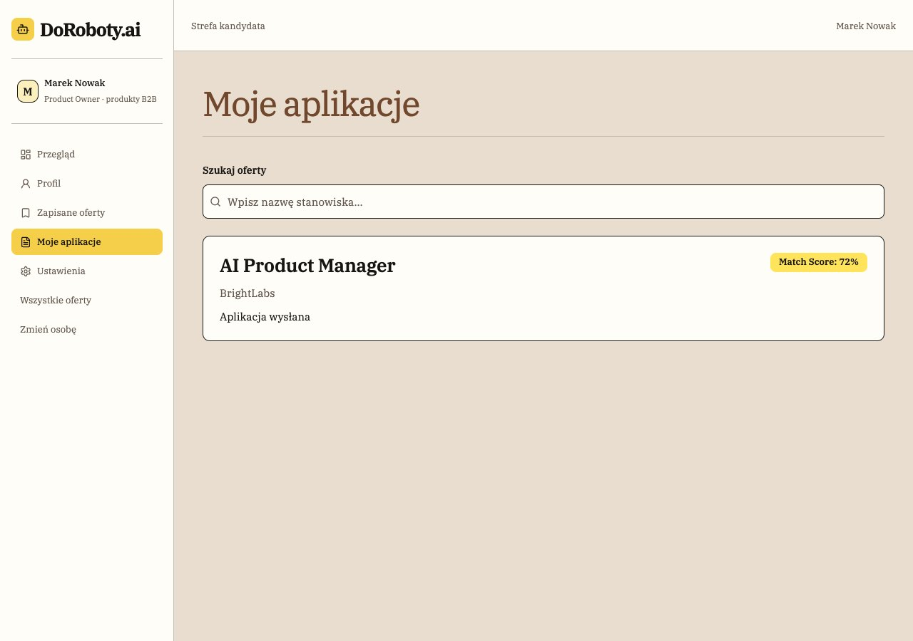

# Przykłady wizualne

## Aktualna iteracja DoRoboty.ai

Przy odtwarzaniu wyglądu zacznij od aktualnych zrzutów: IBM Plex Serif w całym interfejsie, zacieniony papier, jasne karty i cienkie kontury. Używaj ich jako dowodu konkretnej kompozycji, nie jako zgody na kopiowanie marki, danych lub treści do innego produktu.

| Materiał                                                        | Co pokazuje                                                                       |
| --------------------------------------------------------------- | --------------------------------------------------------------------------------- |
| [Listing desktop](../assets/current-listing-desktop.jpg)        | Beżowy hero z drwalem, wyszukiwanie, żółty wybór i czytelne warunki ofert         |
| [Listing mobile](../assets/current-listing-mobile.jpg)          | Hero bez drwala, przewijane kategorie, pensja pod treścią karty                   |
| [Aplikacje desktop](../assets/current-applications-desktop.jpg) | Jasny sidebar, zacieniony obszar pracy, lupa i placeholder, tekstowy etap i score |
| [Aplikacje mobile](../assets/current-applications-mobile.jpg)   | Zawijanie rekordu, score pod treścią i widoczny focus wyszukiwarki                |

Zrzuty wykonano w lokalnym prototypie 10.11.2026, przy viewportach 1280×900 i 390×900 CSS px, z pełną wysokością strony. Dane są syntetyczne. Statyczne kadry nie dokumentują animacji ani pełnego audytu dostępności. Mobile aplikacji pokazuje aktywny focus; nie traktuj go jako stałego drugiego obrysu w spoczynku.

Na telefonie zachowaj pełny tytuł, odstęp od ikony zapisu i wynagrodzenie w osobnym wierszu. Nie skracaj copy, by ukryć problem szerokości. Detale i kandydatury rozwija [design-rules.md](design-rules.md).

## Historyczne studia

[Stary listing](../assets/listing-preview.jpg) pokazuje pierwotny kierunek ilustracyjny, przed zmianą całej typografii na IBM Plex Serif i doprecyzowaniem tła. Nie jest aktualnym wzorcem fontów, cieni ani tekstów.

[Plansza szkiców](../assets/sketches-preview.jpg) pozostaje referencją czterech motywów i ich skali. Ramki planszy oraz pasek „KIERUNEK / 02” były nawigacją raportu, nie elementem portalu. Kontrolki na studiach były przykładami wyglądu; wdrożenie korzysta z działających semantycznych komponentów projektu.
